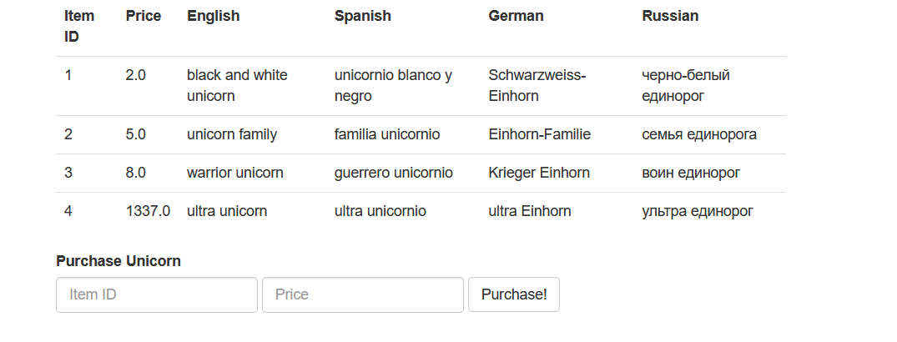
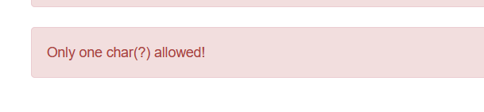
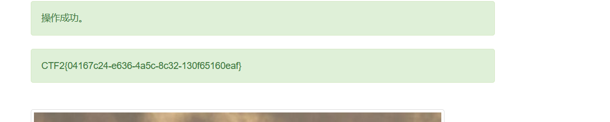

---
date: 2026-10-28
slug: unicorn-shop
categories:
  - 弱类型
  - Unicode
---

# Unicorn Shop



因为是独角兽商店，所以题目的意思应该就是让我们**买下来**（第 4 个 ultra unicorn，价格 1337.0）。

填上去后提示只能输入一个字符，而不是说数字：



```text
Only one char(?) allowed!
```

**注意括号里那个 `?`** —— 它说的是「一个**字符**」，不是「一位数字」。

这里想到 Unicode：**用非数字字符去表示一个数字**，找一个大于 1337 的即可。

在 <https://www.compart.com/en/unicode/> 这个网址中直接输入 `number` 关键字然后搜索，找到对应的数字即可。

我这里用的是这个 `፼`：



得到 flag。

## 为什么一个字符能过 1337

**`፼` 不是一个「奇怪的符号」，它是 Unicode 里的一个数字：**

| 项 | 值 |
|---|---|
| 码点 | `U+137C` |
| 官方名字 | `ETHIOPIC NUMBER TEN THOUSAND`（埃塞俄比亚数字「一万」） |
| 字符长度 | **1** |
| 代表的数值 | **10000** |

**关键点：后端比的是**数值**，不是**字符长度**。**它应该是用 Python 的 `unicodedata.numeric()` 把字符转成数字再比较：

```python
>>> import unicodedata
>>> unicodedata.numeric('፼')
10000.0
```

**所以「只能一个字符」这条限制，和「不能超过 1337」这条限制，是**两个维度**的事 —— 一个字符完全可以代表一个很大的数。**

**这一层是推断（没看到源码），但它能完整解释现象。**

**通用思路：以后看到限制「几个字符」的地方，就想想有没有**一个字符顶很多数值**的东西 —— Unicode 数字、罗马数字、上下标数字都算。**
