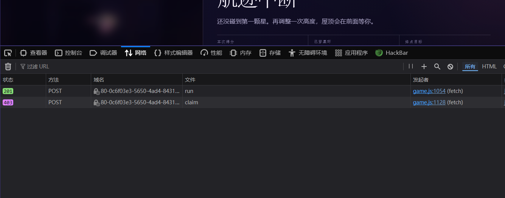
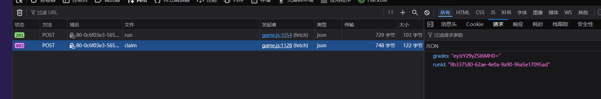
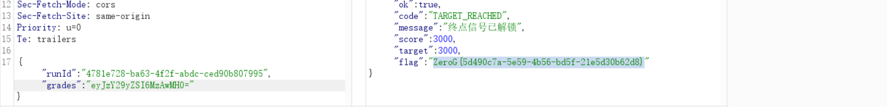

---
date: 2026-10-28
slug: zerog2026-stage3
categories:
  - 客户端信任
  - JS
  - 逻辑漏洞
---

# Stage3 — 重生之我在零重力屋顶当"卷王"

题目是个小游戏：控制碰星娘飞过星环，**攒到 3000 分**才能领终点奖励。

## 做这种题的第一步：F12

**做这种类型的题目，重要的是打开 F12、打开 Network，先玩一局，看它都发送了哪些请求。**



一局下来就两个请求：

```text
POST /api/run     201    开局
POST /api/claim   403    结算
```

## 盯住 claim

`claim` 出现了 `grades` 这个字段，**对其进行 base64 解码**：

```text
eyJzY29yZSI6MH0=   →   {"score":0}
```

**这不就是我的得分吗？那这里就明确了。**



```json
{
  "runId": "9b337580-62ae-4e0a-9a90-96a5e17095ad",
  "grades": "eyJzY29yZSI6MH0="
}
```

**分数是浏览器自己算出来、自己 base64 一下、再交给服务器的 —— 服务器完全相信这个数字。**

**base64 只是编码，不是加密，也不是签名。**

**⚠️ 有个先后依赖：`/api/run` 返回的不只是 `runId`，还有 `expiresInSeconds: 1800`（30 分钟有效）。**

**所以不能只发 `claim` —— 得先拿一个有效的 `runId`，再拿它去结算。**

## 改分数

**直接修改分数为 3000，再做一次 base64 编码，抓包改掉 `grades`，发回去：**

```text
{"score":3000}  →  eyJzY29yZSI6MzAwMH0=
```

**成功得到 flag。**



```json
{
  "ok": true,
  "code": "TARGET_REACHED",
  "message": "终点信号已解锁",
  "score": 3000,
  "target": 3000,
  "flag": "ZeroG{...}"
}
```

## 补充：为什么 base64 挡不住

这段代码其实自己就写着答案：

```js
function encodeGrades(score) {
  return btoa(JSON.stringify({ score }));   // btoa = base64 编码
}
```

**函数名是 `encode`，不是 `sign`。**

**这四个词的区别值得记：**

| 词 | 含义 | 能不能防改 |
|---|---|---|
| `encode` | **编码**（base64、hex、URL） | ❌ 只是换衣服，谁都能脱 |
| `encrypt` | **加密**（AES、RSA） | ✅ 但要密钥 |
| `hash` | **哈希**（md5、sha256） | ✅ 单向，但这里只存不比对 |
| `sign` | **签名**（HMAC、RSA 签名） | ✅ **改了就对不上** |

**只有最后一种能真正防篡改 —— 因为它需要服务器持有的密钥，前端拿不到。**

## 这类题的通法

```
① F12 → Network，玩一局，看发了哪些请求
② 找到"提交结果"的那个请求
③ 看提交的字段是怎么产生的：
     · 明文？          → 直接改
     · base64 / hex？  → 编码而已，解开改
     · 带签名？        → 找密钥（前端藏了也能拿到）
     · 服务器发的 token？→ 看能不能复用
④ 这个值是服务器算的，还是浏览器算的？
     浏览器算的 → 一定能伪造
     服务器算的 → 得去找逻辑漏洞
```

**这道题属于第 ④ 条最简单的那种：分数完完全全是浏览器算的。**
